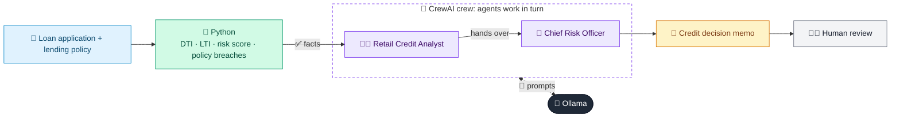

# 01 · Credit Risk Assessment Agent

  

**Industry:** 🏦 Banking · **Category:** 🏦 Credit & Lending

## 🏦 The business problem (new to banking? start here)

**In the business today:** When someone applies for a personal loan, the bank must decide: will this person pay us back? Credit analysts look at income, existing debts, credit bureau history and the bank's lending policy, then a more senior approver signs off.

**Who does this work:** Retail credit analysts and credit approvers (Risk department).

**Why it's hard:** Thousands of applications arrive daily. Decisions must be fast, consistent and explainable to the customer and the regulator.

### Key terms
- **Credit risk**: The risk that a borrower does not pay back what they owe. Managing it is the core skill of any lender.
- **DTI (Debt-to-Income)**: Monthly debt payments divided by monthly income. A DTI of 40% means 40% of income already goes to repayments.
- **LTI (Loan-to-Income)**: Loan amount divided by annual income. Caps how big a loan is relative to what the borrower earns.
- **EMI**: Equated Monthly Instalment: the fixed monthly repayment on a loan, covering interest and principal.
- **Credit score / bureau score**: A number (e.g. 300-900) from a credit bureau summarising a person's repayment history. Higher means lower risk.
- **Risk grade**: An internal rating (A, B, C...) that groups borrowers by riskiness and drives approval and pricing.

More terms: [Banking Primer & glossary](../PRIMER.md#glossary)

---

## 🤖 What the AI does
Scores a retail loan applicant and writes a credit decision memo with risk grade and conditions.

### How it works
Python computes DTI, LTI, PD-style score and policy breaches; a Credit Analyst agent interprets the numbers and a Chief Risk Officer agent issues approve / decline / refer with rationale.



<sub>🟦 data · 🟩 Python: maths & rules (auditable) · 🟪 AI: reasoning & writing · ⬛ local LLM · 🟨 result</sub>

## 💬 Sample conversation

A real recorded run on `qwen2.5:7b-instruct` (local, on a laptop, 40 s). Expand a step to see what happened
behind the answer. LLM wording changes from run to run; the numbers from Python stay the same.

> **👤 You:** New personal loan application from Priya Sharma: 12 lakh for home renovation over 5 years. Should we approve it?

<details><summary>🐍 Python · Computed metrics</summary>

```json
{
  "policy_assessment": {
    "dti": "29.6% vs max 50% -> WITHIN LIMIT (comfortable)",
    "lti": "0.67x vs max 5x -> WITHIN LIMIT (comfortable)",
    "credit_score": "742 vs min 680 -> PASS"
  },
  "requested_loan": "1,200,000",
  "new_emi": 26391,
  "dti_pct": 29.6,
  "lti": 0.67,
  "risk_score": 66.0,
  "risk_grade": "B",
  "policy_breaches": [
    "None"
  ]
}
```

</details>

<details><summary>🧑‍💼 Retail Credit Analyst (agent)</summary>

**Strengths:**
- **DTI Compliance:** The debt-to-income ratio (DTI) is 29.6%, which is well within the bank's maximum limit of 50%.
- **LTI Compliance:** The loan-to-income (LTI) ratio is 0.67x, which is within the maximum limit of 5x.
- **Credit Score:** The credit score of 742 meets the minimum requirement of 680.
- **No Delinquencies:** There have been no delinquencies in the past 24 months, indicating a good credit history.
- **Low Credit Utilization:** The credit utilization ratio is 38%, which is relatively low and suggests responsible credit usage.

**Weaknesses:**
- **High Proposed EMIs:** The proposed monthly EMI of 26,391 is relatively high, which could strain the applicant's financial situation, especially considering the existing monthly EMI of 18,000.
- **Requested Loan Amount:** The requested loan amount of 1,200,000 is significant, which could be a financial burden if the applicant's income and expenses do not support it.

**Key Risk Drivers:**
- **High DTI and Proposed EMIs:** The DTI of 29.6% is within the limit but the proposed EMI of 26,391 is high, which could indicate potential strain on the applicant's finances.
- **Significant Loan Request:** The large loan amount of 1,200,000 could pose a risk if the applicant's income and expenses do not adequately cover the monthly payments.
- **Existing Monthly EMIs:** The applicant already has a monthly EMI of 18,000, which, combined with the proposed EMI, could lead to financial stress if the loan is approved.

</details>

**🦙 Ollama:**

**Credit Decision Memo**

**Decision:** APPROVE WITH CONDITIONS

**Risk Grade:** B

**Rationale:** The applicant's financial profile meets most of the bank's policy criteria, with a debt-to-income ratio (DTI) of 29.6% and a loan-to-income (LTI) ratio of 0.67x, both within the acceptable limits. The credit score of 742 also meets the minimum requirement. However, the proposed monthly EMI of 26,391 is relatively high, and the significant loan amount of 1,200,000 could pose a financial burden. The applicant already has an existing monthly EMI of 18,000, which could lead to financial strain if the loan is approved.

**Conditions and Covenants:**
1. **Debt Service Coverage Ratio (DSCR):** The applicant must maintain a DSCR of at least 1.2x to ensure that the monthly income is sufficient to cover the proposed EMI and existing EMIs.
2. **Regular Income Verification:** The applicant must provide updated income statements every six months to ensure that the income remains stable and sufficient to cover the loan obligations.
3. **Loan Utilization Monitoring:** The applicant must keep the loan utilization below 60% to avoid over-leveraging.

**Recommended Pricing Adjustment:** Given the high proposed EMI and the significant loan amount, a higher interest rate or a higher margin should be applied to this loan to reflect the increased risk. The interest rate should be set at 12.5% to account for the higher risk profile.

**Conclusion:** The loan is approved with the above conditions to ensure prudent risk management while supporting the applicant's growth. Regular monitoring and updates will be necessary to ensure compliance with the covenants and to mitigate potential risks.


## Run
```bash
# from the repo root, with Ollama running
python 01_banking/01_credit_risk_assessment/app.py
```

## Customize
- Replace the sample data at the top of `app.py` with your own data source (CSV, database, API).
- Tune thresholds and rules in the Python functions. These are the auditable part of the solution.
- Change the model with `OLLAMA_MODEL` (see the root [README](../../README.md#-model-recommendations)).

> Sample data is fictional; calculations are simplified for learning.

[⬅ Back to Banking use cases](../README.md#-use-cases) · [All industries](../../README.md)
