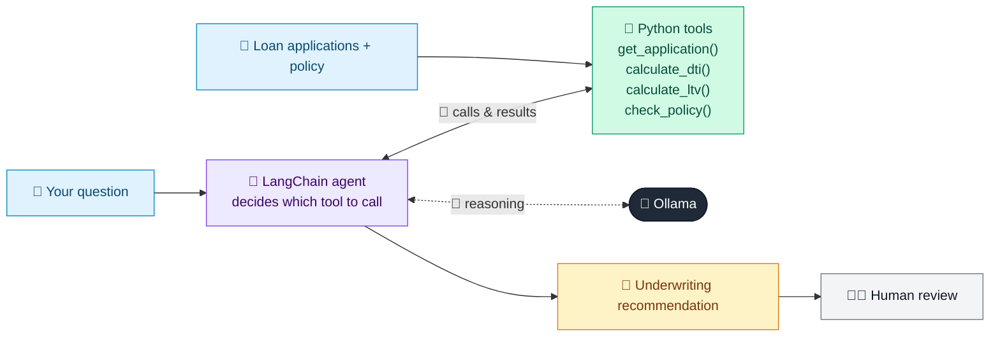

# 02 · Loan Underwriting Assistant

  

**Industry:** 🏦 Banking · **Category:** 🏦 Credit & Lending

## 🏦 The business problem (new to banking? start here)

**In the business today:** Mortgage underwriters check every application against a rulebook: can the borrower afford the payments, is the deposit big enough, is their job stable? They then approve, decline or approve with conditions.

**Who does this work:** Mortgage underwriters (Retail Lending).

**Why it's hard:** Rules are detailed and easy to misapply under time pressure; every decision must be traceable to a rule.

### Key terms
- **Underwriting**: Checking a loan application against the bank's rules and deciding whether to lend, how much and at what price.
- **DTI (Debt-to-Income)**: Monthly debt payments divided by monthly income. A DTI of 40% means 40% of income already goes to repayments.
- **LTV (Loan-to-Value)**: Loan amount divided by the value of the property. 80% LTV means a 20% deposit; higher LTV means less cushion if prices fall.
- **Credit score / bureau score**: A number (e.g. 300-900) from a credit bureau summarising a person's repayment history. Higher means lower risk.

More terms: [Banking Primer & glossary](../PRIMER.md#glossary)

---

## 🤖 What the AI does
Underwriter copilot that checks DTI, LTV and policy rules through tools before recommending a decision.

### How it works
A LangChain agent calls `calculate_dti`, `calculate_ltv` and `check_policy` tools against the application and explains which rules pass or fail.



<sub>🟦 data · 🟩 Python: maths & rules (auditable) · 🟪 AI: reasoning & writing · ⬛ local LLM · 🟨 result</sub>

## 💬 Sample conversation

A real recorded run on `qwen2.5:7b-instruct` (local, on a laptop, 9 s). Expand a step to see what happened
behind the answer. LLM wording changes from run to run; the numbers from Python stay the same.

> **👤 You:** Underwrite APP-1001 and APP-1002 and compare them.

<details><summary>🔧 Tool calls</summary>

```text
get_application(app_id='APP-1001') -> {"monthly_income": 9500, "monthly_debt": 1800, "loan_amount": 320000, "property_value": 400000, "credit_score": 728, "employment_years": 5, "loan_type": "mortgage"}
get_application(app_id='APP-1002') -> {"monthly_income": 6000, "monthly_debt": 2600, "loan_amount": 285000, "property_value": 300000, "credit_score": 655, "employment_years": 1, "loan_type": "mortgage"}
check_policy(app_id='APP-1001') -> {"dti": {"value": 0.189, "max": 0.43, "pass": true}, "ltv": {"value": 0.8, "max": 0.8, "pass": true}, "credit_score": {"value": 728, "min": 680, "pass": true}, "employment_years": {"value": 5, "min": 2, "pass": true}}
check_policy(app_id='APP-1002') -> {"dti": {"value": 0.433, "max": 0.43, "pass": false}, "ltv": {"value": 0.95, "max": 0.8, "pass": false}, "credit_score": {"value": 655, "min": 680, "pass": false}, "employment_years": {"value": 1, "min": 2, "pass": false}}
```

</details>

**🦙 Ollama:**

Based on the provided data and the results from the policy checks, here is a summary for both applications:

### APP-1001
- **Debt-to-Income Ratio (DTI):** 18.9% (Pass)
- **Loan-to-Value Ratio (LTV):** 80.0% (Pass)
- **Credit Score:** 728 (Pass)
- **Employment Years:** 5 (Pass)

### APP-1002
- **Debt-to-Income Ratio (DTI):** 43.3% (Fail)
- **Loan-to-Value Ratio (LTV):** 95.0% (Fail)
- **Credit Score:** 655 (Fail)
- **Employment Years:** 1 (Fail)

### Recommendation
- **APP-1001:** Approve
- **APP-1002:** Decline

### Conditions
- **APP-1002:** None, as it fails multiple policy rules.

The DTI, LTV, credit score, and employment years for APP-1002 do not meet the required thresholds, leading to a decline. APP-1001 meets all the policy requirements and is recommended for approval.


## Run
```bash
# from the repo root, with Ollama running
python 01_banking/02_loan_underwriting_assistant/app.py
```

## Customize
- Replace the sample data at the top of `app.py` with your own data source (CSV, database, API).
- Tune thresholds and rules in the Python functions. These are the auditable part of the solution.
- Change the model with `OLLAMA_MODEL` (see the root [README](../../README.md#-model-recommendations)).

> Sample data is fictional; calculations are simplified for learning.

[⬅ Back to Banking use cases](../README.md#-use-cases) · [All industries](../../README.md)
