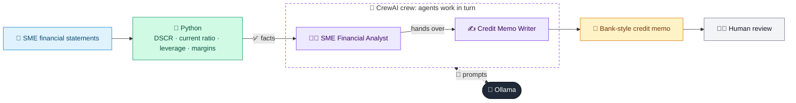

# 03 · SME Credit Memo Writer

  

**Industry:** 🏦 Banking · **Category:** 🏦 Credit & Lending

## 🏦 The business problem (new to banking? start here)

**In the business today:** Before lending to a small or mid-sized business, a relationship manager and credit analyst write a 'credit memo': who the business is, how it is performing, whether it can repay, and what protections the bank will take.

**Who does this work:** Corporate/SME relationship managers and credit analysts.

**Why it's hard:** Writing a memo takes days of spreadsheet work and drafting; analysts spend more time writing than analysing.

### Key terms
- **Credit memo**: The written paper a credit committee reads before approving a business loan: who the borrower is, the numbers, risks and recommendation.
- **DSCR (Debt Service Coverage Ratio)**: Cash profit (EBITDA) divided by loan repayments due. Below 1.0x the business cannot cover its debt from operations.
- **EBITDA / EBIT**: Earnings before interest, tax, depreciation and amortisation (EBITDA), or before interest and tax (EBIT): a measure of operating profit.
- **Leverage (debt-to-equity)**: How much a company relies on borrowing. Higher leverage means higher risk if earnings fall.
- **Covenant**: A promise in a loan agreement, e.g. 'keep debt below 3x EBITDA'. Breaking it lets the bank act early.
- **Collateral**: An asset the bank can take if the loan is not repaid, e.g. property or stock.

More terms: [Banking Primer & glossary](../PRIMER.md#glossary)

---

## 🤖 What the AI does
Turns SME financials into a bank-style credit memo (business profile, ratios, risks, mitigants).

### How it works
Ratios (DSCR, current ratio, leverage, margins) are computed in Python; a Financial Analyst agent analyses them and a Credit Writer agent drafts the memo.



<sub>🟦 data · 🟩 Python: maths & rules (auditable) · 🟪 AI: reasoning & writing · ⬛ local LLM · 🟨 result</sub>

## 💬 Sample response

Real output from `qwen2.5:7b-instruct` running locally on a laptop. LLM wording changes from run to run; the numbers from
Python stay the same.

<details>
<summary><b>Show the full output</b></summary>

````text
--- Computed ratios ---
{
  "FY2024": {
    "ebitda_margin_pct": 12.0,
    "net_margin_pct": 4.7,
    "dscr": 2.27,
    "current_ratio": 1.5,
    "debt_to_equity": 1.1,
    "debt_to_ebitda": 2.54
  },
  "FY2025": {
    "ebitda_margin_pct": 11.5,
    "net_margin_pct": 4.6,
    "dscr": 2.19,
    "current_ratio": 1.39,
    "debt_to_equity": 1.03,
    "debt_to_ebitda": 2.51
  },
  "revenue_growth_pct": 17.1
}


--- Credit memo ---
**Credit Memo**

**1. Borrower Overview**
- **Name**: GreenLeaf Foods Pvt Ltd
- **Industry**: Packaged food manufacturing
- **Years in Business**: 9 years
- **Facility Request**: Working capital line of 25,000,000 + term loan of 15,000,000 for a new packaging unit
- **Collateral**: Factory land & building (valued at 60,000,000), stock, and receivables hypothecation

**2. Facility Request**
GreenLeaf Foods Pvt Ltd is requesting a working capital line of 25,000,000 and a term loan of 15,000,000 for the establishment of a new packaging unit. The company has pledged its factory land & building, stock, and receivables as collateral.

**3. Financial Analysis**
- **Revenue Growth**: 17.1% from FY2024 to FY2025, indicating strong market position and operational efficiency.
- **EBITDA Margin**: 12.0% in FY2024, 11.5% in FY2025 (decrease of 0.5 percentage points).
- **Net Margin**: 4.7% in FY2024, 4.6% in FY2025 (stable).
- **Interest Coverage Ratio (DSCR)**: 2.27 in FY2024, 2.19 in FY2025 (decrease of 0.08).
- **Current Ratio**: 1.5 in FY2024, 1.39 in FY2025 (decrease of 0.11).
- **Debt to Equity**: 1.1 in FY2024, 1.03 in FY2025 (improvement).
- **Debt to EBITDA**: 2.54 in both FY2024 and FY2025 (stable).

**4. Key Risks & Mitigants**
- **Risks**:
  - Decrease in EBITDA margin (11.5% in FY2025) and DSCR (2.19 in FY2025) could indicate operational or market challenges.
  - Decrease in current ratio (1.39 in FY2025) suggests a reduction in short-term liquidity.
  - High debt to EBITDA ratio (2.54) indicates heavy reliance on debt financing.
- **Mitigants**:
  - The company has shown strong revenue growth and consistent profitability.
  - Improved debt to equity ratio (1.03 in FY2025) suggests a healthier capital structure.
  - The company has been repaying principal on its debt, with a reduction from 6,000 in FY2024 to 7,000 in FY2025.

**5. Covenants**
- The borrower must maintain a minimum DSCR of 1.5.
- The borrower must maintain a current ratio of at least 1.2.
- The borrower must not exceed a debt to equity ratio of 1.5.
- The borrower must not exceed a debt to EBITDA ratio of 3.0.

**6. Recommendation**
Based on the analysis, GreenLeaf Foods Pvt Ltd has demonstrated strong revenue growth and consistent profitability. However, the slight decrease in EBITDA margin and DSCR are red flags that need to be monitored closely. The company's capital structure has improved, but the high debt to EBITDA ratio remains a concern. The company should focus on maintaining operational efficiency and ensuring that its EBITDA can cover interest expenses to avoid financial distress. We recommend approving the facility request with the stipulated covenants to mitigate potential risks.
````

</details>

## Run
```bash
# from the repo root, with Ollama running
python 01_banking/03_sme_credit_memo_writer/app.py
```

## Customize
- Replace the sample data at the top of `app.py` with your own data source (CSV, database, API).
- Tune thresholds and rules in the Python functions. These are the auditable part of the solution.
- Change the model with `OLLAMA_MODEL` (see the root [README](../../README.md#-model-recommendations)).

> Sample data is fictional; calculations are simplified for learning.

[⬅ Back to Banking use cases](../README.md#-use-cases) · [All industries](../../README.md)
