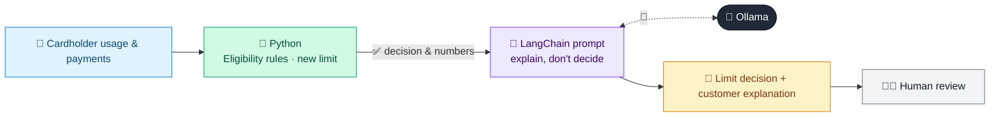

# 04 · Credit Card Limit Optimizer

  

**Industry:** 🏦 Banking · **Category:** 🏦 Credit & Lending

## 🏦 The business problem (new to banking? start here)

**In the business today:** Card issuers regularly review limits: raise them for good customers who need more room, and reduce them for customers showing signs of stress, to manage risk.

**Who does this work:** Card portfolio managers (Cards / Unsecured Lending).

**Why it's hard:** Limit changes affect revenue, risk and customer trust. Each one needs a clear reason, especially a decrease.

### Key terms
- **Credit limit / utilisation**: The maximum a customer can borrow on a card or line, and how much of it they are using (balance / limit).
- **Credit score / bureau score**: A number (e.g. 300-900) from a credit bureau summarising a person's repayment history. Higher means lower risk.
- **Credit risk**: The risk that a borrower does not pay back what they owe. Managing it is the core skill of any lender.

More terms: [Banking Primer & glossary](../PRIMER.md#glossary)

---

## 🤖 What the AI does
Recommends credit-limit increases or decreases per card holder with an explainable reason.

### How it works
Rule-based eligibility and utilisation bands feed an LLM chain that produces a recommended limit and customer-friendly explanation.



<sub>🟦 data · 🟩 Python: maths & rules (auditable) · 🟪 AI: reasoning & writing · ⬛ local LLM · 🟨 result</sub>

## 💬 Sample response

Real output from `qwen2.5:7b-instruct` running locally on a laptop. LLM wording changes from run to run; the numbers from
Python stay the same.

<details>
<summary><b>Show the full output</b></summary>

````text
--- Rule-based decisions ---
[
  {
    "id": "C-201",
    "limit": 5000,
    "avg_balance_6m": 4300,
    "on_time_payments_12m": 12,
    "income": 85000,
    "bureau_score": 760,
    "months_on_book": 30,
    "utilisation_pct": 86,
    "action": "INCREASE",
    "new_limit": 7500.0
  },
  {
    "id": "C-202",
    "limit": 8000,
    "avg_balance_6m": 900,
    "on_time_payments_12m": 12,
    "income": 60000,
    "bureau_score": 710,
    "months_on_book": 48,
    "utilisation_pct": 11,
    "action": "HOLD",
    "new_limit": 8000
  },
  {
    "id": "C-203",
    "limit": 6000,
    "avg_balance_6m": 5900,
    "on_time_payments_12m": 8,
    "income": 40000,
    "bureau_score": 640,
    "months_on_book": 14,
    "utilisation_pct": 98,
    "action": "DECREASE",
    "new_limit": 5900
  }
]


--- Explanations ---
**Internal File:**
C-201's limit was increased to $7,500 due to a high average balance over the past six months and a strong on-time payment history, which indicates responsible usage and financial stability. C-202's limit was held at $8,000 as the utilization percentage is low and the account has a good payment history, suggesting no immediate need for a change. C-203's limit was decreased to $5,900 because of a high utilization percentage and a recent history of late payments, which may indicate financial strain.

**Customer Notifications:**
Your credit limit has been adjusted to better suit your financial situation. We appreciate your continued loyalty and trust.
````

</details>

## Run
```bash
# from the repo root, with Ollama running
python 01_banking/04_credit_limit_optimizer/app.py
```

## Customize
- Replace the sample data at the top of `app.py` with your own data source (CSV, database, API).
- Tune thresholds and rules in the Python functions. These are the auditable part of the solution.
- Change the model with `OLLAMA_MODEL` (see the root [README](../../README.md#-model-recommendations)).

> Sample data is fictional; calculations are simplified for learning.

[⬅ Back to Banking use cases](../README.md#-use-cases) · [All industries](../../README.md)
