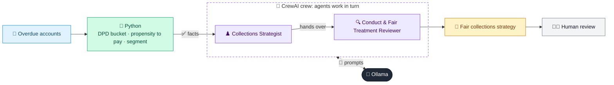

# 05 · Collections & Recovery Strategist

  

**Industry:** 🏦 Banking · **Category:** 🏦 Credit & Lending

## 🏦 The business problem (new to banking? start here)

**In the business today:** When customers miss loan payments, the collections team decides who to contact, how (SMS, call, letter), how often, and what to offer (payment plan, settlement).

**Who does this work:** Collections strategy and operations teams.

**Why it's hard:** Too soft loses money; too aggressive harms customers and breaks conduct rules, especially for customers in hardship.

### Key terms
- **Collections**: The team that contacts customers who have missed payments and agrees ways to pay, e.g. payment plans.
- **DPD (Days Past Due)**: How many days a payment is late. 30, 60 and 90 DPD are the standard warning milestones.
- **Delinquency / NPA / NPL**: A delinquent loan is behind on payments. After about 90 DPD it becomes a Non-Performing Asset / Loan.
- **Propensity to pay**: A prediction of how likely a late customer is to pay, used to choose the right collection approach.
- **Vulnerable customer**: Someone more likely to suffer harm (e.g. due to age, illness, bereavement). Banks must take extra care with them.

More terms: [Banking Primer & glossary](../PRIMER.md#glossary)

---

## 🤖 What the AI does
Segments delinquent accounts and designs a compliant, empathetic collection strategy per segment.

### How it works
Accounts are bucketed by DPD and propensity-to-pay; a Collections Strategist agent designs treatments and a Conduct Reviewer agent checks for fair-treatment issues.



<sub>🟦 data · 🟩 Python: maths & rules (auditable) · 🟪 AI: reasoning & writing · ⬛ local LLM · 🟨 result</sub>

## 💬 Sample conversation

A real recorded run on `qwen2.5:7b-instruct` (local, on a laptop, 22 s). Expand a step to see what happened
behind the answer. LLM wording changes from run to run; the numbers from Python stay the same.

> **👤 You:** These four overdue loan accounts need a collections plan. What should we do with each, fairly?

<details><summary>🐍 Python · Segments</summary>

```json
{
  "1-29 (early) | PTP High": [
    {
      "id": "L-01",
      "outstanding": 2400,
      "hardship": false
    },
    {
      "id": "L-04",
      "outstanding": 900,
      "hardship": false
    }
  ],
  "30-59 | PTP Medium": [
    {
      "id": "L-02",
      "outstanding": 8100,
      "hardship": false
    }
  ],
  "60-89 | PTP Medium": [
    {
      "id": "L-03",
      "outstanding": 15200,
      "hardship": true
    }
  ],
  "90+ (NPA) | PTP Low": [
    {
      "id": "L-05",
      "outstanding": 22000,
      "hardship": false
    }
  ],
  "30-59 | PTP High": [
    {
      "id": "L-06",
      "outstanding": 4300,
      "hardship": true
    }
  ]
}
```

</details>

<details><summary>♟️ Collections Strategist (agent)</summary>

Certainly! Here is the proposed treatment for each segment based on the provided criteria:

| Segment                  | Channel       | Frequency | Offer                                      | Escalation Trigger                                                                 |
|--------------------------|---------------|-----------|--------------------------------------------|------------------------------------------------------------------------------------|
| 1-29 (early) | PTP High      | Monthly   | No immediate action; monitor for changes   | If outstanding balance remains unpaid after 3 months, consider a gentle reminder  |
| 30-59 | PTP Medium    | Bi-weekly  | Offer a payment plan with no interest      | If payment plan is not accepted, escalate to a phone call or letter                |
| 60-89 | PTP Medium    | Weekly     | Offer a payment plan with no interest      | If payment plan is not accepted, escalate to a phone call or letter                |
| 90+ (NPA) | PTP Low      | Monthly   | Offer a settlement at 70% of outstanding   | If no response, escalate to a phone call or letter; consider legal action if necessary |
| 30-59 | PTP High      | Bi-weekly  | Offer a payment plan with no interest      | If payment plan is not accepted, escalate to a phone call or letter                |

This treatment is designed to balance the urgency of recovery with the likelihood of payment, ensuring that resources are used efficiently while maintaining a fair and transparent approach to collections.

</details>

**🦙 Ollama:**

| Segment                  | Channel       | Frequency | Offer                                      | Escalation Trigger                                                                 |
|--------------------------|---------------|-----------|--------------------------------------------|------------------------------------------------------------------------------------|
| 1-29 (early)             | PTP High      | Monthly   | No immediate action; monitor for changes   | If outstanding balance remains unpaid after 3 months, consider a gentle reminder  |
| 30-59                    | PTP Medium    | Bi-weekly | Offer a payment plan with no interest      | If payment plan is not accepted, escalate to a phone call or letter                |
| 60-89                    | PTP Medium    | Weekly    | Offer a payment plan with no interest      | If payment plan is not accepted, escalate to a phone call or letter                |
| 90+ (NPA)                | PTP Low      | Monthly   | Offer a settlement at 70% of outstanding   | If no response, escalate to a phone call or letter; consider legal action if necessary |
| hardship=true            | PTP Low      | Monthly   | Offer a payment plan with no interest      | If payment plan is not accepted, escalate to a phone call or letter                |

### Conduct Notes
1. **Vulnerable Customer Handling**: For accounts flagged with `hardship=true`, the strategy ensures that customers are offered a payment plan with no interest, which is a fair and transparent approach. This aligns with the consumer duty to treat customers fairly and consider their financial circumstances.
2. **Frequency Adjustments**: The frequency of communication is adjusted to be less aggressive for vulnerable customers, ensuring that they are not overwhelmed by frequent contact.
3. **Offering Payment Plans**: Offering a payment plan with no interest is a key component of the strategy, as it provides a feasible solution for customers facing financial difficulties.
4. **Escalation Process**: If a payment plan is not accepted, the escalation process is designed to be gentle, starting with a phone call or letter, which respects the customer's privacy and dignity.
5. **Legal Action Consideration**: While legal action is a last resort, it is included in the escalation process to ensure that all avenues are explored before resorting to more severe measures.
6. **Monitoring and Review**: The strategy includes a review mechanism to monitor the effectiveness of the payment plans and adjust the approach as necessary to ensure fair treatment.

This revised strategy ensures that customers in financial hardship are treated fairly and with empathy, aligning with the principles of consumer duty and fair debt collection.


## Run
```bash
# from the repo root, with Ollama running
python 01_banking/05_collections_strategy_agent/app.py
```

## Customize
- Replace the sample data at the top of `app.py` with your own data source (CSV, database, API).
- Tune thresholds and rules in the Python functions. These are the auditable part of the solution.
- Change the model with `OLLAMA_MODEL` (see the root [README](../../README.md#-model-recommendations)).

> Sample data is fictional; calculations are simplified for learning.

[⬅ Back to Banking use cases](../README.md#-use-cases) · [All industries](../../README.md)
