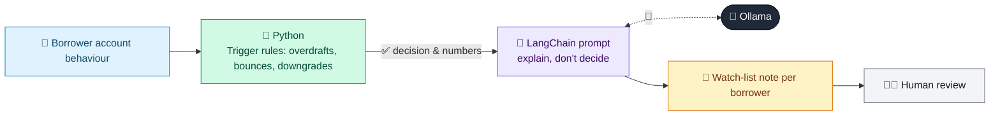

# 06 · Early Warning Signals (EWS) Monitor

  

**Industry:** 🏦 Banking · **Category:** 🏦 Credit & Lending

## 🏦 The business problem (new to banking? start here)

**In the business today:** For business loans, banks watch for warning signs (overdraft breaches, bounced cheques, falling sales, rating downgrades) so they can act before the borrower defaults.

**Who does this work:** Credit monitoring teams and relationship managers.

**Why it's hard:** Signals are spread across many systems; spotting them early is what makes a recovery possible.

### Key terms
- **Early Warning Signals (EWS)**: Signs that a healthy borrower may get into trouble, spotted before they miss payments.
- **SMA / watch-list**: Special Mention Account / watch-list: loans showing stress that get closer monitoring.
- **Credit risk**: The risk that a borrower does not pay back what they owe. Managing it is the core skill of any lender.
- **Covenant**: A promise in a loan agreement, e.g. 'keep debt below 3x EBITDA'. Breaking it lets the bank act early.

More terms: [Banking Primer & glossary](../PRIMER.md#glossary)

---

## 🤖 What the AI does
Detects early signs of stress in a corporate loan book and drafts watch-list commentary.

### How it works
Python flags triggers (overdraft breaches, cheque returns, rating downgrades, late financials); an LLM chain writes a watch-list note per borrower.



<sub>🟦 data · 🟩 Python: maths & rules (auditable) · 🟪 AI: reasoning & writing · ⬛ local LLM · 🟨 result</sub>

## 💬 Sample conversation

A real recorded run on `qwen2.5:7b-instruct` (local, on a laptop, 11 s). Expand a step to see what happened
behind the answer. LLM wording changes from run to run; the numbers from Python stay the same.

> **👤 You:** Run the early warning scan on our corporate borrowers. Who needs to go on the watch-list?

<details><summary>🐍 Python · EWS scan</summary>

```json
[
  {
    "name": "Apex Textiles",
    "exposure": 45000000,
    "status": "RED",
    "triggers": [
      "Persistent overdraft limit breaches",
      "Repeated cheque returns",
      "External rating downgrade / negative outlook",
      "Delay in submitting financials",
      "Sharp fall in GST turnover",
      "High promoter share pledge"
    ]
  },
  {
    "name": "Nova Logistics",
    "exposure": 30000000,
    "status": "GREEN",
    "triggers": []
  },
  {
    "name": "Sunrise Builders",
    "exposure": 80000000,
    "status": "AMBER",
    "triggers": [
      "External rating downgrade / negative outlook",
      "Delay in submitting financials"
    ]
  }
]
```

</details>

**🦙 Ollama:**

### Watch-List Notes

#### RED Borrower: Apex Textiles
**Situation:**
Apex Textiles is currently in a RED status due to multiple critical issues, including persistent overdraft limit breaches, repeated cheque returns, an external rating downgrade, delay in submitting financials, a sharp fall in GST turnover, and a high promoter share pledge.

**Likely Cause:**
The company is facing financial distress, operational issues, and potential liquidity problems. The repeated breaches of overdraft limits and cheque returns suggest cash flow issues. The external rating downgrade and delay in submitting financials indicate possible internal management challenges. The sharp fall in GST turnover and high promoter share pledge further highlight the company's financial instability.

**Recommended Actions:**
1. **Client Call:** Schedule a meeting with the management to discuss the current financial situation and explore potential solutions.
2. **Stock Audit:** Conduct a stock audit to verify the company's inventory levels and ensure accurate financial reporting.
3. **Tighten Limits:** Review and possibly tighten the credit limits to mitigate risk.
4. **SMA Classification:** Re-classify the borrower to a higher risk category for closer monitoring.
5. **Review Date:** Review the situation in 30 days.

---

#### GREEN Borrower: Nova Logistics
**Situation:**
Nova Logistics remains in a GREEN status with no triggering issues.

**No Action:**
No specific issues have been identified that would warrant any action at this time.

**Review Date:** No review required at this time.

---

#### AMBER Borrower: Sunrise Builders
**Situation:**
Sunrise Builders is in an AMBER status due to an external rating downgrade and a delay in submitting financials.

**Likely Cause:**
The company is experiencing some financial and operational challenges, as indicated by the external rating downgrade and delay in submitting financials. These issues suggest potential management or operational inefficiencies.

**Recommended Actions:**
1. **Client Call:** Schedule a meeting with the management to discuss the current financial situation and explore potential solutions.
2. **Review Financials:** Ensure that the financials are submitted promptly and thoroughly reviewed.
3. **SMA Classification:** Monitor the situation closely and consider re-classification if the issues persist.
4. **Review Date:** Review the situation in 60 days.

---


## Run
```bash
# from the repo root, with Ollama running
python 01_banking/06_early_warning_signals/app.py
```

## Customize
- Replace the sample data at the top of `app.py` with your own data source (CSV, database, API).
- Tune thresholds and rules in the Python functions. These are the auditable part of the solution.
- Change the model with `OLLAMA_MODEL` (see the root [README](../../README.md#-model-recommendations)).

> Sample data is fictional; calculations are simplified for learning.

[⬅ Back to Banking use cases](../README.md#-use-cases) · [All industries](../../README.md)
