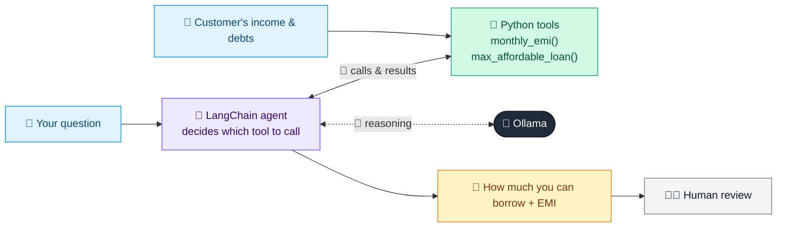

# 07 · Mortgage Pre-Qualification Bot

  

**Industry:** 🏦 Banking · **Category:** 🏦 Credit & Lending

## 🏦 The business problem (new to banking? start here)

**In the business today:** Before a full mortgage application, customers want a quick answer to 'how much can I borrow?' so they know which homes to look at.

**Who does this work:** Mortgage advisers, branch staff and digital channels.

**Why it's hard:** Customers expect instant answers at any hour; staff time is better spent on serious applications.

### Key terms
- **Pre-qualification**: A quick, non-binding estimate of how much a customer could borrow, before a full application.
- **DTI (Debt-to-Income)**: Monthly debt payments divided by monthly income. A DTI of 40% means 40% of income already goes to repayments.
- **EMI**: Equated Monthly Instalment: the fixed monthly repayment on a loan, covering interest and principal.
- **LTV (Loan-to-Value)**: Loan amount divided by the value of the property. 80% LTV means a 20% deposit; higher LTV means less cushion if prices fall.

More terms: [Banking Primer & glossary](../PRIMER.md#glossary)

---

## 🤖 What the AI does
Conversational assistant that estimates how much a customer can borrow and the monthly EMI.

### How it works
Agent uses `max_affordable_loan` and `monthly_emi` tools and answers in plain language with assumptions stated.



<sub>🟦 data · 🟩 Python: maths & rules (auditable) · 🟪 AI: reasoning & writing · ⬛ local LLM · 🟨 result</sub>

## 💬 Sample conversation

A real recorded run on `qwen2.5:7b-instruct` (local, on a laptop, 7 s). Expand a step to see what happened
behind the answer. LLM wording changes from run to run; the numbers from Python stay the same.

> **👤 You:** I earn 8,500 a month and pay 650 a month on a car loan. How much can I borrow, and what would the monthly payment be on a 25 year term at 6.2%?

<details><summary>🔧 Tool calls</summary>

```text
max_affordable_loan(annual_rate_pct=6.2, monthly_debts=650, monthly_income=8500, years=25) -> Max loan ~418,836 (monthly payment budget 2,750, 6.2% over 25y)
monthly_emi(annual_rate_pct=6.2, loan_amount=145657.94, years=25) -> Monthly payment: 956 for 145,658 at 6.2% over 25 years
```

</details>

**🦙 Ollama:**

Based on your monthly income and current monthly debt, you can afford a maximum loan of approximately $418,836, keeping your total debt payments within the bank's 40% Debt-to-Income (DTI) limit. 

For a 25-year term at an annual interest rate of 6.2%, borrowing $145,658 would result in a monthly payment of approximately $956.

This is an indicative estimate and not a loan offer. Please consult with a financial advisor or mortgage lender for a personalized assessment. A sensible down payment is typically around 20%, so with a 20% down payment on a property priced at around $418,836, you would be looking at a down payment of approximately $83,767.20.


## Run
```bash
# from the repo root, with Ollama running
python 01_banking/07_mortgage_prequalification_bot/app.py
```

## Customize
- Replace the sample data at the top of `app.py` with your own data source (CSV, database, API).
- Tune thresholds and rules in the Python functions. These are the auditable part of the solution.
- Change the model with `OLLAMA_MODEL` (see the root [README](../../README.md#-model-recommendations)).

> Sample data is fictional; calculations are simplified for learning.

[⬅ Back to Banking use cases](../README.md#-use-cases) · [All industries](../../README.md)
