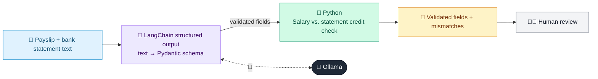

# 08 · Loan Document Extractor

  

**Industry:** 🏦 Banking · **Category:** 🏦 Credit & Lending

## 🏦 The business problem (new to banking? start here)

**In the business today:** Loan processors read payslips and bank statements to verify income and existing debts, and re-type the figures into the loan system.

**Who does this work:** Loan operations / processing teams.

**Why it's hard:** Manual data entry is slow and error-prone, and mismatches between documents can signal fraud.

### Key terms
- **Underwriting**: Checking a loan application against the bank's rules and deciding whether to lend, how much and at what price.
- **EMI**: Equated Monthly Instalment: the fixed monthly repayment on a loan, covering interest and principal.
- **DTI (Debt-to-Income)**: Monthly debt payments divided by monthly income. A DTI of 40% means 40% of income already goes to repayments.

More terms: [Banking Primer & glossary](../PRIMER.md#glossary)

---

## 🤖 What the AI does
Extracts structured fields from payslips and bank statements for loan processing.

### How it works
`with_structured_output` maps unstructured text into a Pydantic schema; Python cross-checks salary vs. statement credits.



<sub>🟦 data · 🟩 Python: maths & rules (auditable) · 🟪 AI: reasoning & writing · ⬛ local LLM · 🟨 result</sub>

## 💬 Sample conversation

A real recorded run on `qwen2.5:7b-instruct` (local, on a laptop, 7 s). Expand a step to see what happened
behind the answer. LLM wording changes from run to run; the numbers from Python stay the same.

> **👤 You:** Here are Rohan Mehta's payslip and bank statement. Extract the details and check they match.

<details><summary>🧾 Extracted · Payslip</summary>

```json
{
  "employee_name": "Rohan Mehta",
  "employer": "E10442",
  "month": "s August 2026",
  "gross_salary": 105000.0,
  "total_deductions": 20000.0,
  "net_pay": 85000.0,
  "date_of_joining": "14-Mar-2019"
}
```

</details>

<details><summary>🧾 Extracted · Bank statement</summary>

```json
{
  "account_holder": "ROHAN MEHTA",
  "period": "01-Aug-2026 to 31-Aug-2026",
  "opening_balance": 142300.55,
  "closing_balance": 155150.55,
  "salary_credits": 85000.0,
  "existing_emi_debits": 32500.0
}
```

</details>

**🦙 Ollama:**

{'name_match': True, 'salary_credit_matches_net_pay': True, 'existing_emi_to_net_pay_pct': 38.2}


## Run
```bash
# from the repo root, with Ollama running
python 01_banking/08_loan_document_extractor/app.py
```

## Customize
- Replace the sample data at the top of `app.py` with your own data source (CSV, database, API).
- Tune thresholds and rules in the Python functions. These are the auditable part of the solution.
- Change the model with `OLLAMA_MODEL` (see the root [README](../../README.md#-model-recommendations)).

> Sample data is fictional; calculations are simplified for learning.

[⬅ Back to Banking use cases](../README.md#-use-cases) · [All industries](../../README.md)
