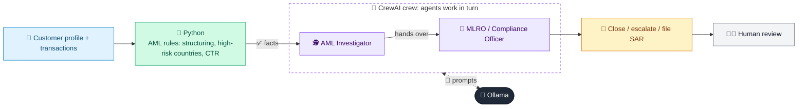

# 09 · AML Transaction Monitoring Agent

  

**Industry:** 🏦 Banking · **Category:** 🕵️ Financial Crime & Compliance

## 🏦 The business problem (new to banking? start here)

**In the business today:** Banks must monitor transactions for money laundering. Rules generate alerts (e.g. repeated cash deposits just under the reporting limit); investigators review each alert and decide whether to report it.

**Who does this work:** AML transaction monitoring analysts and the MLRO (Compliance / Financial Crime).

**Why it's hard:** Most alerts are false positives, yet missing a real case can bring huge fines. Investigation is slow and manual.

### Key terms
- **AML (Anti-Money Laundering)**: Laws and controls that stop criminals disguising illegal money as legitimate. Banks must monitor and report suspicious activity.
- **Money laundering stages**: Placement (getting cash into the system), layering (moving it to hide the trail), integration (using it as 'clean' money).
- **Structuring (smurfing)**: Splitting cash deposits into amounts just under a reporting threshold to avoid triggering a report. Itself an offence.
- **CTR (Currency Transaction Report)**: A report banks file for large cash transactions (e.g. 10,000 or more).
- **SAR / STR**: Suspicious Activity (or Transaction) Report: what a bank files with the financial intelligence unit when it suspects money laundering.
- **MLRO**: Money Laundering Reporting Officer: the senior person accountable for deciding whether to file SARs.
- **False positive**: An alert that turns out to be innocent, e.g. a name that looks like a sanctioned person but is someone else. Usually most alerts are false positives.

More terms: [Banking Primer & glossary](../PRIMER.md#glossary)

---

## 🤖 What the AI does
Detects structuring, rapid movement and high-risk-geography patterns and triages the alert.

### How it works
Python rules raise alerts; an AML Investigator agent reviews the evidence and a Compliance Officer agent decides close / escalate / file SAR.



<sub>🟦 data · 🟩 Python: maths & rules (auditable) · 🟪 AI: reasoning & writing · ⬛ local LLM · 🟨 result</sub>

## 💬 Sample conversation

A real recorded run on `qwen2.5:7b-instruct` (local, on a laptop, 35 s). Expand a step to see what happened
behind the answer. LLM wording changes from run to run; the numbers from Python stay the same.

> **👤 You:** Our monitoring rules flagged Marco Rinaldi, a restaurant owner. Review the alerts: close, escalate or file a SAR?

<details><summary>🐍 Python · Rule alerts</summary>

```json
[
  {
    "rule": "STRUCTURING",
    "evidence": [
      [
        "2026-09-01",
        9500
      ],
      [
        "2026-09-02",
        9800
      ],
      [
        "2026-09-03",
        9700
      ]
    ]
  },
  {
    "rule": "RAPID_PASS_THROUGH",
    "evidence": [
      [
        "2026-09-15",
        48000,
        "Lindell Holdings Ltd"
      ],
      [
        "2026-09-16",
        47500,
        "Kestrel Imports"
      ]
    ]
  },
  {
    "rule": "HIGH_RISK_JURISDICTION",
    "evidence": [
      [
        "2026-09-15",
        48000,
        "VG"
      ]
    ]
  },
  {
    "rule": "PROFILE_DEVIATION",
    "evidence": "2026-09 turnover 154,930 vs expected 15,000"
  }
]
```

</details>

<details><summary>🕵️ AML Investigator (agent)</summary>

### Investigation Summary for Marco Rinaldi

#### Customer Profile
- **ID:** CUST-7781
- **Name:** Marco Rinaldi
- **Occupation:** Restaurant owner
- **Expected Monthly Turnover:** €15,000
- **Risk Rating:** Medium
- **Country:** Italy (IT)

#### Transactions
1. **2026-09-01:** Cash deposit of €9,500 at Branch 12, Italy
2. **2026-09-02:** Cash deposit of €9,800 at Branch 07, Italy
3. **2026-09-03:** Cash deposit of €9,700 at Branch 12, Italy
4. **2026-09-04:** Wire transfer out of €27,000 to Oceanic Trading FZE, UAE
5. **2026-09-10:** Card payment of €230 at Metro Cash&Carry, Italy
6. **2026-09-15:** Wire transfer in of €48,000 from Lindell Holdings Ltd, Vanuatu
7. **2026-09-16:** Wire transfer out of €47,500 to Kestrel Imports, Hong Kong
8. **2026-09-20:** Cash deposit of €3,200 at Branch 12, Italy

#### Alerts
1. **STRUCTURING**
   - **Evidence:** 
     - 2026-09-01: €9,500
     - 2026-09-02: €9,800
     - 2026-09-03: €9,700
   - **Typology:** Structuring
   - **Risk Indicators:** Multiple small cash deposits followed by a large wire transfer out.
   - **Innocent Explanations:** Marco might be using cash deposits to avoid reporting thresholds and then transferring the funds out in a single transaction to avoid suspicion.

2. **RAPID_PASS_THROUGH**
   - **Evidence:** 
     - 2026-09-15: €48,000 from Lindell Holdings Ltd, Vanuatu
     - 2026-09-16: €47,500 to Kestrel Imports, Hong Kong
   - **Typology:** Rapid Pass-Through
   - **Risk Indicators:** Large sums of money are transferred in and out quickly, with no apparent use or retention.
   - **Innocent Explanations:** Marco might be acting as a facilitator for international transactions, possibly for legitimate business purposes or as a result of a one-off transaction.

3. **HIGH_RISK_JURISDICTION**
   - **Evidence:** 
     - 2026-09-15: €48,000 from Vanuatu
   - **Typology:** High-Risk Jurisdiction
   - **Risk Indicators:** Transactions involving high-risk jurisdictions can be indicative of money laundering or other illicit activities.
   - **Innocent Explanations:** Marco might have legitimate business dealings with entities in Vanuatu, or the transaction could be part of a larger, legitimate international business operation.

4. **PROFILE_DEVIATION**
   - **Evidence:** 2026-09 turnover €154,930 vs expected €15,000
   - **Typology:** Profile Deviation
   - **Risk Indicators:** The actual turnover significantly exceeds the expected monthly turnover.
   - **Innocent Explanations:** Marco’s restaurant might be experiencing a sudden increase in business, possibly due to a special event or a seasonal spike in customer traffic.

### Investigation Summary
Marco Rinaldi’s transactions and alerts suggest a pattern that could be indicative of money laundering or other illicit activities. The structuring alerts indicate multiple small cash deposits followed by a large wire transfer out, which is a common technique used to avoid detection. The rapid pass-through alerts highlight the quick movement of large sums of money, which could be a sign of money laundering or other illicit activities. The high-risk jurisdiction alert points to transactions involving Vanuatu, a country known for its high-risk status. Lastly, the profile deviation alert indicates a significant increase in turnover, which could be legitimate but requires further investigation.

### Open Questions
1. **Purpose of Cash Deposits:** Why are Marco Rinaldi making multiple small cash deposits? Are these related to his restaurant business or could they be part of a larger scheme?
2. **Nature of International Transactions:** What is the nature of the transactions with Oceanic Trading FZE, Lindell Holdings Ltd, and Kestrel Imports? Are these legitimate business dealings or could they be part of a money laundering scheme?
3. **Business Operations:** Given the significant increase in turnover, what factors could be contributing to this increase? Are there any special events or seasonal factors that could explain the higher than expected turnover?

### Conclusion
Further investigation is required to determine the legitimacy of Marco Rinaldi’s transactions and to rule out any suspicious activities. A detailed review of his business records, customer interactions, and any relevant documentation would be beneficial. Additionally, a deeper analysis of the international transactions and their context would help in understanding the true nature of these activities.

</details>

**🦙 Ollama:**

Decision: ENHANCED_MONITORING

Risk Score: 8

Justification: The transactions and alerts indicate a pattern that could be indicative of money laundering or other illicit activities. The structuring alerts suggest attempts to avoid reporting thresholds, the rapid pass-through alerts highlight quick movements of large sums of money, and the high-risk jurisdiction alert involves transactions from Vanuatu. The significant increase in turnover also warrants further investigation. While innocent explanations are possible, the combination of these alerts and the nature of the transactions necessitate enhanced monitoring to ensure compliance and to rule out any suspicious activities.

Next Steps:
1. RFI to Customer: Request detailed documentation and explanations for the multiple small cash deposits, the nature of the international transactions, and the significant increase in turnover.
2. EDD: Conduct a detailed enhanced due diligence (EDD) on Marco Rinaldi, including a review of his business records, customer interactions, and any relevant documentation.
3. Account Restrictions: Implement temporary restrictions on the account to prevent any suspicious activities, such as limiting cash deposits and monitoring all outgoing wire transfers.
4. Follow-Up: Schedule a follow-up review after receiving the requested information to reassess the risk and determine the next course of action.


## Run
```bash
# from the repo root, with Ollama running
python 01_banking/09_aml_transaction_monitoring/app.py
```

## Customize
- Replace the sample data at the top of `app.py` with your own data source (CSV, database, API).
- Tune thresholds and rules in the Python functions. These are the auditable part of the solution.
- Change the model with `OLLAMA_MODEL` (see the root [README](../../README.md#-model-recommendations)).

> Sample data is fictional; calculations are simplified for learning.

[⬅ Back to Banking use cases](../README.md#-use-cases) · [All industries](../../README.md)
