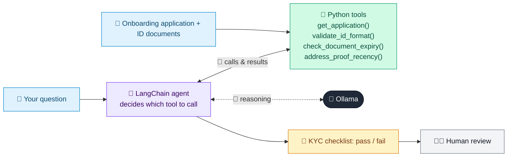

# 10 · KYC Onboarding Verifier

  

**Industry:** 🏦 Banking · **Category:** 🕵️ Financial Crime & Compliance

## 🏦 The business problem (new to banking? start here)

**In the business today:** Before opening an account, the bank must verify identity and address documents and check they match the application.

**Who does this work:** KYC / onboarding operations teams.

**Why it's hard:** Checks are repetitive; small mismatches (spelling, expired IDs) are easy to miss and delay customers.

### Key terms
- **KYC (Know Your Customer)**: Verifying who a customer is (ID, address) and understanding what they do, before and during the relationship.
- **CDD / EDD**: Customer Due Diligence (standard checks) and Enhanced Due Diligence (deeper checks for high-risk customers, such as source of wealth).

More terms: [Banking Primer & glossary](../PRIMER.md#glossary)

---

## 🤖 What the AI does
Checks customer onboarding data for completeness, document validity and consistency.

### How it works
Agent uses `check_document_expiry`, `validate_id_format` and `compare_fields` tools and returns a KYC checklist with pass/fail.



<sub>🟦 data · 🟩 Python: maths & rules (auditable) · 🟪 AI: reasoning & writing · ⬛ local LLM · 🟨 result</sub>

## 💬 Sample response

Real output from `qwen2.5:7b-instruct` running locally on a laptop. LLM wording changes from run to run; the numbers from
Python stay the same.

<details>
<summary><b>Show the full output</b></summary>

````text
--- KYC result ---
Based on the provided information and the results from the tools, here is the checklist:

1. **ID Format**: PASS
2. **ID Expiry**: FAIL (Expired 43 days ago)
3. **Name Match**: PASS (Allowing middle-name/initial differences)
4. **DOB Match**: PASS
5. **Address Match**: PASS (Allowing spelling and abbreviation variants like Bangalore/Bengaluru)
6. **Address Proof Recency**: REVIEW (Issued 124 days ago - TOO OLD (limit 90))

Given the address proof is too old, we need to request a more recent document.

### Final Status: PENDING (list documents needed)
- **Address Proof**: Provide a recent utility bill or any other valid address proof issued within the last 90 days.

Would you like to proceed with this or need further assistance?
````

</details>

## Run
```bash
# from the repo root, with Ollama running
python 01_banking/10_kyc_onboarding_verifier/app.py
```

## Customize
- Replace the sample data at the top of `app.py` with your own data source (CSV, database, API).
- Tune thresholds and rules in the Python functions. These are the auditable part of the solution.
- Change the model with `OLLAMA_MODEL` (see the root [README](../../README.md#-model-recommendations)).

> Sample data is fictional; calculations are simplified for learning.

[⬅ Back to Banking use cases](../README.md#-use-cases) · [All industries](../../README.md)
