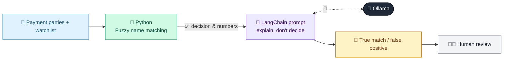

# 11 · Sanctions Screening Assistant

  

**Industry:** 🏦 Banking · **Category:** 🕵️ Financial Crime & Compliance

## 🏦 The business problem (new to banking? start here)

**In the business today:** Every customer and international payment is screened against sanctions lists. A similar name triggers an alert that an analyst must clear or escalate before money moves.

**Who does this work:** Sanctions screening analysts (Financial Crime Compliance).

**Why it's hard:** Name matching produces many false positives that delay payments, while a missed true match is a serious legal breach.

### Key terms
- **Sanctions screening**: Checking customers and payments against government lists of banned people, companies and countries.
- **False positive**: An alert that turns out to be innocent, e.g. a name that looks like a sanctioned person but is someone else. Usually most alerts are false positives.
- **PEP**: Politically Exposed Person: someone with a prominent public role (or their family/associates). Higher bribery and corruption risk, so EDD is required.

More terms: [Banking Primer & glossary](../PRIMER.md#glossary)

---

## 🤖 What the AI does
Reduces false positives in name screening by adjudicating fuzzy matches with secondary identifiers.

### How it works
`difflib` fuzzy-matches against a watchlist; the LLM compares DOB, nationality and address to recommend true match / false positive.



<sub>🟦 data · 🟩 Python: maths & rules (auditable) · 🟪 AI: reasoning & writing · ⬛ local LLM · 🟨 result</sub>

## 💬 Sample conversation

A real recorded run on `qwen2.5:7b-instruct` (local, on a laptop, 6 s). Expand a step to see what happened
behind the answer. LLM wording changes from run to run; the numbers from Python stay the same.

> **👤 You:** Screen today's payment parties against the sanctions watchlist. Are any hits real matches?

<details><summary>🐍 Python · Fuzzy-match hits</summary>

```json
[
  {
    "party": {
      "name": "Victor A. Petrov",
      "dob": "1988-07-19",
      "nationality": "CA",
      "address": "Toronto, Canada",
      "role": "Remitter"
    },
    "watchlist_entry": {
      "name": "Viktor Aleksandrovich Petrov",
      "dob": "1965-03-12",
      "nationality": "RU",
      "program": "SDN-UKRAINE"
    },
    "name_score": 0.94
  },
  {
    "party": {
      "name": "Hasan Al Rashid",
      "dob": "1972-11-02",
      "nationality": "SY",
      "address": "Dubai, UAE",
      "role": "Beneficiary"
    },
    "watchlist_entry": {
      "name": "Hassan Al-Rashid",
      "dob": "1972-11-02",
      "nationality": "SY",
      "program": "SDGT"
    },
    "name_score": 0.97
  },
  {
    "party": {
      "name": "Golden Crescent Shipping",
      "dob": null,
      "nationality": "AE",
      "address": "Jebel Ali, UAE",
      "role": "Beneficiary"
    },
    "watchlist_entry": {
      "name": "Golden Crescent Shipping LLC",
      "dob": null,
      "nationality": "IR",
      "program": "IRAN"
    },
    "name_score": 1.0
  }
]
```

</details>

**🦙 Ollama:**

1. **Victor A. Petrov**:
   - **Match Type**: FALSE POSITIVE
   - **Reason**: The DOB (1988-07-19 vs 1965-03-12) is clearly different.
   - **Action**: Release payment.

2. **Hasan Al Rashid**:
   - **Match Type**: TRUE MATCH
   - **Reason**: The DOB (1972-11-02) and nationality (SY) match exactly.
   - **Action**: Hold payment for further review.

3. **Golden Crescent Shipping**:
   - **Match Type**: POSSIBLE MATCH (Escalate)
   - **Reason**: The name is nearly identical, but the nationality differs (AE vs IR). This could indicate a front company.
   - **Action**: Hold payment for further review.


## Run
```bash
# from the repo root, with Ollama running
python 01_banking/11_sanctions_screening_assistant/app.py
```

## Customize
- Replace the sample data at the top of `app.py` with your own data source (CSV, database, API).
- Tune thresholds and rules in the Python functions. These are the auditable part of the solution.
- Change the model with `OLLAMA_MODEL` (see the root [README](../../README.md#-model-recommendations)).

> Sample data is fictional; calculations are simplified for learning.

[⬅ Back to Banking use cases](../README.md#-use-cases) · [All industries](../../README.md)
