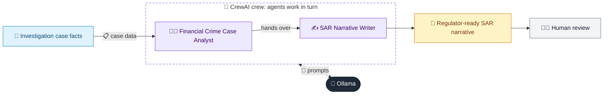

# 12 · SAR Narrative Generator

  

**Industry:** 🏦 Banking · **Category:** 🕵️ Financial Crime & Compliance

## 🏦 The business problem (new to banking? start here)

**In the business today:** When an investigation concludes activity is suspicious, the bank files a SAR with a written narrative explaining who, what, when, where and why.

**Who does this work:** AML investigators and the MLRO.

**Why it's hard:** Narratives must be precise, factual and complete; writing them takes hours per case.

### Key terms
- **SAR / STR**: Suspicious Activity (or Transaction) Report: what a bank files with the financial intelligence unit when it suspects money laundering.
- **MLRO**: Money Laundering Reporting Officer: the senior person accountable for deciding whether to file SARs.
- **Typology**: A known pattern of financial crime, e.g. structuring, mule accounts or trade-based laundering.
- **Money mule**: A person whose account is used to receive and quickly pass on stolen money, often recruited with 'easy money' offers.
- **APP fraud**: Authorised Push Payment fraud: victims are tricked into sending money themselves, e.g. a fake investment.

More terms: [Banking Primer & glossary](../PRIMER.md#glossary)

---

## 🤖 What the AI does
Drafts a Suspicious Activity Report narrative (who, what, when, where, why) from case facts.

### How it works
A Case Analyst agent builds the timeline and a SAR Writer agent produces the regulator-ready narrative.



<sub>🟦 data · 🟩 Python: maths & rules (auditable) · 🟪 AI: reasoning & writing · ⬛ local LLM · 🟨 result</sub>

## 💬 Sample conversation

A real recorded run on `qwen2.5:7b-instruct` (local, on a laptop, 34 s). Expand a step to see what happened
behind the answer. LLM wording changes from run to run; the numbers from Python stay the same.

> **👤 You:** Case INV-2026-0912 on Daniel Okafor is confirmed suspicious. Draft the SAR narrative for the regulator.

<details><summary>🧑‍💼 Financial Crime Case Analyst (agent)</summary>

### Chronology Table

| Date       | Event Description                                                                 | Details                                                                 |
|------------|----------------------------------------------------------------------------------|------------------------------------------------------------------------|
| 2026-05-03 | Account opened by Daniel Okafor                                                   | Personal current account opened for freelance graphic designer          |
| 2026-07-01 | Incoming P2P transfers start                                                      | 46 transfers from 31 unrelated individuals, values 300-1,900, total 41,250 |
| 2026-07-01 to 2026-09-30 | Funds transferred to crypto exchanges                                             | 92% of funds (37,950) sent to CoinPeak and BitHarbor within 24 hours    |
| 2026-09-10 | First request for information sent to Daniel Okafor                                | No response received                                                   |
| 2026-09-20 | Second request for information sent to Daniel Okafor                               | No response received                                                   |
| 2026-09-25 | Account restricted                                                                | Due to non-response to information requests and suspicious activity     |

### Typology Assessment

**Typology: Money Mule**

- **Pattern of Activity**: The account was used to receive and quickly transfer funds, which is a common behavior of a money mule.
- **Funding Source**: The transfers were from multiple unrelated individuals, suggesting a dispersed and potentially illicit source of funds.
- **Destination**: The funds were primarily sent to crypto exchanges, which is a common destination for illicit funds.

### Red-Flag List

1. **Unusual Activity**: Frequent and large P2P transfers from multiple unrelated individuals.
2. **High Volume of Transactions**: 46 transfers totaling 41,250 within a short period.
3. **Quick Turnaround**: 92% of funds were sent to crypto exchanges within 24 hours of receipt.
4. **Recalled Payments**: 4 incoming payments were recalled as APP fraud victims, indicating potential involvement in fraud schemes.
5. **Multiple IP Addresses and Device Changes**: Login IP addresses from 3 countries in the same week, and device changes 5 times, suggesting a high level of activity and potential evasion.
6. **Non-Response to Information Requests**: Failure to respond to two requests for information, indicating possible concealment of activity.
7. **Suspicious Occupation**: Stated occupation as a freelance graphic designer with an expected income of 4,000, which does not align with the volume of transactions.
8. **Account Restriction**: Account was restricted due to the above-mentioned suspicious activities, indicating a high risk of money laundering or fraud.

This chronology and typology assessment provide a clear picture of the case and highlight the key red flags that indicate potential financial crime.

</details>

**🦙 Ollama:**

### Suspicious Activity Report (SAR) Narrative

#### Introduction
On May 3, 2026, an account was opened by Daniel Okafor, a freelance graphic designer. The account has since exhibited a series of suspicious activities, leading to its eventual restriction. This report details the chronological sequence of events, the red flags identified, and the actions taken.

#### Subject Information
Daniel Okafor opened a personal current account on May 3, 2026, for his freelance graphic design work. The account was initially used for legitimate transactions, but soon began to show signs of unusual activity.

#### Suspicious Activity
- **2026-07-01**: Incoming peer-to-peer (P2P) transfers started. Over 46 transfers were received from 31 unrelated individuals, with values ranging from 300 to 1,900, totaling 41,250.
- **2026-07-01 to 2026-09-30**: A significant portion (92%) of the received funds, amounting to 37,950, were transferred to cryptocurrency exchanges, specifically CoinPeak and BitHarbor, within 24 hours of receipt.
- **2026-09-10**: The first request for information was sent to Daniel Okafor regarding the suspicious activity. No response was received.
- **2026-09-20**: A second request for information was sent to Daniel Okafor. Again, no response was received.
- **2026-09-25**: The account was restricted due to the non-response to information requests and the suspicious activity observed.

#### Red Flags & Typology
The account exhibits characteristics of a money mule, a typology commonly associated with financial crime. The following red flags are evident:
1. **Unusual Activity**: Frequent and large P2P transfers from multiple unrelated individuals.
2. **High Volume of Transactions**: 46 transfers totaling 41,250 within a short period.
3. **Quick Turnaround**: 92% of funds were sent to crypto exchanges within 24 hours of receipt.
4. **Recalled Payments**: 4 incoming payments were recalled, indicating potential involvement in fraud schemes.
5. **Multiple IP Addresses and Device Changes**: Login IP addresses from 3 countries in the same week, and device changes 5 times, suggesting a high level of activity and potential evasion.
6. **Non-Response to Information Requests**: Failure to respond to two requests for information, indicating possible concealment of activity.
7. **Suspicious Occupation**: Stated occupation as a freelance graphic designer with an expected income of 4,000, which does not align with the volume of transactions.
8. **Account Restriction**: The account was restricted due to the above-mentioned suspicious activities, indicating a high risk of money laundering or fraud.

#### Actions Taken
- **Initial Monitoring**: The account was monitored for any unusual activity.
- **Information Requests**: Two requests for information were sent to Daniel Okafor, but no response was received.
- **Account Restriction**: Due to the non-response and the suspicious activity, the account was restricted on September 25, 2026.

#### Conclusion
The account of Daniel Okafor, opened on May 3, 2026, has shown clear signs of suspicious activity, consistent with the behavior of a money mule. The high volume of P2P transfers, quick turnaround to crypto exchanges, and the failure to respond to information requests all contribute to the suspicion. The account was ultimately restricted to mitigate the risk of financial crime. Further investigation may be warranted to determine the exact nature of the activity and to identify any potential victims or perpetrators.


## Run
```bash
# from the repo root, with Ollama running
python 01_banking/12_sar_narrative_generator/app.py
```

## Customize
- Replace the sample data at the top of `app.py` with your own data source (CSV, database, API).
- Tune thresholds and rules in the Python functions. These are the auditable part of the solution.
- Change the model with `OLLAMA_MODEL` (see the root [README](../../README.md#-model-recommendations)).

> Sample data is fictional; calculations are simplified for learning.

[⬅ Back to Banking use cases](../README.md#-use-cases) · [All industries](../../README.md)
