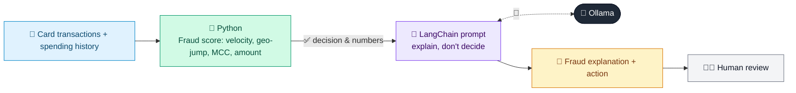

# 13 · Card Fraud Detection Explainer

  

**Industry:** 🏦 Banking · **Category:** 🕵️ Financial Crime & Compliance

## 🏦 The business problem (new to banking? start here)

**In the business today:** Card transactions are scored for fraud in real time. Suspicious ones are blocked or held, and the customer is asked to confirm.

**Who does this work:** Fraud operations analysts.

**Why it's hard:** Blocking genuine spending annoys customers; letting fraud through costs money. Analysts need to see why a transaction was flagged.

### Key terms
- **Card fraud / CNP**: Unauthorised card use. Card-Not-Present (online/phone) fraud is the most common type.
- **MCC**: Merchant Category Code: a 4-digit code describing what kind of business a card merchant is, e.g. 5411 grocery, 7995 gambling.
- **False positive**: An alert that turns out to be innocent, e.g. a name that looks like a sanctioned person but is someone else. Usually most alerts are false positives.

More terms: [Banking Primer & glossary](../PRIMER.md#glossary)

---

## 🤖 What the AI does
Scores card transactions for fraud and explains each alert for analysts and customers.

### How it works
Feature-based risk score (velocity, geo-jump, MCC, amount z-score) plus an LLM explanation and suggested action.



<sub>🟦 data · 🟩 Python: maths & rules (auditable) · 🟪 AI: reasoning & writing · ⬛ local LLM · 🟨 result</sub>

## 💬 Sample conversation

A real recorded run on `qwen2.5:7b-instruct` (local, on a laptop, 8 s). Expand a step to see what happened
behind the answer. LLM wording changes from run to run; the numbers from Python stay the same.

> **👤 You:** Score today's card transactions for fraud and tell me what action to take on each.

<details><summary>🐍 Python · Scores</summary>

```json
[
  {
    "id": "T1",
    "merchant": "Tesco",
    "amount": 58,
    "score": 0,
    "action": "APPROVE",
    "reasons": []
  },
  {
    "id": "T2",
    "merchant": "CoinFast",
    "amount": 1450,
    "score": 110,
    "action": "BLOCK",
    "reasons": [
      "amount z-score 47.6",
      "high-risk MCC (Quasi-cash / crypto)",
      "foreign country LT",
      "card-not-present",
      "velocity 4 txns/hour",
      "unusual hour"
    ]
  },
  {
    "id": "T3",
    "merchant": "LuckySpin",
    "amount": 980,
    "score": 110,
    "action": "BLOCK",
    "reasons": [
      "amount z-score 31.5",
      "high-risk MCC (Gambling)",
      "foreign country MT",
      "card-not-present",
      "velocity 5 txns/hour",
      "unusual hour"
    ]
  },
  {
    "id": "T4",
    "merchant": "Ryanair",
    "amount": 240,
    "score": 55,
    "action": "REVIEW",
    "reasons": [
      "amount z-score 6.3",
      "foreign country IE",
      "card-not-present"
    ]
  }
]
```

</details>

**🦙 Ollama:**

### Analyst Explanations and Actions:

1. **Transaction T1:**
   - **Explanation:** The transaction at Tesco for €58 has a low score, indicating no suspicious activity.
   - **Action:** APPROVE

2. **Transaction T2:**
   - **Explanation:** The transaction at CoinFast for €1450 has a very high score due to multiple risk factors, including high-risk merchant category, foreign country, and unusual behavior.
   - **Action:** BLOCK

3. **Transaction T3:**
   - **Explanation:** The transaction at LuckySpin for €980 has a high score due to risk factors such as gambling, foreign country, and unusual transaction velocity.
   - **Action:** BLOCK

4. **Transaction T4:**
   - **Explanation:** The transaction at Ryanair for €240 has a moderate score with risk factors like foreign country and card-not-present, warranting further review.
   - **Action:** REVIEW

### SMS Messages:

1. **For BLOCK/REVIEW Transactions:**

   - **T2:**
     ```
     Hi, we noticed an unusual transaction from CoinFast. Could you please confirm this was you? Thanks!
     ```

   - **T3:**
     ```
     Hi, we noticed an unusual transaction from LuckySpin. Could you please confirm this was you? Thanks!
     ```

   - **T4:**
     ```
     Hi, we noticed a transaction from Ryanair that looks unusual. Could you please confirm this was you? Thanks!
     ```


## Run
```bash
# from the repo root, with Ollama running
python 01_banking/13_card_fraud_explainer/app.py
```

## Customize
- Replace the sample data at the top of `app.py` with your own data source (CSV, database, API).
- Tune thresholds and rules in the Python functions. These are the auditable part of the solution.
- Change the model with `OLLAMA_MODEL` (see the root [README](../../README.md#-model-recommendations)).

> Sample data is fictional; calculations are simplified for learning.

[⬅ Back to Banking use cases](../README.md#-use-cases) · [All industries](../../README.md)
