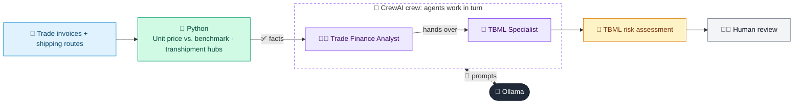

# 14 · Trade-Based Money Laundering Detector

  

**Industry:** 🏦 Banking · **Category:** 🕵️ Financial Crime & Compliance

## 🏦 The business problem (new to banking? start here)

**In the business today:** Trade finance teams check that goods, prices and shipping routes make commercial sense, because criminals use fake trade invoices to move money across borders.

**Who does this work:** Trade finance operations and financial crime specialists.

**Why it's hard:** Requires knowing what goods normally cost and how they normally ship; red flags are subtle.

### Key terms
- **TBML (Trade-Based Money Laundering)**: Disguising criminal money as trade, e.g. invoicing goods at fake prices to move value across borders.
- **Trade finance**: Bank services that help importers and exporters trade safely, e.g. Letters of Credit and guarantees.
- **Letter of Credit (LC)**: A bank's promise to pay an exporter if they present documents that exactly match the LC's terms.

More terms: [Banking Primer & glossary](../PRIMER.md#glossary)

---

## 🤖 What the AI does
Flags over/under-invoicing and suspicious trade routes in trade finance transactions.

### How it works
Python compares unit prices to benchmarks; a Trade Finance Analyst and a TBML Specialist agent assess red flags.



<sub>🟦 data · 🟩 Python: maths & rules (auditable) · 🟪 AI: reasoning & writing · ⬛ local LLM · 🟨 result</sub>

## 💬 Sample response

Real output from `qwen2.5:7b-instruct` running locally on a laptop. LLM wording changes from run to run; the numbers from
Python stay the same.

<details>
<summary><b>Show the full output</b></summary>

````text
--- Pricing & route analysis ---
[
  {
    "lc": "LC-301",
    "unit_price": 3.3,
    "deviation_pct": 3,
    "flags": []
  },
  {
    "lc": "LC-302",
    "unit_price": 824.0,
    "deviation_pct": 358,
    "flags": [
      "Over-invoicing: unit price 824.00 vs benchmark 180.0 (+358%)",
      "Transhipment via AE not required for route",
      "Beneficiary free-zone entity, not the manufacturer"
    ]
  },
  {
    "lc": "LC-303",
    "unit_price": 2.45,
    "deviation_pct": -74,
    "flags": [
      "Under-invoicing: unit price 2.45 vs benchmark 9.5 (-74%)",
      "Transhipment via PA not required for route"
    ]
  }
]


--- TBML assessment ---
### Per-LC Risk Rating, Red Flags, and Recommended Actions

#### LC-301: Cotton T-shirts
- **Per-LC Risk Rating**: LOW
- **Red Flags**: None
- **Recommended Actions**: None

**Commercial Rationale**:
- The unit price of $3.30 per T-shirt is within a reasonable range for bulk orders of this type of garment.
- The total invoice value of $66,000 for 20,000 T-shirts is plausible.
- The shipping route from Bangladesh to Germany is common and direct.
- The applicant and beneficiary are typical for textile imports.

---

#### LC-302: Used Laptops
- **Per-LC Risk Rating**: HIGH
- **Red Flags**:
  - Over-invoicing: The unit price of $824.00 is significantly higher than the benchmark of $180.00.
  - Transhipment via AE: Transhipment via the UAE is not required for the route from China to Nigeria.
  - Beneficiary: The beneficiary, Gulf Star Trading FZE, is a free-zone entity, which is not the manufacturer.
- **Recommended Actions**:
  - Request price justification for the unit price.
  - Verify the shipment via vessel tracking.
  - Conduct enhanced due diligence (EDD) on the beneficiary.

**Commercial Rationale**:
- The unit price of $824.00 per laptop is extremely high, which is not typical for used laptops.
- The total invoice value of $412,000 for 500 laptops is unusually high.
- The route from China to Nigeria via the UAE is not necessary.
- The beneficiary is not the manufacturer, which is unusual.

---

#### LC-303: Frozen Shrimp (kg)
- **Per-LC Risk Rating**: HIGH
- **Red Flags**:
  - Under-invoicing: The unit price of $0.245 per kg is significantly lower than the benchmark of $9.50.
  - Transhipment via PA: Transhipment via Panama is not required for the route from Vietnam to the United States.
- **Recommended Actions**:
  - Request price justification for the unit price.
  - Verify the shipment via vessel tracking.
  - Conduct enhanced due diligence (EDD) on the beneficiary.

**Commercial Rationale**:
- The unit price of $0.245 per kg is unusually low, which is not typical for frozen shrimp.
- The total invoice value of $98,000 for 40,000 kg of frozen shrimp is also unusually low.
- The route from Vietnam to the United States via Panama is not necessary.
- The beneficiary is the manufacturer, which is typical, but the low unit price and invoice value are concerning.

---

### Summary
- **LC-301**: LOW risk, no further actions required.
- **LC-302**: HIGH risk, recommend price justification, vessel tracking, and EDD on the beneficiary.
- **LC-303**: HIGH risk, recommend price justification, vessel tracking, and EDD on the beneficiary.
````

</details>

## Run
```bash
# from the repo root, with Ollama running
python 01_banking/14_tbml_detector/app.py
```

## Customize
- Replace the sample data at the top of `app.py` with your own data source (CSV, database, API).
- Tune thresholds and rules in the Python functions. These are the auditable part of the solution.
- Change the model with `OLLAMA_MODEL` (see the root [README](../../README.md#-model-recommendations)).

> Sample data is fictional; calculations are simplified for learning.

[⬅ Back to Banking use cases](../README.md#-use-cases) · [All industries](../../README.md)
