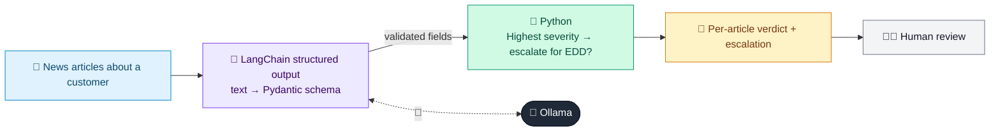

# 15 · Adverse Media Screening

  

**Industry:** 🏦 Banking · **Category:** 🕵️ Financial Crime & Compliance

## 🏦 The business problem (new to banking? start here)

**In the business today:** During onboarding and periodic reviews, banks search news for negative stories about customers (fraud, corruption, investigations).

**Who does this work:** KYC / Enhanced Due Diligence analysts.

**Why it's hard:** Searches return many irrelevant hits, including people who just share a name. Reading them all is time-consuming.

### Key terms
- **Adverse media**: Negative news linking a customer to crime (fraud, bribery, laundering). Checked during onboarding and reviews.
- **CDD / EDD**: Customer Due Diligence (standard checks) and Enhanced Due Diligence (deeper checks for high-risk customers, such as source of wealth).
- **KYC (Know Your Customer)**: Verifying who a customer is (ID, address) and understanding what they do, before and during the relationship.

More terms: [Banking Primer & glossary](../PRIMER.md#glossary)

---

## 🤖 What the AI does
Classifies news articles about a customer for financial-crime relevance and severity.

### How it works
Each article is classified into a Pydantic schema (relevant, category, severity, summary) and aggregated.



<sub>🟦 data · 🟩 Python: maths & rules (auditable) · 🟪 AI: reasoning & writing · ⬛ local LLM · 🟨 result</sub>

## 💬 Sample response

Real output from `qwen2.5:7b-instruct` running locally on a laptop. LLM wording changes from run to run; the numbers from
Python stay the same.

<details>
<summary><b>Show the full output</b></summary>

````text
--- Article 1 ---
Horizon Infra Projects wins 2,400 crore highway contract; MD Rajiv Malhotra says execution starts Q1.
-> {'summary': 'Horizon Infra Projects has secured a significant highway contract worth 2,400 crore. The Managing Director, Rajiv Malhotra, has stated that the execution of the project will begin in the first quarter.', 'about_subject': False, 'category': 'none', 'severity': 'low', 'status': 'charged'}


--- Article 2 ---
Enforcement agency raids Horizon Infra offices in money laundering probe linked to bid-rigging; MD Rajiv Malhotra questioned for 9 hours, no charges filed yet.
-> {'summary': "An enforcement agency conducted a raid on Horizon Infra Projects' offices as part of a money laundering investigation related to bid-rigging. The Managing Director, Rajiv Malhotra, was questioned for nine hours, but no charges have been filed against him so far.", 'about_subject': True, 'category': 'sanctions', 'severity': 'medium', 'status': 'investigation'}


--- Article 3 ---
Rajiv Malhotra, a Mumbai-based chef, opens new restaurant in Bandra.
-> {'summary': 'Rajiv Malhotra, a chef based in Mumbai, has opened a new restaurant in the Bandra area.', 'about_subject': False, 'category': 'none', 'severity': 'low', 'status': 'charged'}


--- Article 4 ---
Court grants bail to Horizon Infra MD Rajiv Malhotra after arrest on bribery charges involving state officials.
-> {'summary': 'Rajiv Malhotra, the Managing Director of Horizon Infra Projects, has been granted bail after being arrested on bribery charges involving state officials.', 'about_subject': True, 'category': 'fraud', 'severity': 'high', 'status': 'allegation'}


--- Overall ---
2 relevant adverse articles; highest severity: HIGH -> Escalate for EDD
````

</details>

## Run
```bash
# from the repo root, with Ollama running
python 01_banking/15_adverse_media_screening/app.py
```

## Customize
- Replace the sample data at the top of `app.py` with your own data source (CSV, database, API).
- Tune thresholds and rules in the Python functions. These are the auditable part of the solution.
- Change the model with `OLLAMA_MODEL` (see the root [README](../../README.md#-model-recommendations)).

> Sample data is fictional; calculations are simplified for learning.

[⬅ Back to Banking use cases](../README.md#-use-cases) · [All industries](../../README.md)
