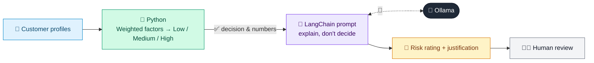

# 16 · Customer Risk Rating (CRR)

  

**Industry:** 🏦 Banking · **Category:** 🕵️ Financial Crime & Compliance

## 🏦 The business problem (new to banking? start here)

**In the business today:** Each customer gets a money-laundering risk rating based on factors like occupation, countries, products and PEP status. It decides how much checking and how frequent reviews they need.

**Who does this work:** KYC / AML compliance teams.

**Why it's hard:** Ratings must be consistent and justified in writing for auditors and regulators.

### Key terms
- **Customer Risk Rating (CRR)**: A Low / Medium / High money-laundering risk score per customer that decides how much due diligence and monitoring they get.
- **PEP**: Politically Exposed Person: someone with a prominent public role (or their family/associates). Higher bribery and corruption risk, so EDD is required.
- **CDD / EDD**: Customer Due Diligence (standard checks) and Enhanced Due Diligence (deeper checks for high-risk customers, such as source of wealth).
- **KYC (Know Your Customer)**: Verifying who a customer is (ID, address) and understanding what they do, before and during the relationship.

More terms: [Banking Primer & glossary](../PRIMER.md#glossary)

---

## 🤖 What the AI does
Computes a customer ML/TF risk rating and justifies it for periodic KYC review.

### How it works
Weighted factor model (occupation, geography, product, channel, PEP) gives Low/Medium/High; LLM writes the justification.



<sub>🟦 data · 🟩 Python: maths & rules (auditable) · 🟪 AI: reasoning & writing · ⬛ local LLM · 🟨 result</sub>

## 💬 Sample conversation

A real recorded run on `qwen2.5:7b-instruct` (local, on a laptop, 10 s). Expand a step to see what happened
behind the answer. LLM wording changes from run to run; the numbers from Python stay the same.

> **👤 You:** Rate the AML risk of these customers and justify each rating for the file.

<details><summary>🐍 Python · Ratings</summary>

```json
[
  {
    "id": "K-01",
    "factor_scores": {
      "occupation": 1,
      "geography": 1,
      "product": 1,
      "channel": 1,
      "pep": 1
    },
    "weighted_score": 1.0,
    "rating": "LOW",
    "next_review": "36 months"
  },
  {
    "id": "K-02",
    "factor_scores": {
      "occupation": 3,
      "geography": 2,
      "product": 2,
      "channel": 2,
      "pep": 1
    },
    "weighted_score": 2.05,
    "rating": "MEDIUM",
    "next_review": "24 months"
  },
  {
    "id": "K-03",
    "factor_scores": {
      "occupation": 3,
      "geography": 3,
      "product": 3,
      "channel": 3,
      "pep": 3
    },
    "weighted_score": 3.0,
    "rating": "HIGH",
    "next_review": "12 months"
  }
]
```

</details>

**🦙 Ollama:**

### Customer K-01
**Risk-Rating Justification: LOW**
The customer is a salaried individual operating domestically, using a savings account through a branch channel. There are no indicators of political exposure. The low risk is driven by the domestic geography, salaried occupation, and the use of a branch channel, which provides a level of direct interaction and oversight. Due-diligence measures include standard due diligence (SDD) and a review by a senior officer if the customer is a foreign Politically Exposed Person (PEP).

### Customer K-02
**Risk-Rating Justification: MEDIUM**
The customer is a jeweller operating in a medium-risk geography, using a current account through a digital channel. The occupation of a jeweller, while not inherently high-risk, can involve transactions that may be subject to scrutiny due to the nature of the business. The medium risk is further driven by the use of a digital channel, which may limit the level of direct interaction. Due-diligence measures include standard due diligence (SDD), enhanced due diligence (EDD) for the source of wealth, and a review by a senior officer.

### Customer K-03
**Risk-Rating Justification: HIGH**
The customer is a real estate professional operating in a high-risk geography, engaging in private banking through a non-face-to-face channel. The occupation of a real estate professional, combined with the high-risk geography, increases the likelihood of involvement in money laundering or other financial crimes. The non-face-to-face channel further complicates the ability to verify the customer's identity and transactional patterns. The high risk is also driven by the customer being a foreign Politically Exposed Person (PEP). Due-diligence measures include enhanced due diligence (EDD), a thorough review of the source of wealth, and a senior officer's approval for the PEP status. Regular reviews are required to ensure ongoing compliance and risk assessment.


## Run
```bash
# from the repo root, with Ollama running
python 01_banking/16_customer_risk_rating/app.py
```

## Customize
- Replace the sample data at the top of `app.py` with your own data source (CSV, database, API).
- Tune thresholds and rules in the Python functions. These are the auditable part of the solution.
- Change the model with `OLLAMA_MODEL` (see the root [README](../../README.md#-model-recommendations)).

> Sample data is fictional; calculations are simplified for learning.

[⬅ Back to Banking use cases](../README.md#-use-cases) · [All industries](../../README.md)
