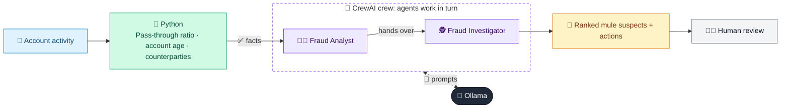

# 17 · Money Mule Account Detector

  

**Industry:** 🏦 Banking · **Category:** 🕵️ Financial Crime & Compliance

## 🏦 The business problem (new to banking? start here)

**In the business today:** Fraudsters use 'mule' accounts to receive stolen money and pass it on quickly. Banks look for accounts where money comes in from many people and leaves almost immediately.

**Who does this work:** Fraud and financial crime teams.

**Why it's hard:** Mules are often young people being exploited, so action must stop the fraud and also protect them.

### Key terms
- **Money mule**: A person whose account is used to receive and quickly pass on stolen money, often recruited with 'easy money' offers.
- **APP fraud**: Authorised Push Payment fraud: victims are tricked into sending money themselves, e.g. a fake investment.
- **Typology**: A known pattern of financial crime, e.g. structuring, mule accounts or trade-based laundering.

More terms: [Banking Primer & glossary](../PRIMER.md#glossary)

---

## 🤖 What the AI does
Identifies likely mule accounts from pass-through behaviour and new-account signals.

### How it works
Python computes pass-through ratio, account age and counterparties; Fraud Analyst and Investigator agents rank and recommend actions.



<sub>🟦 data · 🟩 Python: maths & rules (auditable) · 🟪 AI: reasoning & writing · ⬛ local LLM · 🟨 result</sub>

## 💬 Sample response

Real output from `qwen2.5:7b-instruct` running locally on a laptop. LLM wording changes from run to run; the numbers from
Python stay the same.

<details>
<summary><b>Show the full output</b></summary>

````text
--- Mule scores ---
[
  {
    "acct": "A-100",
    "pass_through_ratio": 0.98,
    "mule_score": 100,
    "tier": "HIGH"
  },
  {
    "acct": "A-102",
    "pass_through_ratio": 0.98,
    "mule_score": 100,
    "tier": "HIGH"
  },
  {
    "acct": "A-101",
    "pass_through_ratio": 0.9,
    "mule_score": 25,
    "tier": "LOW"
  },
  {
    "acct": "A-103",
    "pass_through_ratio": 0.4,
    "mule_score": 0,
    "tier": "LOW"
  }
]


--- Recommendations ---
### Prioritized Action List

1. **Account A-100**
   - **Action:** Close & Report
   - **Reasoning:** High Mule Score (100), Tier HIGH, and multiple strong indicators of money laundering activities, including high inflow and outflow, high number of unique senders, short average hold time, and high crypto or cash out percentage. The young age of the account holder (19 years) is a significant red flag.

2. **Account A-101**
   - **Action:** Contact Customer
   - **Reasoning:** Low Mule Score (25), Tier LOW, with moderate inflow and outflow, low number of unique senders, long average hold time, and no shared device. The older age of the account holder (41 years) and the low crypto or cash out percentage suggest this account is less likely to be involved in money laundering.

3. **Account A-102**
   - **Action:** Close & Report
   - **Reasoning:** High Mule Score (100), Tier HIGH, and multiple strong indicators of money laundering activities, including high inflow and outflow, high number of unique senders, short average hold time, and high crypto or cash out percentage. The young age of the account holder (22 years) is a significant red flag.

4. **Account A-103**
   - **Action:** Contact Customer
   - **Reasoning:** Low Mule Score (0), Tier LOW, with high inflow and low outflow, low number of unique senders, long average hold time, and no crypto or cash out transactions. The older age of the account holder (55 years) and the lack of crypto or cash out activities suggest this account is less likely to be involved in money laundering.

### Additional Actions

- **Account A-100 & A-102:** Safeguarding Message for Possibly-Exploited Young Holders
  - **Reasoning:** Both accounts have young holders (19 and 22 years old), and given the high Mule Scores, it is important to inform the holders about the risks and potential exploitation.

- **Network Link Analysis:**
  - **Reasoning:** Conduct a network link analysis for all accounts to identify any connections or patterns that might indicate a larger scheme or network of money mules. This will help in understanding the broader context and potential for coordinated fraudulent activities.
````

</details>

## Run
```bash
# from the repo root, with Ollama running
python 01_banking/17_mule_account_detector/app.py
```

## Customize
- Replace the sample data at the top of `app.py` with your own data source (CSV, database, API).
- Tune thresholds and rules in the Python functions. These are the auditable part of the solution.
- Change the model with `OLLAMA_MODEL` (see the root [README](../../README.md#-model-recommendations)).

> Sample data is fictional; calculations are simplified for learning.

[⬅ Back to Banking use cases](../README.md#-use-cases) · [All industries](../../README.md)
