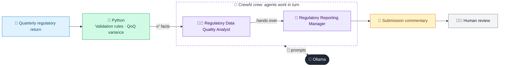

# 18 · Regulatory Reporting Agent

  

**Industry:** 🏦 Banking · **Category:** 📜 Regulatory & Risk Reporting

## 🏦 The business problem (new to banking? start here)

**In the business today:** Each quarter, banks submit returns to the regulator on capital, liquidity and asset quality, with commentary explaining big movements.

**Who does this work:** Regulatory reporting team (Finance), signed off by the CFO.

**Why it's hard:** Data comes from many systems; errors or unexplained movements trigger regulator questions or fines.

### Key terms
- **Regulatory reporting**: Regular returns banks must send to their regulator (capital, liquidity, large exposures...). Errors can mean fines.
- **Capital (CET1, Tier 1, Tier 2)**: The bank's own money that absorbs losses. CET1 (mostly shareholders' equity) is the highest-quality layer.
- **RWA (Risk-Weighted Assets)**: Assets adjusted for risk: a government bond might count 0%, an unrated corporate loan 100%. Capital requirements are a % of RWA.
- **Capital ratio**: Capital / RWA. E.g. a CET1 ratio of 12% vs a 7% minimum means 5 percentage points of headroom.
- **LCR (Liquidity Coverage Ratio)**: High-quality liquid assets / expected net cash outflows over 30 days of stress. Must be at least 100%.
- **Delinquency / NPA / NPL**: A delinquent loan is behind on payments. After about 90 DPD it becomes a Non-Performing Asset / Loan.

More terms: [Banking Primer & glossary](../PRIMER.md#glossary)

---

## 🤖 What the AI does
Validates a regulatory return, explains period-on-period movements and drafts the submission commentary.

### How it works
Python runs validation and variance checks; a Data Quality agent reviews breaks and a Regulatory Reporting agent writes commentary.



<sub>🟦 data · 🟩 Python: maths & rules (auditable) · 🟪 AI: reasoning & writing · ⬛ local LLM · 🟨 result</sub>

## 💬 Sample response

Real output from `qwen2.5:7b-instruct` running locally on a laptop. LLM wording changes from run to run; the numbers from
Python stay the same.

<details>
<summary><b>Show the full output</b></summary>

````text
--- Metrics ---
{
  "Q2-2026": {
    "total_rwa": 37200,
    "cet1_ratio": 13.04,
    "tier1_ratio": 14.65,
    "total_capital_ratio": 17.07,
    "lcr": 140.0,
    "npl_ratio": 3.0
  },
  "Q3-2026": {
    "total_rwa": 41400,
    "cet1_ratio": 11.86,
    "tier1_ratio": 13.31,
    "total_capital_ratio": 15.43,
    "lcr": 119.7,
    "npl_ratio": 3.19
  }
}


--- QoQ variance ---
{
  "total_rwa": 4200,
  "cet1_ratio": -1.18,
  "tier1_ratio": -1.34,
  "total_capital_ratio": -1.64,
  "lcr": -20.3,
  "npl_ratio": 0.19
}


--- Validation ---
All validation checks passed


--- Submission commentary ---
### Regulatory Submission Commentary

#### 1. Executive Summary
This commentary provides a detailed analysis of the regulatory capital and liquidity ratios for the periods Q2-2026 and Q3-2026, along with an explanation of the key movements and data quality observations. The submission includes a review of the capital adequacy, liquidity, asset quality, and data quality statements, followed by specific items for the CFO's attention.

#### 2. Capital Adequacy (Ratios vs Minimums & Drivers)
- **Total Risk-Weighted Assets (RWA):**
  - **Q2-2026:** 37,200
  - **Q3-2026:** 41,400
  - **Change:** +4,200 (11.29%)
  - **Explanation:** The increase in RWA is primarily driven by higher RWA_credit and RWA_market, reflecting growth in credit and market risk exposures.

- **Common Equity Tier 1 (CET1) Ratio:**
  - **Q2-2026:** 13.04%
  - **Q3-2026:** 11.86%
  - **Change:** -1.18 percentage points
  - **Explanation:** The decrease in the CET1 ratio is likely due to an increase in RWA_credit or a decrease in CET1 capital, possibly reflecting the growth in risk-weighted assets.

- **Tier 1 Capital Ratio:**
  - **Q2-2026:** 14.65%
  - **Q3-2026:** 13.31%
  - **Change:** -1.34 percentage points
  - **Explanation:** The Tier1 ratio decrease mirrors the CET1 ratio, suggesting a similar driver, such as an increase in RWA_credit or a decrease in CET1 capital.

- **Total Capital Ratio:**
  - **Q2-2026:** 17.07%
  - **Q3-2026:** 15.43%
  - **Change:** -1.64 percentage points
  - **Explanation:** The total capital ratio decrease is consistent with the trends in CET1 and Tier1 ratios, indicating a potential need for additional capital to meet regulatory requirements.

- **Liquidity Coverage Ratio (LCR):**
  - **Q2-2026:** 140.0%
  - **Q3-2026:** 119.7%
  - **Change:** -20.3 percentage points
  - **Explanation:** The significant decrease in LCR is primarily due to a decrease in high-quality liquid assets (HQLA) or an increase in net outflows over 30 days, which needs further investigation.

- **Non-Performing Loan (NPL) Ratio:**
  - **Q2-2026:** 3.0%
  - **Q3-2026:** 3.19%
  - **Change:** +0.19 percentage points
  - **Explanation:** The slight increase in the NPL ratio could be due to an increase in NPLs or a decrease in total loans, requiring further analysis to ensure the accuracy of the reported figures.

#### 3. Liquidity
- **Liquidity Coverage Ratio (LCR):**
  - **Q2-2026:** 140.0%
  - **Q3-2026:** 119.7%
  - **Change:** -20.3 percentage points
  - **Explanation:** The significant decrease in LCR is a cause for concern and requires further investigation. The decrease could be attributed to a decrease in HQLA or an increase in net outflows over 30 days. This movement needs to be validated and explained.

#### 4. Asset Quality
- **Non-Performing Loan (NPL) Ratio:**
  - **Q2-2026:** 3.0%
  - **Q3-2026:** 3.19%
  - **Change:** +0.19 percentage points
  - **Explanation:** The slight increase in the NPL ratio, while not significant, indicates potential credit risk issues. This movement needs further investigation to ensure the accuracy and completeness of the reported figures.

#### 5. Data Quality Statement
- **High-Quality Liquid Assets (HQLA):**
  - **Q2-2026:** 9,800
  - **Q3-2026:** 9,100
  - **Change:** -700 (7.14%)
  - **Explanation:** The significant decrease in HQLA could impact the LCR and overall liquidity position. This movement needs further explanation and validation.

- **Net Outflows 30 Days:**
  - **Q2-2026:** 7,000
  - **Q3-2026:** 7,600
  - **Change:** +600 (8.57%)
  - **Explanation:** The increase in net outflows over 30 days could impact the LCR and overall liquidity position. This movement needs further investigation.

- **Total Loans:**
  - **Q2-2026:** 52,000
  - **Q3-2026:** 57,300
  - **Change:** +5,300 (10.19%)
  - **Explanation:** The significant increase in total loans, particularly in the construction sector, could impact the NPL ratio and overall risk profile. This movement needs further explanation.

- **Non-Performing Loans (NPLs):**
  - **Q2-2026:** 1,560
  - **Q3-2026:** 1,830
  - **Change:** +270 (17.46%)
  - **Explanation:** The increase in NPLs, particularly in the construction sector, could indicate potential credit risk issues. This movement needs further investigation.

#### 6. Items for CFO Attention
- **Review and Validate HQLA and Net Outflows 30 Days:** Ensure the accuracy and completeness of these figures, as they significantly impact the LCR.
- **Investigate the Increase in Total Loans and NPLs:** Specifically, focus on the construction sector to understand the underlying reasons for the increase in loans and NPLs.
- **Examine the Drivers of the Decrease in CET1, Tier1, and Total Capital Ratios:** Ensure that the reported figures accurately reflect the company's capital position and that any changes are appropriately accounted for.
- **Validate the LCR Calculation:** Ensure that the HQLA and net outflows figures are correctly calculated and reported, as a significant decrease in LCR is a cause for concern.
- **Monitor and Address Credit Risk:** Given the slight increase in the NPL ratio, closely monitor credit risk and take necessary actions to mitigate potential issues.

This commentary provides a comprehensive overview of the regulatory reporting for the periods Q2-2026 and Q3-2026, highlighting key movements and areas for further investigation. Please review and provide your sign-off.

Sincerely,

[Your Name]  
Regulatory Reporting Manager  
[Your Company]
````

</details>

## Run
```bash
# from the repo root, with Ollama running
python 01_banking/18_regulatory_reporting_agent/app.py
```

## Customize
- Replace the sample data at the top of `app.py` with your own data source (CSV, database, API).
- Tune thresholds and rules in the Python functions. These are the auditable part of the solution.
- Change the model with `OLLAMA_MODEL` (see the root [README](../../README.md#-model-recommendations)).

> Sample data is fictional; calculations are simplified for learning.

[⬅ Back to Banking use cases](../README.md#-use-cases) · [All industries](../../README.md)
