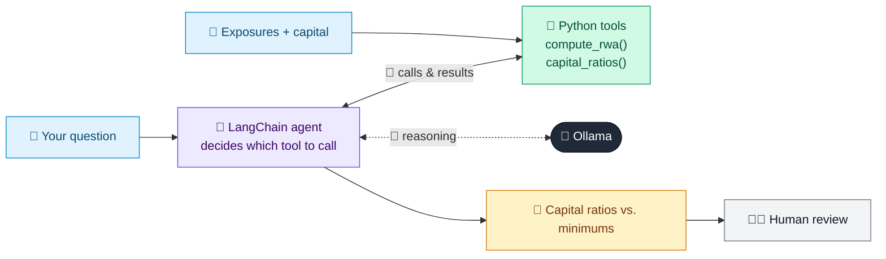

# 19 · Basel III Capital Calculator Assistant

  

**Industry:** 🏦 Banking · **Category:** 📜 Regulatory & Risk Reporting

## 🏦 The business problem (new to banking? start here)

**In the business today:** Banks must hold enough capital against risky assets. Treasury and risk teams constantly ask: what are our ratios, and what happens if we lend more?

**Who does this work:** Capital management (Treasury / Finance / Risk).

**Why it's hard:** Capital is expensive and limited; every lending decision consumes some, so quick what-if answers matter.

### Key terms
- **Basel III**: The global rulebook for how much capital and liquidity banks must hold, set by the Basel Committee.
- **Capital (CET1, Tier 1, Tier 2)**: The bank's own money that absorbs losses. CET1 (mostly shareholders' equity) is the highest-quality layer.
- **RWA (Risk-Weighted Assets)**: Assets adjusted for risk: a government bond might count 0%, an unrated corporate loan 100%. Capital requirements are a % of RWA.
- **Capital ratio**: Capital / RWA. E.g. a CET1 ratio of 12% vs a 7% minimum means 5 percentage points of headroom.

More terms: [Banking Primer & glossary](../PRIMER.md#glossary)

---

## 🤖 What the AI does
Answers capital-adequacy questions by computing RWA, CET1, Tier 1 and total capital ratios.

### How it works
Agent uses `compute_rwa` and `capital_ratios` tools on the sample balance sheet and explains headroom vs. minimums.



<sub>🟦 data · 🟩 Python: maths & rules (auditable) · 🟪 AI: reasoning & writing · ⬛ local LLM · 🟨 result</sub>

## 💬 Sample response

Real output from `qwen2.5:7b-instruct` running locally on a laptop. LLM wording changes from run to run; the numbers from
Python stay the same.

<details>
<summary><b>Show the full output</b></summary>

````text
--- Question ---
What are our current capital ratios? Then: what happens if unrated corporate exposure grows by 3,000 million?


--- Answer ---
Based on the current RWA calculations, here are the capital ratios:

| Ratio        | Ratio (%) | Minimum (%) | Headroom (pp) |
|--------------|----------|-------------|--------------|
| CET1         | 26.0     | 7.0         | 19.0         |
| Tier 1       | 29.33    | 8.5         | 20.83        |
| Total Capital| 34.0     | 10.5        | 23.5         |

The headroom for all ratios is substantial, with each ratio comfortably above the minimum requirements.

Now, let's consider the scenario where the corporate unrated exposure grows by 3,000 million. Here are the updated RWA calculations:


Based on the updated RWA calculations after increasing the corporate unrated exposure by 3,000 million, here are the new capital ratios:

| Ratio        | Ratio (%) | Minimum (%) | Headroom (pp) |
|--------------|----------|-------------|--------------|
| CET1         | 8.74     | 7.0         | 1.74         |
| Tier 1       | 9.87     | 8.5         | 1.37         |
| Total Capital| 11.43    | 10.5        | 0.93         |

### Analysis:
- **CET1 Ratio**: The headroom is now 1.74 percentage points, which is still above the minimum requirement but close.
- **Tier 1 Ratio**: The headroom is 1.37 percentage points, also above the minimum but close.
- **Total Capital Ratio**: The headroom is 0.93 percentage points, which is just above the minimum requirement.

### Comments:
- The headroom for all ratios is now very tight, with each ratio barely meeting the minimum requirements. This indicates a high risk of not meeting the regulatory requirements if there are any unexpected increases in RWA.
- The largest RWA driver in this scenario is the corporate unrated exposure, which has significantly increased the total RWA.

### Suggestions for RWA Optimization:
1. **Reduce Corporate Unrated Exposure**: Consider reducing the corporate unrated exposure to bring down the total RWA and improve headroom.
2. **Risk Mitigation Strategies**: Implement risk mitigation strategies for corporate unrated exposures, such as diversification, hedging, or risk transfer.
3. **Asset-Liability Management**: Adjust the balance sheet to manage the overall RWA more effectively.
4. **Capital Buffer**: Maintain a higher capital buffer to provide a cushion against potential future increases in RWA.

By addressing these areas, you can improve the headroom and ensure compliance with regulatory requirements.
````

</details>

## Run
```bash
# from the repo root, with Ollama running
python 01_banking/19_basel_capital_calculator/app.py
```

## Customize
- Replace the sample data at the top of `app.py` with your own data source (CSV, database, API).
- Tune thresholds and rules in the Python functions. These are the auditable part of the solution.
- Change the model with `OLLAMA_MODEL` (see the root [README](../../README.md#-model-recommendations)).

> Sample data is fictional; calculations are simplified for learning.

[⬅ Back to Banking use cases](../README.md#-use-cases) · [All industries](../../README.md)
