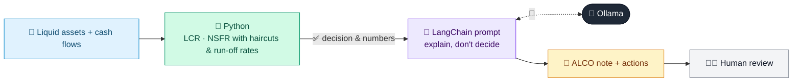

# 20 · Liquidity LCR / NSFR Monitor

  

**Industry:** 🏦 Banking · **Category:** 📜 Regulatory & Risk Reporting

## 🏦 The business problem (new to banking? start here)

**In the business today:** Treasury tracks whether the bank has enough liquid assets to survive a 30-day stress (LCR) and stable funding for the next year (NSFR), and reports to ALCO.

**Who does this work:** Treasury / liquidity risk team, reporting to ALCO.

**Why it's hard:** Liquidity can disappear fast (as in bank runs); positions must be monitored and explained frequently.

### Key terms
- **Liquidity**: Having enough cash to pay what is due, even under stress. Banks can be solvent but still fail from lack of liquidity.
- **LCR (Liquidity Coverage Ratio)**: High-quality liquid assets / expected net cash outflows over 30 days of stress. Must be at least 100%.
- **NSFR (Net Stable Funding Ratio)**: Stable funding available / stable funding required over one year. Must be at least 100%.
- **HQLA**: High-Quality Liquid Assets: cash and assets (like government bonds) that can be sold quickly without big losses.
- **ALCO**: Asset-Liability Committee: senior managers who oversee the bank's liquidity, funding and interest-rate risk.

More terms: [Banking Primer & glossary](../PRIMER.md#glossary)

---

## 🤖 What the AI does
Calculates LCR and NSFR and produces an ALCO liquidity commentary.

### How it works
HQLA haircuts and outflow run-off rates are applied in Python; an LLM writes the ALCO note and actions.



<sub>🟦 data · 🟩 Python: maths & rules (auditable) · 🟪 AI: reasoning & writing · ⬛ local LLM · 🟨 result</sub>

## 💬 Sample response

Real output from `qwen2.5:7b-instruct` running locally on a laptop. LLM wording changes from run to run; the numbers from
Python stay the same.

<details>
<summary><b>Show the full output</b></summary>

````text
--- Metrics ---
{
  "hqla": 10275,
  "gross_outflows": 8800,
  "capped_inflows": 1400,
  "lcr_pct": 138.9,
  "asf": 40750,
  "rsf": 30700,
  "nsfr_pct": 132.7,
  "limits": {
    "lcr_min": 100,
    "nsfr_min": 100,
    "internal_lcr_trigger": 120,
    "internal_nsfr_trigger": 110
  }
}


--- ALCO note ---
### Treasury Liquidity Risk Management Report

#### Headline (RAG Status)
- **LCR**: Green
- **NSFR**: Amber

#### Liquidity Coverage Ratio (LCR)
- **Current LCR**: 138.9%
- **Regulatory Minimum**: 100%
- **Internal Trigger**: 120%
- **Status**: Green

#### Net Stable Funding Ratio (NSFR)
- **Current NSFR**: 132.7%
- **Regulatory Minimum**: 100%
- **Internal Trigger**: 110%
- **Status**: Amber

#### Top Drivers of Outflows/RSF
1. **Operational Wholesale Funding**: 6000 (27.27% of total gross outflows)
2. **Non-Operational Wholesale Funding**: 9000 (50.00% of total gross outflows)
3. **Retail Less Stable Deposits**: 15000 (17.04% of total gross outflows)

#### Concrete Actions
1. **Term Out Wholesale Funding**: Reduce non-operational wholesale funding by 9000, focusing on terming out these funds to more stable sources.
2. **Grow Stable Retail Deposits**: Increase retail stable deposits by 20000, aiming to diversify funding sources and improve the stability of funding.
3. **Add Level 1 High-Quality Liquid Assets (HQLA)**: Increase Level 1 HQLA by 1600, bringing the total to 10275, to further strengthen the liquidity buffer.

These actions will help in maintaining compliance with both the regulatory and internal liquidity triggers.
````

</details>

## Run
```bash
# from the repo root, with Ollama running
python 01_banking/20_liquidity_lcr_nsfr_monitor/app.py
```

## Customize
- Replace the sample data at the top of `app.py` with your own data source (CSV, database, API).
- Tune thresholds and rules in the Python functions. These are the auditable part of the solution.
- Change the model with `OLLAMA_MODEL` (see the root [README](../../README.md#-model-recommendations)).

> Sample data is fictional; calculations are simplified for learning.

[⬅ Back to Banking use cases](../README.md#-use-cases) · [All industries](../../README.md)
