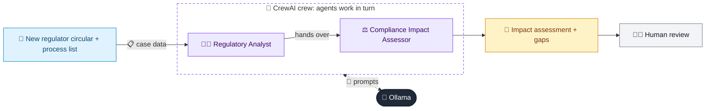

# 21 · Regulatory Change Impact Analyzer

  

**Industry:** 🏦 Banking · **Category:** 📜 Regulatory & Risk Reporting

## 🏦 The business problem (new to banking? start here)

**In the business today:** Regulators publish new rules constantly. Compliance must work out what each new rule requires, which teams and systems are affected, and what must change by the deadline.

**Who does this work:** Compliance and regulatory change management teams.

**Why it's hard:** Legal text is dense, and missing one obligation can lead to enforcement action.

### Key terms
- **Regulatory circular**: A notice from a regulator introducing new rules that banks must implement by a deadline.
- **Regulatory reporting**: Regular returns banks must send to their regulator (capital, liquidity, large exposures...). Errors can mean fines.

More terms: [Banking Primer & glossary](../PRIMER.md#glossary)

---

## 🤖 What the AI does
Reads a new regulatory circular and maps obligations to impacted business units and controls.

### How it works
Regulatory Analyst agent extracts obligations; Compliance Impact agent maps them to the bank's process inventory and gaps.



<sub>🟦 data · 🟩 Python: maths & rules (auditable) · 🟪 AI: reasoning & writing · ⬛ local LLM · 🟨 result</sub>

## 💬 Sample response

Real output from `qwen2.5:7b-instruct` running locally on a laptop. LLM wording changes from run to run; the numbers from
Python stay the same.

<details>
<summary><b>Show the full output</b></summary>

````text
--- Impact assessment ---
### Gap Table

| Obligation | Impacted Unit | Current State | Gap | Action | Owner | Priority (H/M/L) |
|------------|---------------|---------------|-----|--------|--------|------------------|
| 2026/14-1  | Loan Origination System | No APR shown, shows flat interest rate | Does not provide all-in APR | Update Loan Origination System to include all-in APR | IT & Product Teams | H |
| 2026/14-2  | Retail Lending, Loan Origination System | EMI collected via QuickCred's escrow account | Disbursements and repayments flow through third-party accounts | Modify system to ensure direct flow between borrower and lender accounts | IT & Retail Lending Teams | H |
| 2026/14-3  | Product Team | No cooling-off feature | No cooling-off period available | Implement cooling-off feature with no prepayment penalty | Product Team | H |
| 2026/14-4  | Compliance, Customer Service | No nodal grievance redressal officer appointed | No grievance redressal mechanism in place | Appoint nodal grievance redressal officer and update complaint SLA to 30 days | Compliance & Customer Service Teams | H |
| 2026/14-5  | Compliance | No DLA register exists | No record of digital lending apps | Establish and maintain a DLA register for all digital lending apps | Compliance Team | H |

### Executive Summary

1. **Obligation 2026/14-1**: The current Loan Origination System does not provide the Key Fact Statement (KFS) with the all-in annual percentage rate (APR). This needs to be updated to include the APR before contract execution. The IT and Product Teams are responsible for this task, and it is a high priority.

2. **Obligation 2026/14-2**: The current process allows EMIs to be collected via QuickCred's escrow account, which violates the requirement for disbursements and repayments to flow only between the borrower's and lender's accounts. The IT and Retail Lending Teams must modify the system to ensure direct flow, and this is a high priority.

3. **Obligation 2026/14-3**: The Product Team needs to implement a cooling-off feature with no prepayment penalty to comply with the new cooling-off period requirement. This is a high priority task.

4. **Obligation 2026/14-4**: The Compliance and Customer Service Teams must appoint a nodal grievance redressal officer and update the complaint SLA to 30 days. This is a high priority task.

5. **Obligation 2026/14-5**: The Compliance Team needs to establish and maintain a DLA register for all digital lending apps, including those of LSPs. This is a high priority task.
````

</details>

## Run
```bash
# from the repo root, with Ollama running
python 01_banking/21_regulatory_change_tracker/app.py
```

## Customize
- Replace the sample data at the top of `app.py` with your own data source (CSV, database, API).
- Tune thresholds and rules in the Python functions. These are the auditable part of the solution.
- Change the model with `OLLAMA_MODEL` (see the root [README](../../README.md#-model-recommendations)).

> Sample data is fictional; calculations are simplified for learning.

[⬅ Back to Banking use cases](../README.md#-use-cases) · [All industries](../../README.md)
