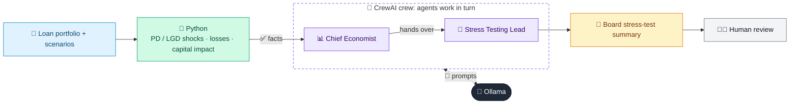

# 22 · Stress Testing Scenario Narrator

  

**Industry:** 🏦 Banking · **Category:** 📜 Regulatory & Risk Reporting

## 🏦 The business problem (new to banking? start here)

**In the business today:** Banks simulate severe recessions to check they would still have enough capital, then explain the results to the board and regulator.

**Who does this work:** Stress testing / ICAAP teams (Risk), economists, the board risk committee.

**Why it's hard:** Results must be turned into a clear story of what breaks, why, and what management would do.

### Key terms
- **Stress testing**: Simulating a severe recession (GDP down, unemployment up) to check the bank would still have enough capital.
- **ICAAP**: Internal Capital Adequacy Assessment Process: the bank's own assessment of the capital it needs, reviewed by the regulator.
- **PD / LGD / EAD**: Probability of Default, Loss Given Default (% lost if default happens) and Exposure at Default (amount owed).
- **Capital ratio**: Capital / RWA. E.g. a CET1 ratio of 12% vs a 7% minimum means 5 percentage points of headroom.

More terms: [Banking Primer & glossary](../PRIMER.md#glossary)

---

## 🤖 What the AI does
Applies macro stress scenarios to a portfolio and writes the stress-test narrative for the board.

### How it works
Python shocks PD/LGD by scenario; an Economist agent describes scenarios and a Risk Reporter agent explains capital impact.



<sub>🟦 data · 🟩 Python: maths & rules (auditable) · 🟪 AI: reasoning & writing · ⬛ local LLM · 🟨 result</sub>

## 💬 Sample conversation

A real recorded run on `qwen2.5:7b-instruct` (local, on a laptop, 33 s). Expand a step to see what happened
behind the answer. LLM wording changes from run to run; the numbers from Python stay the same.

> **👤 You:** Run the stress scenarios on our loan portfolio and write the board summary.

<details><summary>🐍 Python · Stress results</summary>

```json
{
  "Baseline": {
    "macro": {
      "gdp": 2.5,
      "unemployment": 4.5,
      "house_prices": 3
    },
    "losses_by_portfolio": {
      "Residential mortgages": 19,
      "Commercial real estate": 24,
      "SME loans": 81,
      "Large corporate": 67,
      "Credit cards": 90
    },
    "total_credit_loss": 281,
    "cet1_ratio_start": 9.75,
    "cet1_ratio_end": 10.67,
    "hurdle_pct": 7.0
  },
  "Adverse": {
    "macro": {
      "gdp": -1.5,
      "unemployment": 7.5,
      "house_prices": -12
    },
    "losses_by_portfolio": {
      "Residential mortgages": 48,
      "Commercial real estate": 54,
      "SME loans": 180,
      "Large corporate": 151,
      "Credit cards": 191
    },
    "total_credit_loss": 624,
    "cet1_ratio_start": 9.75,
    "cet1_ratio_end": 9.49,
    "hurdle_pct": 7.0
  },
  "Severely adverse": {
    "macro": {
      "gdp": -4.0,
      "unemployment": 10.0,
      "house_prices": -25
    },
    "losses_by_portfolio": {
      "Residential mortgages": 101,
      "Commercial real estate": 105,
      "SME loans": 346,
      "Large corporate": 294,
      "Credit cards": 354
    },
    "total_credit_loss": 1201,
    "cet1_ratio_start": 9.75,
    "cet1_ratio_end": 7.72,
    "hurdle_pct": 7.0
  }
}
```

</details>

<details><summary>🐍 Python · Results table</summary>

| Scenario | Credit loss (m) | CET1 start | CET1 end | vs 7% hurdle |
|---|---|---|---|---|
| Baseline | 281 | 9.75% | 10.67% | PASS |
| Adverse | 624 | 9.75% | 9.49% | PASS |
| Severely adverse | 1,201 | 9.75% | 7.72% | PASS |

</details>

<details><summary>📊 Chief Economist (agent)</summary>

### Scenario Narratives and Transmission Channels

#### Baseline Scenario

**Narrative:**
The baseline scenario represents a stable economic environment with moderate growth. The GDP is expected to grow by 2.5%, unemployment is projected to remain at 4.5%, and house prices are anticipated to appreciate by 3%. This scenario is generally favorable for most sectors of the economy, but it also implies a relatively low level of stress on bank portfolios.

**Transmission Channels:**
- **Residential Mortgages:** With stable economic conditions, borrowers are likely to maintain their ability to repay, leading to lower default rates and manageable losses.
- **Commercial Real Estate:** The steady economic growth supports commercial real estate values, reducing the risk of significant losses.
- **SME Loans:** Small and medium-sized enterprises (SMEs) benefit from a stable economy, which translates to lower default rates and manageable credit losses.
- **Large Corporate:** Larger companies are better positioned to weather economic fluctuations, resulting in lower credit losses.
- **Credit Cards:** Consumer spending remains steady, leading to lower delinquencies and credit losses.

#### Adverse Scenario

**Narrative:**
The adverse scenario depicts a more challenging economic environment with a negative GDP growth of -1.5%, an increase in unemployment to 7.5%, and a significant decline in house prices by 12%. This scenario reflects a downturn in the economy, affecting various sectors and potentially leading to higher credit losses.

**Transmission Channels:**
- **Residential Mortgages:** Higher unemployment and lower house prices can lead to increased delinquencies and defaults among homeowners, resulting in higher credit losses.
- **Commercial Real Estate:** The decline in economic activity can negatively impact commercial real estate values, leading to higher losses for banks holding such loans.
- **SME Loans:** SMEs may struggle with reduced sales and cash flow, leading to higher default rates and credit losses.
- **Large Corporate:** Larger companies may also face challenges, but they are generally better capitalized and can weather the downturn, leading to lower credit losses compared to SMEs.
- **Credit Cards:** Consumer spending may decline, leading to higher delinquencies and credit losses.

#### Severely Adverse Scenario

**Narrative:**
The severely adverse scenario represents a severe economic downturn with a negative GDP growth of -4.0%, a significant increase in unemployment to 10.0%, and a dramatic decline in house prices by 25%. This scenario is the most challenging and reflects a deep recession, leading to substantial credit losses across all portfolios.

**Transmission Channels:**
- **Residential Mortgages:** The combination of high unemployment and significant house price declines can lead to a high number of defaults and foreclosures, resulting in the highest credit losses in this scenario.
- **Commercial Real Estate:** The severe economic downturn can lead to a collapse in commercial real estate values, resulting in the highest credit losses in this portfolio.
- **SME Loans:** SMEs are likely to face severe financial distress, leading to the highest default rates and credit losses.
- **Large Corporate:** While larger companies may have more resources, the severe downturn can still lead to significant credit losses, especially in industries heavily impacted by the recession.
- **Credit Cards:** Consumer spending may collapse, leading to the highest delinquencies and credit losses.

### Summary

- **Baseline Scenario:** Represents a stable economic environment with moderate growth, leading to manageable credit losses across all portfolios.
- **Adverse Scenario:** Reflects a downturn in the economy with negative GDP growth, higher unemployment, and declining house prices, leading to increased credit losses, particularly in residential mortgages and commercial real estate.
- **Severely Adverse Scenario:** Represents a severe economic downturn with significant negative GDP growth, high unemployment, and dramatic declines in house prices, leading to the highest credit losses across all portfolios, with residential mortgages and commercial real estate being the most affected.

</details>

**🦙 Ollama:**

### Key Messages

The stress testing results for our bank under various economic scenarios indicate that our capital adequacy remains robust, with all scenarios passing the 7% CET1 capital adequacy ratio hurdle. The baseline scenario, representing a stable economic environment, shows a credit loss of 281 million, resulting in a CET1 ratio of 10.67%. The adverse scenario, reflecting a downturn in the economy, results in a credit loss of 624 million, leading to a CET1 ratio of 9.49%. The severely adverse scenario, representing a severe economic downturn, results in a credit loss of 1,201 million, with a CET1 ratio of 7.72%.

### Most Vulnerable Portfolios

The stress testing results highlight that certain portfolios are more vulnerable to economic downturns. In the adverse scenario, the residential mortgages and commercial real estate portfolios are the most affected, with credit losses of 48 million and 54 million, respectively. In the severely adverse scenario, the residential mortgages and commercial real estate portfolios experience the highest credit losses, amounting to 101 million and 105 million, respectively. These portfolios are particularly sensitive to economic downturns, as evidenced by their significant credit losses.

### Management Actions

To address the vulnerabilities identified in the stress testing results, the following management actions are proposed:

1. **Capital Management:**
   - **Baseline and Adverse Scenarios:** Maintain the current capital buffer to ensure a CET1 ratio of at least 10.67% and 9.49%, respectively. This buffer will provide a cushion against potential credit losses.
   - **Severely Adverse Scenario:** Increase the capital buffer to ensure a CET1 ratio of at least 7.72%. This may involve raising additional capital through equity issuances or reducing dividends to preserve capital.

2. **Risk Appetite:**
   - Review and adjust the risk appetite framework to ensure it aligns with the bank's ability to withstand severe economic downturns. This may involve tightening underwriting standards and reducing exposure to high-risk portfolios.

3. **Hedging Strategies:**
   - Implement hedging strategies to mitigate the impact of economic downturns. This could include interest rate swaps, credit default swaps, and other financial instruments to manage credit risk.

4. **Portfolio Diversification:**
   - Diversify the loan portfolio to reduce concentration risk. This could involve increasing the proportion of low-risk portfolios and reducing exposure to high-risk sectors such as residential mortgages and commercial real estate.

5. **Stress Testing Frequency and Rigor:**
   - Increase the frequency and rigor of stress testing to ensure that the bank is adequately prepared for various economic scenarios. This will help in identifying potential risks early and taking proactive measures to mitigate them.

By implementing these management actions, we can ensure that our bank remains resilient and well-capitalized to withstand potential economic downturns, thereby protecting our financial stability and meeting regulatory requirements.


## Run
```bash
# from the repo root, with Ollama running
python 01_banking/22_stress_testing_narrator/app.py
```

## Customize
- Replace the sample data at the top of `app.py` with your own data source (CSV, database, API).
- Tune thresholds and rules in the Python functions. These are the auditable part of the solution.
- Change the model with `OLLAMA_MODEL` (see the root [README](../../README.md#-model-recommendations)).

> Sample data is fictional; calculations are simplified for learning.

[⬅ Back to Banking use cases](../README.md#-use-cases) · [All industries](../../README.md)
