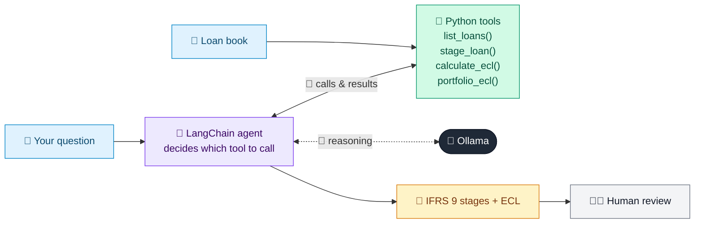

# 23 · IFRS 9 ECL Calculator & Explainer

  

**Industry:** 🏦 Banking · **Category:** 📜 Regulatory & Risk Reporting

## 🏦 The business problem (new to banking? start here)

**In the business today:** Under IFRS 9, banks set aside provisions for loans they expect to go bad, based on each loan's stage and probability of default.

**Who does this work:** Credit risk / impairment team and Finance.

**Why it's hard:** Provisions directly hit profit; auditors challenge every staging decision and number.

### Key terms
- **IFRS 9**: The accounting standard that makes banks set aside provisions for expected (not just actual) loan losses.
- **ECL (Expected Credit Loss)**: The loss a bank expects on a loan: PD x LGD x EAD. Booked as a provision in the accounts.
- **PD / LGD / EAD**: Probability of Default, Loss Given Default (% lost if default happens) and Exposure at Default (amount owed).
- **IFRS 9 stages**: Stage 1 performing (12-month ECL), Stage 2 significant increase in credit risk (lifetime ECL), Stage 3 credit-impaired.
- **SICR**: Significant Increase in Credit Risk since the loan was made. Moves a loan from Stage 1 to Stage 2.

More terms: [Banking Primer & glossary](../PRIMER.md#glossary)

---

## 🤖 What the AI does
Stages loans (1/2/3) and calculates expected credit loss, then explains drivers.

### How it works
Agent calls `stage_loan` and `calculate_ecl` tools; explains SICR triggers and 12-month vs. lifetime ECL.



<sub>🟦 data · 🟩 Python: maths & rules (auditable) · 🟪 AI: reasoning & writing · ⬛ local LLM · 🟨 result</sub>

## 💬 Sample response

Real output from `qwen2.5:7b-instruct` running locally on a laptop. LLM wording changes from run to run; the numbers from
Python stay the same.

<details>
<summary><b>Show the full output</b></summary>

````text
--- Question ---
Calculate the ECL for the whole portfolio and explain it.


--- Answer ---
Here is the table summarizing the ECL for each loan in the portfolio, along with the total ECL and coverage percentage:

| Loan | Stage | Triggers | ECL (€) | Coverage % |
|------|-------|----------|--------|-----------|
| LN-1 | 1     | No SICR  | 1,750  | 0.35%     |
| LN-2 | 2     | >30 DPD backstop, PD increased >=2.5x since origination (SICR) | 18,000 | 7.20%     |
| LN-3 | 2     | PD increased >=2.5x since origination (SICR), On credit watchlist | 43,200 | 5.40%     |
| LN-4 | 3     | Credit-impaired: >90 DPD / default | 72,000 | 60.00%    |

**Total ECL for the Portfolio: 134,950 €**

### Explanation of 12-Month vs Lifetime ECL

- **12-Month ECL**: This is the expected credit loss over the next 12 months. It is calculated using the 12-month probability of default (PD) for Stage 1 loans. For Stage 2 and Stage 3 loans, the 12-month PD is used as a proxy for the lifetime PD, as the full lifetime PD is not yet realized.
  
- **Lifetime ECL**: This is the total expected credit loss over the entire life of the loan. For Stage 2 and Stage 3 loans, the lifetime PD is used, which reflects the full extent of the expected credit loss over the loan's remaining life.

### Main Drivers

- **Probability of Default (PD)**: The higher the PD, the greater the expected credit loss. Loans in Stage 3 (credit-impaired) have the highest PD, leading to the highest ECL.
  
- **Loss Given Default (LGD)**: This represents the percentage of the exposure at default that is expected to be lost. Higher LGD values increase the ECL.
  
- **Exposure at Default (EAD)**: This is the total amount of credit exposure at the time of default. Larger EAD values result in higher ECL.

In summary, the total ECL of 134,950 € is driven by the combination of high PD, LGD, and EAD for the loans in Stages 2 and 3, with the largest contribution coming from LN-4, which is in Stage 3. The coverage percentages indicate the extent to which the provisions cover the expected credit losses, with LN-4 having the highest coverage due to its high ECL.
````

</details>

## Run
```bash
# from the repo root, with Ollama running
python 01_banking/23_ifrs9_ecl_calculator/app.py
```

## Customize
- Replace the sample data at the top of `app.py` with your own data source (CSV, database, API).
- Tune thresholds and rules in the Python functions. These are the auditable part of the solution.
- Change the model with `OLLAMA_MODEL` (see the root [README](../../README.md#-model-recommendations)).

> Sample data is fictional; calculations are simplified for learning.

[⬅ Back to Banking use cases](../README.md#-use-cases) · [All industries](../../README.md)
