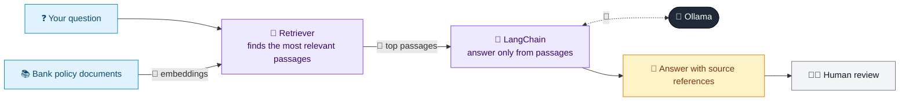

# 24 · Bank Policy & Procedure Q&A (RAG)

  

**Industry:** 🏦 Banking · **Category:** 📜 Regulatory & Risk Reporting

## 🏦 The business problem (new to banking? start here)

**In the business today:** Bank staff constantly need answers from long internal policy manuals: 'can I approve this?', 'what do I do with this cash deposit?'.

**Who does this work:** Front-line staff, operations and compliance (as the help desk).

**Why it's hard:** Policies are long and scattered; wrong answers lead to breaches; compliance teams answer the same questions repeatedly.

### Key terms
- **KYC (Know Your Customer)**: Verifying who a customer is (ID, address) and understanding what they do, before and during the relationship.
- **PEP**: Politically Exposed Person: someone with a prominent public role (or their family/associates). Higher bribery and corruption risk, so EDD is required.
- **CTR (Currency Transaction Report)**: A report banks file for large cash transactions (e.g. 10,000 or more).
- **Structuring (smurfing)**: Splitting cash deposits into amounts just under a reporting threshold to avoid triggering a report. Itself an offence.

More terms: [Banking Primer & glossary](../PRIMER.md#glossary)

---

## 🤖 What the AI does
Answers staff questions from internal credit, KYC and operations policies with citations.

### How it works
Policy snippets are embedded with Ollama embeddings, retrieved by similarity and answered with source references.



<sub>🟦 data · 🟩 Python: maths & rules (auditable) · 🟪 AI: reasoning & writing · ⬛ local LLM · 🟨 result</sub>

## 💬 Sample conversation

A real recorded run on `qwen2.5:7b-instruct` (local, on a laptop, 10 s). Expand a step to see what happened
behind the answer. LLM wording changes from run to run; the numbers from Python stay the same.

> **👤 You:** Do I need senior approval to onboard a PEP, and how often must we review them?

**🦙 Ollama:**

Yes, you need senior approval (Head of Compliance) to onboard a PEP. PEPs require Enhanced Due Diligence, source of wealth verification, and approval by senior management before onboarding [KYC Policy 3.4]. Their periodic KYC review should be conducted annually [KYC Policy 5.1].

---

> **👤 You:** A customer deposited 9,900 cash three days in a row. What should I do?

**🦙 Ollama:**

No action is required as the transactions do not meet the threshold of 10,000 for reporting. However, monitor the activity for any suspicious behavior. If you have concerns, escalate to the Money Laundering Reporting Officer (MLRO) as per [Ops Manual 2.8].

---

> **👤 You:** What is the maximum personal loan for someone earning 4,000 net per month?

**🦙 Ollama:**

The maximum personal loan for someone earning 4,000 net per month is 80,000 (20x net monthly income). [Credit Policy 4.2]


## Run
```bash
# from the repo root, with Ollama running
python 01_banking/24_policy_qa_rag/app.py
```

## Customize
- Replace the sample data at the top of `app.py` with your own data source (CSV, database, API).
- Tune thresholds and rules in the Python functions. These are the auditable part of the solution.
- Change the model with `OLLAMA_MODEL` (see the root [README](../../README.md#-model-recommendations)).

> Sample data is fictional; calculations are simplified for learning.

[⬅ Back to Banking use cases](../README.md#-use-cases) · [All industries](../../README.md)
