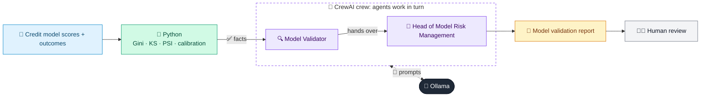

# 25 · Model Risk Validation Assistant

  

**Industry:** 🏦 Banking · **Category:** 📜 Regulatory & Risk Reporting

## 🏦 The business problem (new to banking? start here)

**In the business today:** Banks use statistical models (e.g. credit scores) to make decisions. An independent team must test each model regularly and report whether it still works.

**Who does this work:** Model validation / Model Risk Management team.

**Why it's hard:** Validation reports are long and technical; findings must be rated and explained to non-specialists.

### Key terms
- **Model risk**: The risk of losses from a model that is wrong or misused. Regulators (e.g. SR 11-7) require independent model validation.
- **Gini / KS / PSI**: Model metrics: Gini and KS measure how well a score separates good and bad customers; PSI measures how much the population has shifted.
- **PD / LGD / EAD**: Probability of Default, Loss Given Default (% lost if default happens) and Exposure at Default (amount owed).

More terms: [Banking Primer & glossary](../PRIMER.md#glossary)

---

## 🤖 What the AI does
Reviews a credit model's performance metrics and drafts an SR 11-7 style validation report.

### How it works
Python computes Gini, KS, PSI and calibration; Model Validator and MRM Reviewer agents write findings and ratings.



<sub>🟦 data · 🟩 Python: maths & rules (auditable) · 🟪 AI: reasoning & writing · ⬛ local LLM · 🟨 result</sub>

## 💬 Sample conversation

A real recorded run on `qwen2.5:7b-instruct` (local, on a laptop, 33 s). Expand a step to see what happened
behind the answer. LLM wording changes from run to run; the numbers from Python stay the same.

> **👤 You:** Validate our retail credit scorecard: is it still performing well enough to keep using?

<details><summary>🐍 Python · Validation metrics</summary>

```json
{
  "model": "Retail PD Scorecard v3 (logistic regression)",
  "gini_development": 0.588,
  "gini_out_of_time": 0.546,
  "ks_out_of_time": 0.421,
  "psi_dev_vs_oot": 0.135,
  "avg_predicted_pd_oot": 0.11,
  "observed_default_rate_oot": 0.122,
  "thresholds": {
    "gini_min": 0.4,
    "psi_amber": 0.1,
    "psi_red": 0.25,
    "calibration_tolerance_rel": 0.1
  }
}
```

</details>

<details><summary>🐍 Python · Test results (RAG)</summary>

```json
{
  "discrimination (Gini OOT)": "GREEN",
  "stability (PSI)": "AMBER",
  "calibration (predicted vs observed PD)": "GREEN (relative gap 10%)"
}
```

</details>

<details><summary>🔍 Model Validator (agent)</summary>

### Test-by-test Explanation:

1. **Discrimination (Gini OOT): GREEN**
   - **Meaning**: The Gini coefficient for the out-of-time (OOT) data is 0.546, which is above the minimum threshold of 0.4. A Gini coefficient of 0.546 indicates that the model has a good discriminatory power, meaning it can effectively distinguish between defaulters and non-defaulters.
   - **Likely Causes**: The model is performing well in separating the defaulting and non-defaulting retail customers, which is a positive sign. This suggests that the model's predictors are capturing relevant risk factors.

2. **Stability (PSI): AMBER**
   - **Meaning**: The Population Stability Index (PSI) between the development and out-of-time data is 0.135, which is within the amber range (0.1 to 0.25). PSI measures the difference in the distribution of a variable between two datasets.
   - **Likely Causes**: The slight increase in PSI suggests that there might be some changes in the customer base or risk profile over time, but these changes are not significant enough to be considered a major issue. However, it indicates that the model might need to be monitored and potentially recalibrated to ensure it remains effective in the future.

3. **Calibration (Predicted vs Observed PD): GREEN (relative gap 10%)**
   - **Meaning**: The average predicted probability of default (PD) for the out-of-time data is 0.11, and the observed default rate is 0.122. The relative gap between the predicted and observed PD is 10%, which is within the acceptable range.
   - **Likely Causes**: The model's predictions are reasonably close to the actual observed outcomes, indicating that the model is well-calibrated. This suggests that the model's predicted probabilities are reliable and can be used to make informed decisions.

### Summary:
- **Discrimination**: The model is performing well in distinguishing between defaulters and non-defaulters, as indicated by the high Gini coefficient.
- **Stability**: There are minor changes in the customer base, as indicated by the PSI value, but these changes are not significant enough to be classified as red.
- **Calibration**: The model's predictions are well-calibrated, with a relative gap of 10% between the predicted and observed PD, which is within the acceptable range.

These results suggest that the model is performing well overall, but the slight increase in PSI indicates that some monitoring and potential recalibration might be necessary to ensure long-term stability.

</details>

**🦙 Ollama:**

### Validation Report Summary

#### Scope
The validation process for the Retail PD Scorecard v3 (logistic regression) focused on assessing the model's performance in terms of discrimination, stability, and calibration. The validation was conducted using out-of-time (OOT) data to ensure the model's robustness and reliability.

#### Summary of Tests

| Test                  | Result | Gini OOT (Development) | Gini OOT (OOT) | PSI (Development vs OOT) | Avg Predicted PD (OOT) | Observed Default Rate (OOT) | PSI Threshold (Amber) | PSI Threshold (Red) | Calibration Tolerance (Relative) |
|-----------------------|--------|------------------------|----------------|--------------------------|------------------------|-----------------------------|-----------------------|----------------------|----------------------------------|
| Discrimination        | GREEN  | 0.588                  | 0.546          | -                        | -                      | -                           | -                     | -                    | -                                |
| Stability             | AMBER  | -                      | 0.135          | 0.1                      | 0.11                   | 0.122                       | 0.1                   | 0.25                 | 0.1                              |
| Calibration           | GREEN  | -                      | -              | -                        | -                      | -                           | -                     | -                    | 10%                              |

#### Findings with Severity and Remediation

1. **Discrimination (Gini OOT): GREEN**
   - **Meaning**: The Gini coefficient for the out-of-time (OOT) data is 0.546, which is above the minimum threshold of 0.4.
   - **Likely Causes**: The model is performing well in distinguishing between defaulters and non-defaulters.
   - **Remediation**: No immediate action required. Continue to monitor the model's performance.

2. **Stability (PSI): AMBER**
   - **Meaning**: The Population Stability Index (PSI) between the development and out-of-time data is 0.135, which is within the amber range (0.1 to 0.25).
   - **Likely Causes**: There are minor changes in the customer base, but these changes are not significant enough to be classified as red.
   - **Remediation**: Monitor the model's performance over time and consider recalibrating the model if significant changes in the customer base or risk profile are observed.

3. **Calibration (Predicted vs Observed PD): GREEN (relative gap 10%)**
   - **Meaning**: The average predicted probability of default (PD) for the out-of-time data is 0.11, and the observed default rate is 0.122. The relative gap between the predicted and observed PD is 10%, which is within the acceptable range.
   - **Likely Causes**: The model's predictions are reasonably close to the actual observed outcomes, indicating that the model is well-calibrated.
   - **Remediation**: No immediate action required. Continue to monitor the model's calibration.

#### Overall Rating
The overall rating for the Retail PD Scorecard v3 (logistic regression) is **Fit for use with conditions**. The model is performing well in terms of discrimination and calibration, but the slight increase in PSI indicates that some monitoring and potential recalibration might be necessary to ensure long-term stability.

#### Monitoring Recommendations
1. **Regular Monitoring**: Conduct regular out-of-time validation to ensure the model's performance remains consistent.
2. **Customer Base Analysis**: Periodically review the customer base and risk profile to identify any significant changes that may require model recalibration.
3. **Model Recalibration**: Recalibrate the model if significant changes in the customer base or risk profile are observed.
4. **Documentation**: Maintain detailed documentation of the validation process, findings, and any actions taken.

By following these recommendations, the model can continue to provide reliable and accurate predictions for retail PD scoring.


## Run
```bash
# from the repo root, with Ollama running
python 01_banking/25_model_risk_validator/app.py
```

## Customize
- Replace the sample data at the top of `app.py` with your own data source (CSV, database, API).
- Tune thresholds and rules in the Python functions. These are the auditable part of the solution.
- Change the model with `OLLAMA_MODEL` (see the root [README](../../README.md#-model-recommendations)).

> Sample data is fictional; calculations are simplified for learning.

[⬅ Back to Banking use cases](../README.md#-use-cases) · [All industries](../../README.md)
