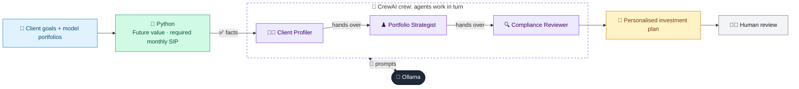

# 26 · AI Wealth Advisor

  

**Industry:** 🏦 Banking · **Category:** 📈 Wealth & Investment Management

## 🏦 The business problem (new to banking? start here)

**In the business today:** Wealth advisers understand a client's goals (education, retirement, a home), assess their risk tolerance, recommend a portfolio and document why it is suitable.

**Who does this work:** Financial advisers / relationship managers, checked by compliance.

**Why it's hard:** Good advice is personal and time-consuming, so it is usually only available to wealthier clients.

### Key terms
- **Wealth management**: Advice and investment services for individuals, from mass affluent to private banking clients.
- **Asset allocation**: How a portfolio is split between asset classes (equity, bonds, gold, cash). The biggest driver of risk and return.
- **Risk profile**: How much investment risk a client is willing and able to take, usually from a questionnaire.
- **Suitability**: The rule that a recommended product must fit the client's risk profile, knowledge, goals and time horizon.
- **SIP**: Systematic Investment Plan: investing a fixed amount every month into a fund.

More terms: [Banking Primer & glossary](../PRIMER.md#glossary)

---

## 🤖 What the AI does
Builds a goals-based investment plan for a client with suitability checks.

### How it works
Client Profiler, Portfolio Strategist and Compliance Reviewer agents collaborate to produce a personalised plan.



<sub>🟦 data · 🟩 Python: maths & rules (auditable) · 🟪 AI: reasoning & writing · ⬛ local LLM · 🟨 result</sub>

## 💬 Sample conversation

A real recorded run on `qwen2.5:7b-instruct` (local, on a laptop, 67 s). Expand a step to see what happened
behind the answer. LLM wording changes from run to run; the numbers from Python stay the same.

> **👤 You:** Arjun and Meera Nair want a plan for their children's education and retirement. What do you recommend?

<details><summary>🐍 Python · Computed facts</summary>

```json
{
  "goals": [
    {
      "goal": "Children's higher education",
      "years": 10,
      "today_cost": 4000000,
      "inflated_cost": 7163391,
      "assumed_return_pct": 10.0,
      "required_monthly_sip": 34970
    },
    {
      "goal": "Retirement corpus",
      "years": 22,
      "today_cost": 30000000,
      "inflated_cost": 108106122,
      "assumed_return_pct": 10.0,
      "required_monthly_sip": 113417
    },
    {
      "goal": "Family vacation home",
      "years": 10,
      "today_cost": 5000000,
      "inflated_cost": 8954238,
      "assumed_return_pct": 10.0,
      "required_monthly_sip": 43712
    }
  ],
  "net_worth": 1500000,
  "est_monthly_investable_surplus_post_tax": 148000,
  "total_required_monthly_sip": 192099,
  "monthly_shortfall": 44099,
  "existing_investable_assets": 5400000,
  "emergency_fund_months": 6.0
}
```

</details>

<details><summary>🧑‍💼 Client Profiler (agent)</summary>

### Client Profile Summary

#### Net Worth
- **Current Net Worth:** The Nairs have a net worth of approximately 15,000,000 INR, considering their assets and liabilities. This includes savings accounts, fixed deposits, equity stocks, employer provident fund, and gold, offset by their outstanding home loan.

#### Cash Flow
- **Annual Household Income:** 60,000,000 INR
- **Monthly Expenses:** 150,000 INR
- **Net Monthly Surplus Post-Tax:** 148,000 INR
- **Total Required Monthly SIP:** 192,099 INR
- **Monthly Shortfall:** 44,099 INR

#### Protection Adequacy
- **Term Life Cover:** The couple has a term life cover of 10,000,000 INR, which is adequate for their family's financial needs, especially considering their children and retirement goals.
- **Health Cover:** They have a health cover of 1,000,000 INR, which is a good starting point but may need to be reviewed for adequacy, especially if they have any pre-existing conditions or higher medical needs.
- **Emergency Fund:** The emergency fund is sufficient to cover 6 months of expenses, which is a good buffer but may need to be increased to 3-6 months of living expenses for better financial security.

#### Risk Capacity vs. Tolerance
- **Risk Questionnaire Score:** The score of 62 indicates a moderate risk tolerance, suggesting that the couple is comfortable with some level of risk in their investment portfolio.
- **Investment Experience:** They have 5 years of experience in direct equity and mutual funds, which suggests a moderate to higher risk tolerance.
- **Preferences:** They prefer low-cost index funds and avoid tobacco/alcohol companies, indicating a preference for socially responsible investments. This aligns with their moderate risk tolerance and ethical considerations.

#### Summary
- **Net Worth:** The Nairs have a substantial net worth, but their current investment strategy may not be sufficient to meet their long-term financial goals.
- **Cash Flow:** They have a monthly surplus, but the shortfall in their savings plan indicates a need for better allocation of their investable surplus.
- **Protection Adequacy:** Their current insurance coverage is adequate but may need to be reviewed for any gaps, especially in health insurance.
- **Risk Capacity vs. Tolerance:** Their moderate risk tolerance aligns with their investment experience, but they may need to consider a more diversified portfolio to meet their goals, especially for their children's education and retirement.

### Recommendations
1. **Increase Monthly Savings:** The couple should aim to increase their monthly savings to bridge the shortfall of 44,099 INR. This could be achieved by either increasing their monthly surplus or reallocating their existing investments.
2. **Review Insurance Coverage:** Consider reviewing and possibly increasing their health insurance coverage to ensure it meets their family's needs.
3. **Diversify Investments:** Given their moderate risk tolerance, they should consider a more diversified investment portfolio that includes a mix of equity, debt, and alternative investments to better align with their risk capacity.
4. **Emergency Fund:** Consider increasing their emergency fund to a more standard 3-6 months of living expenses for better financial security.
5. **Regular Reviews:** Regularly review their financial plan to ensure it remains aligned with their changing goals and circumstances.

</details>

<details><summary>♟️ Portfolio Strategist (agent)</summary>

### Prioritised Goal-wise Plan with Allocations

Given the computed figures and the client's profile, the following prioritised plan and allocations are recommended:

#### 1. **Retirement Corpus**
   - **Years:** 22
   - **Inflated Cost:** 108,106,122 INR
   - **Required Monthly SIP:** 113,417 INR
   - **Allocated Portfolio:** Moderate (40-65)
   - **Allocation:** 
     - **Equity:** 50%
     - **Debt:** 35%
     - **Gold:** 10%
     - **Cash:** 5%
   - **Explanation:** The retirement corpus is the most critical long-term goal and requires a higher allocation to equity to meet the required return of 10%.

#### 2. **Children's Higher Education**
   - **Years:** 10
   - **Inflated Cost:** 7,163,391 INR
   - **Required Monthly SIP:** 34,970 INR
   - **Allocated Portfolio:** Conservative (score <40)
   - **Allocation:** 
     - **Equity:** 25%
     - **Debt:** 60%
     - **Gold:** 10%
     - **Cash:** 5%
   - **Explanation:** The children's education goal is a shorter-term goal and can be allocated to a more conservative portfolio to preserve capital.

#### 3. **Family Vacation Home**
   - **Years:** 10
   - **Inflated Cost:** 8,954,238 INR
   - **Required Monthly SIP:** 43,712 INR
   - **Allocated Portfolio:** Conservative (score <40)
   - **Allocation:** 
     - **Equity:** 25%
     - **Debt:** 60%
     - **Gold:** 10%
     - **Cash:** 5%
   - **Explanation:** The vacation home goal is also a shorter-term goal and can be allocated to a more conservative portfolio to ensure capital preservation.

### Immediate Actions

1. **Increase Monthly Savings:**
   - **Current Monthly Surplus:** 148,000 INR
   - **Required Monthly SIP:** 192,099 INR
   - **Shortfall:** 44,099 INR
   - **Action:** The couple should aim to increase their monthly savings by 44,099 INR. This can be achieved by either increasing their monthly surplus or reallocating their existing investments.

2. **Review Insurance Coverage:**
   - **Current Term Life Cover:** 10,000,000 INR
   - **Current Health Cover:** 1,000,000 INR
   - **Action:** Consider reviewing and possibly increasing their health insurance coverage to ensure it meets their family's needs.

3. **Diversify Investments:**
   - **Current Portfolio:** The existing portfolio should be diversified to include a mix of equity, debt, and gold to better align with their moderate risk tolerance.
   - **Action:** Reallocate the existing investments to the recommended allocations for each goal.

4. **Emergency Fund:**
   - **Current Emergency Fund:** 6 months of expenses (900,000 INR)
   - **Recommended Emergency Fund:** 3-6 months of living expenses (1,500,000 - 3,000,000 INR)
   - **Action:** Increase the emergency fund to a more standard 3-6 months of living expenses for better financial security.

5. **Regular Reviews:**
   - **Frequency:** Review the financial plan annually or whenever there are significant changes in the client's circumstances.
   - **Action:** Schedule regular reviews to ensure the plan remains aligned with the client's changing goals and circumstances.

### Summary of Allocations

- **Retirement Corpus:**
  - **Equity:** 50%
  - **Debt:** 35%
  - **Gold:** 10%
  - **Cash:** 5%

- **Children's Higher Education:**
  - **Equity:** 25%
  - **Debt:** 60%
  - **Gold:** 10%
  - **Cash:** 5%

- **Family Vacation Home:**
  - **Equity:** 25%
  - **Debt:** 60%
  - **Gold:** 10%
  - **Cash:** 5%

By following this prioritised plan and making the recommended adjustments, the Nairs can better align their investments with their financial goals and ensure a more secure financial future.

</details>

**🦙 Ollama:**

### Client-Ready Advice Letter

#### Summary

Dear [Client's Name],

We are pleased to provide you with our comprehensive financial advice based on your current profile and goals. Our analysis indicates that while you have a substantial net worth, there is a need to optimize your investment strategy to meet your long-term financial goals. Below, we outline a detailed plan to address your key financial objectives.

#### Plan Per Goal

1. **Retirement Corpus**
   - **Years:** 22
   - **Inflated Cost:** 108,106,122 INR
   - **Required Monthly SIP:** 113,417 INR
   - **Allocated Portfolio:** Moderate (40-65%)
   - **Allocation:**
     - **Equity:** 50%
     - **Debt:** 35%
     - **Gold:** 10%
     - **Cash:** 5%
   - **Explanation:** The retirement corpus is the most critical long-term goal and requires a higher allocation to equity to meet the required return of 10%.

2. **Children's Higher Education**
   - **Years:** 10
   - **Inflated Cost:** 7,163,391 INR
   - **Required Monthly SIP:** 34,970 INR
   - **Allocated Portfolio:** Conservative (score <40%)
   - **Allocation:**
     - **Equity:** 25%
     - **Debt:** 60%
     - **Gold:** 10%
     - **Cash:** 5%
   - **Explanation:** The children's education goal is a shorter-term goal and can be allocated to a more conservative portfolio to preserve capital.

3. **Family Vacation Home**
   - **Years:** 10
   - **Inflated Cost:** 8,954,238 INR
   - **Required Monthly SIP:** 43,712 INR
   - **Allocated Portfolio:** Conservative (score <40%)
   - **Allocation:**
     - **Equity:** 25%
     - **Debt:** 60%
     - **Gold:** 10%
     - **Cash:** 5%
   - **Explanation:** The vacation home goal is also a shorter-term goal and can be allocated to a more conservative portfolio to ensure capital preservation.

#### Actions

1. **Increase Monthly Savings:**
   - **Current Monthly Surplus:** 148,000 INR
   - **Required Monthly SIP:** 192,099 INR
   - **Shortfall:** 44,099 INR
   - **Action:** The couple should aim to increase their monthly savings by 44,099 INR. This can be achieved by either increasing their monthly surplus or reallocating their existing investments.

2. **Review Insurance Coverage:**
   - **Current Term Life Cover:** 10,000,000 INR
   - **Current Health Cover:** 1,000,000 INR
   - **Action:** Consider reviewing and possibly increasing your health insurance coverage to ensure it meets your family's needs.

3. **Diversify Investments:**
   - **Current Portfolio:** The existing portfolio should be diversified to include a mix of equity, debt, and gold to better align with your moderate risk tolerance.
   - **Action:** Reallocate the existing investments to the recommended allocations for each goal.

4. **Emergency Fund:**
   - **Current Emergency Fund:** 6 months of expenses (900,000 INR)
   - **Recommended Emergency Fund:** 3-6 months of living expenses (1,500,000 - 3,000,000 INR)
   - **Action:** Increase the emergency fund to a more standard 3-6 months of living expenses for better financial security.

5. **Regular Reviews:**
   - **Frequency:** Review the financial plan annually or whenever there are significant changes in your circumstances.
   - **Action:** Schedule regular reviews to ensure the plan remains aligned with your changing goals and circumstances.

#### Risks & Disclaimers

- **Risk of Market Fluctuations:** The value of investments can fluctuate, and you may not get back the full amount invested. The returns on your investments are not guaranteed.
- **Risk of Inflation:** Inflation can erode the purchasing power of your savings over time, potentially reducing the real value of your investments.
- **Risk of Illiquidity:** Some investments may be illiquid, meaning they cannot be sold quickly without a significant loss in value.
- **Risk of Unforeseen Circumstances:** There is a risk of unforeseen circumstances such as health issues, job loss, or other personal or economic events that could impact your financial plan.

We recommend that you carefully consider these risks and ensure that your investment strategy is aligned with your risk tolerance and financial goals. If you have any questions or need further clarification, please do not hesitate to contact us.

Best regards,

[Your Name]  
[Your Title]  
[Your Contact Information]  
[Date]

---

This advice letter is designed to be clear, balanced, and properly disclosed, ensuring that the client understands the potential risks and the steps required to achieve their financial goals.


## Run
```bash
# from the repo root, with Ollama running
python 01_banking/26_wealth_advisor_agent/app.py
```

## Customize
- Replace the sample data at the top of `app.py` with your own data source (CSV, database, API).
- Tune thresholds and rules in the Python functions. These are the auditable part of the solution.
- Change the model with `OLLAMA_MODEL` (see the root [README](../../README.md#-model-recommendations)).

> Sample data is fictional; calculations are simplified for learning.

[⬅ Back to Banking use cases](../README.md#-use-cases) · [All industries](../../README.md)
