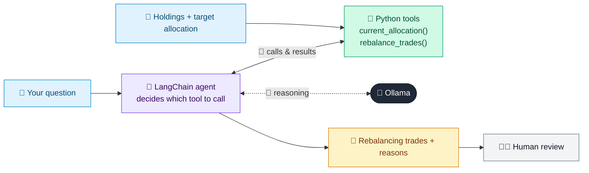

# 27 · Portfolio Rebalancing Agent

  

**Industry:** 🏦 Banking · **Category:** 📈 Wealth & Investment Management

## 🏦 The business problem (new to banking? start here)

**In the business today:** Markets move, so a client's portfolio drifts away from its agreed mix (e.g. too much in equities after a rally). Advisers rebalance by selling some winners and buying underweight assets, minding taxes.

**Who does this work:** Portfolio managers and advisers.

**Why it's hard:** Rebalancing too little lets risk creep up; doing it carelessly triggers unnecessary taxes and costs.

### Key terms
- **Rebalancing**: Buying and selling to bring a portfolio back to its target allocation after markets move it.
- **Asset allocation**: How a portfolio is split between asset classes (equity, bonds, gold, cash). The biggest driver of risk and return.
- **Capital gains tax**: Tax on profit from selling an investment. Often lower for long-term holdings, so trade timing matters.

More terms: [Banking Primer & glossary](../PRIMER.md#glossary)

---

## 🤖 What the AI does
Detects drift from target allocation and proposes tax-aware rebalancing trades.

### How it works
Agent uses `current_allocation` and `rebalance_trades` tools and explains each trade.



<sub>🟦 data · 🟩 Python: maths & rules (auditable) · 🟪 AI: reasoning & writing · ⬛ local LLM · 🟨 result</sub>

## 💬 Sample response

Real output from `qwen2.5:7b-instruct` running locally on a laptop. LLM wording changes from run to run; the numbers from
Python stay the same.

<details>
<summary><b>Show the full output</b></summary>

````text
--- Recommendation ---
Based on the current allocation, we need to rebalance the portfolio to align with the target weights. Here's the drift analysis:

1. **US Equity**: Current weight is 68.5%, which is 23.5 percentage points (pp) higher than the target of 45%. This class is significantly over-weighted.
2. **Intl Equity**: Current weight is 11.0%, which is 9.0 pp lower than the target of 20%. This class is under-weighted.
3. **Bonds**: Current weight is 10.8%, which is 14.2 pp lower than the target of 25%. This class is under-weighted.
4. **REITs**: Current weight is 4.5%, which is 0.5 pp lower than the target of 5%. This class is slightly under-weighted.
5. **Cash**: Current weight is 5.2%, which is 0.2 pp higher than the target of 5%. This class is slightly over-weighted.

To rebalance, we will call the `rebalance_trades` function to determine the exact trades needed. This will ensure we make the necessary adjustments without inventing trade amounts or tax outcomes.

Let's proceed with the rebalance.


To rebalance the portfolio, the following trades are recommended:

1. **Sell VTI (US Equity)**
   - **Action**: SELL
   - **Amount**: $41,098
   - **Units**: 144.2
   - **Estimated Gain**: $13,700 (long-term capital gain)
   - **Reason**: To reduce the weight of US Equity from 68.5% to 45%.

2. **Buy VXUS (Intl Equity)**
   - **Action**: BUY
   - **Amount**: $15,734
   - **Units**: 245.8
   - **Reason**: To increase the weight of Intl Equity from 11.0% to 20%.

3. **Buy BND (Bonds)**
   - **Action**: BUY
   - **Amount**: $24,818
   - **Units**: 342.3
   - **Reason**: To increase the weight of Bonds from 10.8% to 25%.

4. **Buy VNQ (REITs)**
   - **Action**: BUY
   - **Amount**: $814
   - **Units**: 9.2
   - **Reason**: To increase the weight of REITs from 4.5% to 5%.

These trades will help to bring the portfolio back to the target allocation. The estimated gain from selling VTI is a long-term capital gain, which is generally more favorable for tax purposes.

To avoid selling more than necessary, consider using cash or new contributions to reduce the selling amount. For example, you could use $9,000 of your cash holdings to offset some of the VTI sell order.

### Client Summary
Your portfolio is currently over-weighted in US Equity and under-weighted in Intl Equity, Bonds, and REITs. The rebalance will involve selling US Equity (VTI) and buying Intl Equity (VXUS), Bonds (BND), and REITs (VNQ). The estimated gain from the sale of VTI is a long-term capital gain, which is beneficial for tax purposes. Consider using cash or new contributions to minimize the selling amount.
````

</details>

## Run
```bash
# from the repo root, with Ollama running
python 01_banking/27_portfolio_rebalancer/app.py
```

## Customize
- Replace the sample data at the top of `app.py` with your own data source (CSV, database, API).
- Tune thresholds and rules in the Python functions. These are the auditable part of the solution.
- Change the model with `OLLAMA_MODEL` (see the root [README](../../README.md#-model-recommendations)).

> Sample data is fictional; calculations are simplified for learning.

[⬅ Back to Banking use cases](../README.md#-use-cases) · [All industries](../../README.md)
