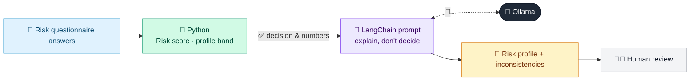

# 28 · Investor Risk Profiling Agent

  

**Industry:** 🏦 Banking · **Category:** 📈 Wealth & Investment Management

## 🏦 The business problem (new to banking? start here)

**In the business today:** Before giving investment advice, banks must assess a client's risk profile, usually through a questionnaire, and explain the result to the client.

**Who does this work:** Advisers / RMs.

**Why it's hard:** Answers are often contradictory (e.g. wants high growth but cannot tolerate losses), and these need a conversation.

### Key terms
- **Risk profile**: How much investment risk a client is willing and able to take, usually from a questionnaire.
- **Suitability**: The rule that a recommended product must fit the client's risk profile, knowledge, goals and time horizon.

More terms: [Banking Primer & glossary](../PRIMER.md#glossary)

---

## 🤖 What the AI does
Scores a risk questionnaire and explains the resulting risk profile to the client.

### How it works
Questionnaire answers are scored in Python; the LLM writes a profile summary and flags inconsistencies.



<sub>🟦 data · 🟩 Python: maths & rules (auditable) · 🟪 AI: reasoning & writing · ⬛ local LLM · 🟨 result</sub>

## 💬 Sample response

Real output from `qwen2.5:7b-instruct` running locally on a laptop. LLM wording changes from run to run; the numbers from
Python stay the same.

<details>
<summary><b>Show the full output</b></summary>

````text
--- Score ---
{
  "points": {
    "Investment horizon": 5,
    "Reaction to a 20% portfolio fall": 1,
    "Primary objective": 5,
    "Investment experience": 2,
    "Share of savings being invested": 1,
    "Income stability": 5
  },
  "score_pct": 54,
  "profile": "Moderate",
  "inconsistencies": [
    "Wants maximum growth but would sell everything after a 20% fall",
    "Aggressive objective with limited investment experience"
  ]
}


--- Client explanation ---
Based on your responses, your risk profile is moderate. You have a long-term investment horizon and want maximum growth, which is great for potential long-term gains. However, you would sell everything if your portfolio drops by 20%, which is quite cautious. Given your limited investment experience, this reaction seems inconsistent with your growth objective.

To better understand your risk tolerance, let's discuss a few things:

1. **Why would you sell everything if your portfolio drops by 20%?** Is there a specific reason for this reaction?
2. **How do you feel about volatility in your investments?** Understanding your comfort level with ups and downs can help tailor a more suitable strategy.
3. **Are there any specific financial goals or concerns you have?** This can help us align your risk profile with your overall financial plan.

Let's chat more to find the right balance for you!
````

</details>

## Run
```bash
# from the repo root, with Ollama running
python 01_banking/28_risk_profiling_agent/app.py
```

## Customize
- Replace the sample data at the top of `app.py` with your own data source (CSV, database, API).
- Tune thresholds and rules in the Python functions. These are the auditable part of the solution.
- Change the model with `OLLAMA_MODEL` (see the root [README](../../README.md#-model-recommendations)).

> Sample data is fictional; calculations are simplified for learning.

[⬅ Back to Banking use cases](../README.md#-use-cases) · [All industries](../../README.md)
