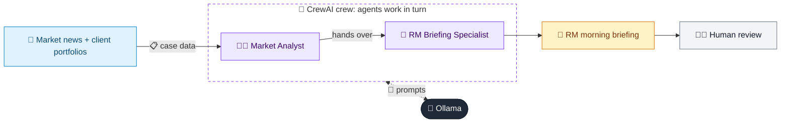

# 29 · Market News Briefing for RMs

  

**Industry:** 🏦 Banking · **Category:** 📈 Wealth & Investment Management

## 🏦 The business problem (new to banking? start here)

**In the business today:** Every morning, relationship managers need to know what happened in markets and which of their clients are affected, so they can call them proactively.

**Who does this work:** Relationship managers, investment strategists.

**Why it's hard:** News volume is huge; linking it to each client's holdings by hand is impossible at scale.

### Key terms
- **Relationship Manager (RM)**: The banker who owns a client relationship and is their main point of contact.
- **Asset allocation**: How a portfolio is split between asset classes (equity, bonds, gold, cash). The biggest driver of risk and return.
- **Guidance**: Management's forecast of future results. Investors watch closely for upgrades, downgrades or softer wording.

More terms: [Banking Primer & glossary](../PRIMER.md#glossary)

---

## 🤖 What the AI does
Summarises market news and maps it to client holdings for relationship managers.

### How it works
Market Analyst agent summarises themes; RM Briefing agent links them to each client's portfolio with talking points.



<sub>🟦 data · 🟩 Python: maths & rules (auditable) · 🟪 AI: reasoning & writing · ⬛ local LLM · 🟨 result</sub>

## 💬 Sample conversation

A real recorded run on `qwen2.5:7b-instruct` (local, on a laptop, 35 s). Expand a step to see what happened
behind the answer. LLM wording changes from run to run; the numbers from Python stay the same.

> **👤 You:** Prepare this morning's market briefing for our relationship managers, with talking points per client.

<details><summary>🧑‍💼 Market Analyst (agent)</summary>

### Theme List with Asset-Class/Sector Impacts

1. **Interest Rate and Inflation Dynamics (Neutral to Positive for Equities, Negative for Bonds)**
   - **Impact on Equities:** Neutral to Positive. The central bank's decision to hold the policy rate at 6.25% and signal one more cut this year suggests a gradual easing of monetary policy, which could support equity markets. However, the exact timing and magnitude of rate cuts are uncertain.
   - **Impact on Bonds:** Negative. The central bank's guidance for a further rate cut could lead to a decline in bond yields, which is generally positive for bond prices. However, if the rate cut is delayed, it could negatively impact bond yields.

2. **Commodity Prices and Sector Performance (Negative for Energy, Positive for Gold)**
   - **Impact on Energy Sector:** Negative. Crude oil's jump of 6% due to supply disruption fears could negatively impact energy stocks, particularly those in the upstream sector. This could also affect airline and paint stocks, which are sensitive to fuel costs.
   - **Impact on Gold:** Positive. Gold's record high on safe-haven demand indicates a shift towards precious metals as a hedge against economic uncertainties, which is positive for gold prices and related ETFs.

3. **Technology and IT Services Sector Outlook (Negative)**
   - **Impact on IT Services Sector:** Negative. IT services majors guiding flat revenue growth and US clients delaying discretionary spend suggests a cautious outlook for the sector. This could lead to reduced earnings expectations and potentially lower stock prices for IT services firms.

4. **Government Policy and Capital Expenditure (Positive for Semiconductors)**
   - **Impact on Semiconductor Manufacturing:** Positive. The government's announcement of a 15% capital subsidy for semiconductor manufacturing could boost investment in the sector, leading to increased capital expenditure and potentially higher stock prices for semiconductor manufacturers.

5. **Yield Curve and Fixed Income Markets (Negative for Bonds)**
   - **Impact on Fixed Income Markets:** Negative. The 10-year government bond yield falling 12 bps to 6.48% after the central bank's rate guidance could indicate a flattening of the yield curve. This is generally negative for long-term bond yields, which could affect bond prices and fixed income portfolios.

### Summary
- **Equities:** Neutral to Positive (Interest Rate and Inflation Dynamics, Government Policy)
- **Bonds:** Negative (Interest Rate and Inflation Dynamics, Yield Curve)
- **Commodities:** Negative (Commodity Prices and Sector Performance), Positive (Gold)
- **IT Services Sector:** Negative (Technology and IT Services Sector Outlook)
- **Semiconductors:** Positive (Government Policy and Capital Expenditure)

</details>

**🦙 Ollama:**

### Per-client Briefing

#### Mr. Kapoor (Retired, Conservative)
**Impact on Holdings:**
- **Equities:** Neutral to Positive. The neutral to positive outlook for equities could benefit Mr. Kapoor's portfolio, especially if the market gains traction.
- **Bonds:** Negative. The negative impact on bond yields could affect the value of his fixed deposits and bond funds.
- **Commodities:** Negative. The negative impact on energy stocks could indirectly affect his holdings in aviation stocks.
- **Gold:** Positive. The positive impact on gold prices could benefit his gold ETF.

**Talking Points:**
1. **Interest Rate and Inflation Dynamics:** The central bank's decision to hold the policy rate and signal one more cut this year could support equity markets, which might benefit his large-cap fund.
2. **Commodity Prices and Sector Performance:** The negative impact on energy stocks due to supply disruption fears could affect his aviation stocks, highlighting the need for diversification.
3. **Gold's Performance:** The positive impact on gold prices could be a hedge against economic uncertainties, supporting his gold ETF.

**Proactive Call Warranted:** Yes. Given the potential impact on his fixed deposits and bond funds, a proactive call could help discuss alternative investment options that might mitigate the negative impact on his bond holdings.

---

#### Ms. Rao (Tech Founder, Aggressive)
**Impact on Holdings:**
- **Equities:** Negative. The negative outlook for the IT services sector could impact her IT services stocks and small-cap fund.
- **Bonds:** Negative. The negative impact on bond yields could affect her cash holdings.
- **Commodities:** Negative. The negative impact on energy stocks could affect her paint stocks.
- **Gold:** Positive. The positive impact on gold prices could benefit her gold ETF.

**Talking Points:**
1. **Technology and IT Services Sector Outlook:** The cautious outlook for the IT services sector could lead to reduced earnings expectations, affecting her IT services stocks and small-cap fund.
2. **Government Policy and Capital Expenditure:** The positive impact on semiconductor manufacturing could benefit her semiconductor theme fund, highlighting the potential for growth in the sector.
3. **Gold's Performance:** The positive impact on gold prices could be a hedge against economic uncertainties, supporting her gold ETF.

**Proactive Call Warranted:** Yes. Given the negative outlook for the IT services sector and the potential impact on her cash holdings, a proactive call could help explore alternative investment opportunities that might better align with her aggressive profile.

---

#### Sharma Family Office (Balanced)
**Impact on Holdings:**
- **Equities:** Neutral to Positive. The neutral to positive outlook for equities could benefit her Nifty index fund and corporate bond fund.
- **Bonds:** Negative. The negative impact on bond yields could affect her corporate bond fund.
- **Commodities:** Negative. The negative impact on energy stocks could affect her aviation stocks.
- **Gold:** Positive. The positive impact on gold prices could benefit her gold ETF.

**Talking Points:**
1. **Interest Rate and Inflation Dynamics:** The central bank's decision to hold the policy rate and signal one more cut this year could support equity markets, which might benefit her Nifty index fund.
2. **Commodity Prices and Sector Performance:** The negative impact on energy stocks due to supply disruption fears could affect her aviation stocks, highlighting the need for diversification.
3. **Gold's Performance:** The positive impact on gold prices could be a hedge against economic uncertainties, supporting her gold ETF.

**Proactive Call Warranted:** Yes. Given the potential impact on her corporate bond fund and the need for diversification, a proactive call could help discuss alternative investment options that might better balance her portfolio.

---

### Summary
- **Equities:** Neutral to Positive (Interest Rate and Inflation Dynamics, Government Policy)
- **Bonds:** Negative (Interest Rate and Inflation Dynamics, Yield Curve)
- **Commodities:** Negative (Commodity Prices and Sector Performance), Positive (Gold)
- **IT Services Sector:** Negative (Technology and IT Services Sector Outlook)
- **Semiconductors:** Positive (Government Policy and Capital Expenditure)

These points should help in crafting a comprehensive and informed discussion with each client, ensuring they are aware of the potential impacts and have the opportunity to make informed decisions.


## Run
```bash
# from the repo root, with Ollama running
python 01_banking/29_market_news_summarizer/app.py
```

## Customize
- Replace the sample data at the top of `app.py` with your own data source (CSV, database, API).
- Tune thresholds and rules in the Python functions. These are the auditable part of the solution.
- Change the model with `OLLAMA_MODEL` (see the root [README](../../README.md#-model-recommendations)).

> Sample data is fictional; calculations are simplified for learning.

[⬅ Back to Banking use cases](../README.md#-use-cases) · [All industries](../../README.md)
