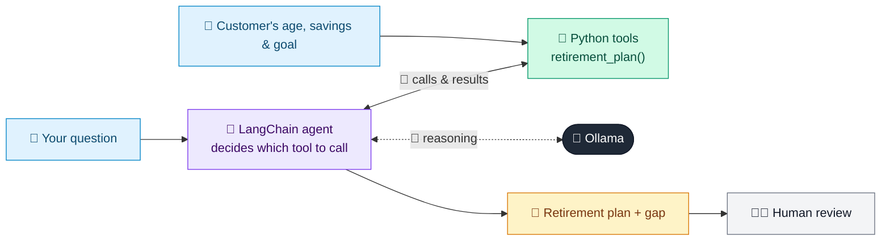

# 30 · Retirement Planning Assistant

  

**Industry:** 🏦 Banking · **Category:** 📈 Wealth & Investment Management

## 🏦 The business problem (new to banking? start here)

**In the business today:** Customers ask 'can I retire at 60?'. Advisers estimate the savings needed, project current savings forward and work out the gap.

**Who does this work:** Financial planners and digital advice tools.

**Why it's hard:** The maths (inflation, returns, years in retirement) is unfamiliar to most customers; clear what-ifs help them act.

### Key terms
- **Retirement corpus**: The total savings needed at retirement to fund living costs for the rest of one's life.
- **SIP**: Systematic Investment Plan: investing a fixed amount every month into a fund.
- **Asset allocation**: How a portfolio is split between asset classes (equity, bonds, gold, cash). The biggest driver of risk and return.

More terms: [Banking Primer & glossary](../PRIMER.md#glossary)

---

## 🤖 What the AI does
Projects a retirement corpus, gap and required monthly savings.

### How it works
Agent uses a `retirement_plan` tool (corpus needed, projection, gap, extra saving) and re-runs it for what-if questions.



<sub>🟦 data · 🟩 Python: maths & rules (auditable) · 🟪 AI: reasoning & writing · ⬛ local LLM · 🟨 result</sub>

## 💬 Sample conversation

A real recorded run on `qwen2.5:7b-instruct` (local, on a laptop, 9 s). Expand a step to see what happened
behind the answer. LLM wording changes from run to run; the numbers from Python stay the same.

> **👤 You:** I'm 40, have 150,000 saved, save 1,000 a month and spend 3,500 a month. Can I retire at 60?

<details><summary>🔧 Tool calls</summary>

```text
retirement_plan(current_age=40, current_savings=150000, monthly_saving=1000, monthly_expense_today=3500, retire_age=60) -> {"years_to_retirement": 20, "required_corpus": 1520117, "projected_corpus": 1126737, "gap": 393380, "on_track": false, "required_total_monthly_saving": 1755, "extra_monthly_saving_needed": 755, "assumptions": "7.0% return before retirement, 5.0% after, 3.0% inflation, 25 years in retirement"}
```

</details>

**🦙 Ollama:**

To retire at age 60, you would need a total corpus of approximately $1,520,117. Based on your current savings and monthly contributions, you are projected to have a corpus of about $1,126,737. This leaves a gap of $393,380. To bridge this gap, you would need to save an additional $755 per month.

Here are three practical levers to consider:

1. **Retire Later**: If you can delay your retirement to age 65, the required corpus would decrease to approximately $1,337,000, and the gap would be reduced to about $183,380. Calling `retirement_plan` with a retire_age of 65 might show a more manageable gap.

2. **Save More**: Increasing your monthly savings to $1,755 would help close the gap. This could be achieved by boosting your contributions or finding ways to earn more income.

3. **Adjust Allocation**: Optimizing your investment allocation to target a higher return before retirement could help. For instance, if you could achieve an annual return of 8% before retirement, the required corpus would decrease, and the gap would be smaller.

Would you like to explore any of these options further?


## Run
```bash
# from the repo root, with Ollama running
python 01_banking/30_retirement_planner/app.py
```

## Customize
- Replace the sample data at the top of `app.py` with your own data source (CSV, database, API).
- Tune thresholds and rules in the Python functions. These are the auditable part of the solution.
- Change the model with `OLLAMA_MODEL` (see the root [README](../../README.md#-model-recommendations)).

> Sample data is fictional; calculations are simplified for learning.

[⬅ Back to Banking use cases](../README.md#-use-cases) · [All industries](../../README.md)
