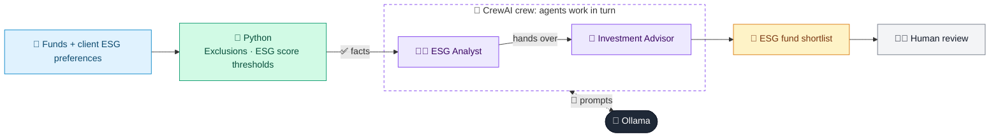

# 31 · ESG Investment Screener

  

**Industry:** 🏦 Banking · **Category:** 📈 Wealth & Investment Management

## 🏦 The business problem (new to banking? start here)

**In the business today:** More clients want investments that match their values, such as no tobacco or weapons and low carbon. Advisers screen funds and explain the trade-offs.

**Who does this work:** Investment advisers and ESG / product teams.

**Why it's hard:** ESG data is messy and greenwashing is a regulatory risk.

### Key terms
- **ESG**: Environmental, Social and Governance factors used to screen investments for sustainability.
- **Asset allocation**: How a portfolio is split between asset classes (equity, bonds, gold, cash). The biggest driver of risk and return.
- **Suitability**: The rule that a recommended product must fit the client's risk profile, knowledge, goals and time horizon.

More terms: [Banking Primer & glossary](../PRIMER.md#glossary)

---

## 🤖 What the AI does
Screens a fund universe against ESG preferences and exclusions.

### How it works
Python applies exclusions and score thresholds; ESG Analyst and Advisor agents explain trade-offs and shortlist funds.



<sub>🟦 data · 🟩 Python: maths & rules (auditable) · 🟪 AI: reasoning & writing · ⬛ local LLM · 🟨 result</sub>

## 💬 Sample conversation

A real recorded run on `qwen2.5:7b-instruct` (local, on a laptop, 53 s). Expand a step to see what happened
behind the answer. LLM wording changes from run to run; the numbers from Python stay the same.

> **👤 You:** Which funds fit my client's ESG preferences? Shortlist them and explain the trade-offs.

<details><summary>🐍 Python · Screening</summary>

```json
[
  {
    "fund": "Global Clean Energy Fund",
    "passes": true,
    "fail_reasons": []
  },
  {
    "fund": "World Index Tracker",
    "passes": false,
    "fail_reasons": [
      "ESG score 58 < 70",
      "carbon intensity 140",
      "weapons exposure 1%",
      "tobacco exposure 1%",
      "fossil fuel 6%"
    ]
  },
  {
    "fund": "ESG Leaders Equity",
    "passes": true,
    "fail_reasons": []
  },
  {
    "fund": "Emerging Markets Value",
    "passes": false,
    "fail_reasons": [
      "ESG score 41 < 70",
      "carbon intensity 310",
      "tobacco exposure 3%",
      "fossil fuel 14%"
    ]
  },
  {
    "fund": "Green Bond Fund",
    "passes": true,
    "fail_reasons": []
  },
  {
    "fund": "Aerospace & Defence Opportunities",
    "passes": false,
    "fail_reasons": [
      "ESG score 49 < 70",
      "carbon intensity 120",
      "weapons exposure 35%"
    ]
  }
]
```

</details>

<details><summary>🧑‍💼 ESG Analyst (agent)</summary>

### ESG Analysis of Selected Funds

#### Fund Screening Criteria
- **Minimum ESG Score:** 70
- **Maximum Carbon Intensity:** 100
- **Exclusions:** Weapons, Tobacco
- **Maximum Fossil Fuel Percentage:** 2%
- **Client Goal:** Long-term growth with balanced risk; values climate action

#### Screening Outcomes

1. **Global Clean Energy Fund**
   - **ESG Score:** 82 (Pass)
   - **Carbon Intensity:** 45 (Pass)
   - **Fossil Fuel Percentage:** 0% (Pass)
   - **Weapons Percentage:** 0% (Pass)
   - **Tobacco Percentage:** 0% (Pass)
   - ** TER Percentage:** 0.85 (Pass)
   - **5-Year Return:** 9.1%
   - **Pass Reason:** Meets all criteria, including a high ESG score and low carbon intensity, aligning with the client's goal of climate action.

2. **World Index Tracker**
   - **ESG Score:** 58 (Fail)
   - **Carbon Intensity:** 140 (Fail)
   - **Fossil Fuel Percentage:** 6% (Fail)
   - **Weapons Percentage:** 1% (Fail)
   - **Tobacco Percentage:** 1% (Fail)
   - **TER Percentage:** 0.12 (Pass)
   - **5-Year Return:** 10.4%
   - **Fail Reason:** ESG score below the minimum threshold, high carbon intensity, and exposure to weapons and tobacco.

3. **ESG Leaders Equity**
   - **ESG Score:** 76 (Pass)
   - **Carbon Intensity:** 70 (Pass)
   - **Fossil Fuel Percentage:** 1% (Pass)
   - **Weapons Percentage:** 0% (Pass)
   - **Tobacco Percentage:** 0% (Pass)
   - **TER Percentage:** 0.3 (Pass)
   - **5-Year Return:** 9.8%
   - **Pass Reason:** Meets all criteria, including a high ESG score and low carbon intensity, with minimal exposure to weapons and tobacco.

4. **Emerging Markets Value**
   - **ESG Score:** 41 (Fail)
   - **Carbon Intensity:** 310 (Fail)
   - **Fossil Fuel Percentage:** 14% (Fail)
   - **Weapons Percentage:** 0% (Pass)
   - **Tobacco Percentage:** 3% (Fail)
   - **TER Percentage:** 0.55 (Pass)
   - **5-Year Return:** 7.2%
   - **Fail Reason:** ESG score below the minimum threshold, high carbon intensity, and exposure to tobacco.

5. **Green Bond Fund**
   - **ESG Score:** 79 (Pass)
   - **Carbon Intensity:** 30 (Pass)
   - **Fossil Fuel Percentage:** 0% (Pass)
   - **Weapons Percentage:** 0% (Pass)
   - **Tobacco Percentage:** 0% (Pass)
   - **TER Percentage:** 0.25 (Pass)
   - **5-Year Return:** 3.4%
   - **Pass Reason:** Meets all criteria, including a high ESG score and low carbon intensity, with no exposure to weapons or tobacco.

6. **Aerospace & Defence Opportunities**
   - **ESG Score:** 49 (Fail)
   - **Carbon Intensity:** 120 (Fail)
   - **Fossil Fuel Percentage:** 0% (Pass)
   - **Weapons Percentage:** 35% (Fail)
   - **Tobacco Percentage:** 0% (Pass)
   - **TER Percentage:** 0.65 (Pass)
   - **5-Year Return:** 12.0%
   - **Fail Reason:** ESG score below the minimum threshold, high carbon intensity, and significant exposure to weapons.

### Trade-Offs and Analysis

1. **Global Clean Energy Fund**
   - **Pass:** Meets all criteria, including a high ESG score and low carbon intensity.
   - **Return/Cost Trade-Off:** 9.1% return with a TER of 0.85. This fund aligns well with the client's goal of long-term growth and balanced risk, while also focusing on climate action.

2. **ESG Leaders Equity**
   - **Pass:** Meets all criteria, including a high ESG score and low carbon intensity.
   - **Return/Cost Trade-Off:** 9.8% return with a TER of 0.3. This fund offers a slightly lower return compared to the Global Clean Energy Fund but still meets the client's criteria and provides a balanced risk profile.

3. **Green Bond Fund**
   - **Pass:** Meets all criteria, including a high ESG score and low carbon intensity.
   - **Return/Cost Trade-Off:** 3.4% return with a TER of 0.25. This fund has the lowest return among the passing funds but offers the highest ESG score and lowest carbon intensity, making it a strong choice for clients prioritizing climate action.

4. **World Index Tracker**
   - **Fail:** Does not meet the minimum ESG score, carbon intensity, and exposure to weapons and tobacco.
   - **Return/Cost Trade-Off:** 10.4% return with a TER of 0.12. While this fund offers a high return, it fails to meet the client's ESG criteria, making it less suitable for clients who prioritize sustainability.

5. **Emerging Markets Value**
   - **Fail:** Does not meet the minimum ESG score, carbon intensity, and exposure to tobacco.
   - **Return/Cost Trade-Off:** 7.2% return with a TER of 0.55. This fund offers a moderate return but fails to meet the client's ESG criteria, making it less suitable for clients who prioritize sustainability.

6. **Aerospace & Defence Opportunities**
   - **Fail:** Does not meet the minimum ESG score, carbon intensity, and significant exposure to weapons.
   - **Return/Cost Trade-Off:** 12.0% return with a TER of 0.65. While this fund offers a high return, it fails to meet the client's ESG criteria, making it less suitable for clients who prioritize sustainability.

### Conclusion
The funds that pass the screening criteria (Global Clean Energy Fund, ESG Leaders Equity, and Green Bond Fund) offer a balanced approach to long-term growth while prioritizing climate action and sustainability. The Global Clean Energy Fund and ESG Leaders Equity provide a good balance between returns and ESG scores, while the Green Bond Fund offers the highest ESG score and lowest carbon intensity. The client should consider their risk tolerance and return expectations when choosing between these funds.

</details>

**🦙 Ollama:**

### Recommended Shortlist and Allocation

#### Shortlist
1. **Global Clean Energy Fund**
   - **Pass Reason:** Meets all criteria, including a high ESG score and low carbon intensity.
   - **Return/Cost Trade-Off:** 9.1% return with a TER of 0.85.
   - **Rationale:** This fund aligns well with the client's goal of long-term growth and balanced risk, while also focusing on climate action.

2. **ESG Leaders Equity**
   - **Pass Reason:** Meets all criteria, including a high ESG score and low carbon intensity.
   - **Return/Cost Trade-Off:** 9.8% return with a TER of 0.3.
   - **Rationale:** This fund offers a slightly lower return compared to the Global Clean Energy Fund but still meets the client's criteria and provides a balanced risk profile.

3. **Green Bond Fund**
   - **Pass Reason:** Meets all criteria, including a high ESG score and low carbon intensity.
   - **Return/Cost Trade-Off:** 3.4% return with a TER of 0.25.
   - **Rationale:** This fund has the lowest return among the passing funds but offers the highest ESG score and lowest carbon intensity, making it a strong choice for clients prioritizing climate action.

#### Allocation
- **Global Clean Energy Fund:** 40%
- **ESG Leaders Equity:** 30%
- **Green Bond Fund:** 30%

### Diversification Gaps
- **Geographic Diversification:** The shortlist is focused on global funds, which already provides a broad geographic exposure.
- **Asset Class Diversification:** The shortlist includes equity funds, which can be complemented by adding a bond or fixed income component to the portfolio.
- **Industry Diversification:** The funds cover a range of industries, including clean energy, equities, and green bonds, which provides a diverse set of investments.

### Trade-Offs to Discuss with the Client
1. **Return vs. ESG Score:**
   - **Global Clean Energy Fund:** High ESG score and low carbon intensity, but slightly lower return.
   - **ESG Leaders Equity:** Balanced return and ESG score, suitable for clients who want a good balance.
   - **Green Bond Fund:** Highest ESG score and lowest carbon intensity, but lowest return.

2. **Risk Tolerance:**
   - **Global Clean Energy Fund:** Lower risk due to diversified exposure and lower carbon intensity.
   - **ESG Leaders Equity:** Moderate risk with a balanced approach.
   - **Green Bond Fund:** Lower risk due to fixed income nature and high ESG score.

3. **Long-Term Growth vs. Immediate Returns:**
   - **Global Clean Energy Fund:** Focuses on long-term growth with a 9.1% return.
   - **ESG Leaders Equity:** Offers a 9.8% return with a balanced risk profile.
   - **Green Bond Fund:** Provides a 3.4% return with a strong ESG focus.

### Conclusion
The recommended shortlist of Global Clean Energy Fund, ESG Leaders Equity, and Green Bond Fund offers a balanced approach to long-term growth while prioritizing climate action and sustainability. The allocation of 40% in Global Clean Energy Fund, 30% in ESG Leaders Equity, and 30% in Green Bond Fund provides a diversified portfolio that meets the client's values and financial goals. The client should consider their risk tolerance and return expectations when choosing between these funds.


## Run
```bash
# from the repo root, with Ollama running
python 01_banking/31_esg_investment_screener/app.py
```

## Customize
- Replace the sample data at the top of `app.py` with your own data source (CSV, database, API).
- Tune thresholds and rules in the Python functions. These are the auditable part of the solution.
- Change the model with `OLLAMA_MODEL` (see the root [README](../../README.md#-model-recommendations)).

> Sample data is fictional; calculations are simplified for learning.

[⬅ Back to Banking use cases](../README.md#-use-cases) · [All industries](../../README.md)
