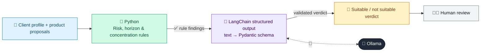

# 32 · Suitability & Mis-selling Checker

  

**Industry:** 🏦 Banking · **Category:** 📈 Wealth & Investment Management

## 🏦 The business problem (new to banking? start here)

**In the business today:** Before a product is sold, a check confirms it suits the client's risk profile, knowledge, time horizon and need for cash.

**Who does this work:** Sales supervisors and compliance / conduct teams.

**Why it's hard:** Mis-selling (especially to elderly or vulnerable customers) leads to compensation and fines.

### Key terms
- **Suitability**: The rule that a recommended product must fit the client's risk profile, knowledge, goals and time horizon.
- **Mis-selling**: Selling a product that is unsuitable or not properly explained. Leads to compensation and regulatory fines.
- **Vulnerable customer**: Someone more likely to suffer harm (e.g. due to age, illness, bereavement). Banks must take extra care with them.
- **Risk profile**: How much investment risk a client is willing and able to take, usually from a questionnaire.

More terms: [Banking Primer & glossary](../PRIMER.md#glossary)

---

## 🤖 What the AI does
Checks whether a recommended product is suitable for a client's profile before sale.

### How it works
Rules compare product risk vs. client risk, horizon and concentration; LLM returns a structured suitability verdict.



<sub>🟦 data · 🟩 Python: maths & rules (auditable) · 🟪 AI: reasoning & writing · ⬛ local LLM · 🟨 result</sub>

## 💬 Sample response

Real output from `qwen2.5:7b-instruct` running locally on a laptop. LLM wording changes from run to run; the numbers from
Python stay the same.

<details>
<summary><b>Show the full output</b></summary>

````text
--- Structured note linked to small-cap index, capital at risk, 5-year lock-in ---
Rule findings: ['Product risk 5 > client risk 2', 'Lock-in 5y exceeds horizon 2y', 'Concentration >50% of liquid net worth', 'Complex product for inexperienced client']
{
  "verdict": "NOT_SUITABLE",
  "vulnerable_customer": true,
  "reasons": [
    "The product risk rating (5) is significantly higher than the client's risk profile (2/5).",
    "The lock-in period (5 years) exceeds the client's investment horizon (2 years).",
    "The concentration of the proposed investment (1800000 out of 3000000) is more than 50% of the client's liquid net worth.",
    "The complexity of the structured note is not aligned with the client's experience, who has only dealt with fixed deposits."
  ],
  "required_actions": [
    "Recommend a lower risk product that aligns with the client's risk profile.",
    "Suggest a shorter lock-in period that fits within the client's investment horizon.",
    "Propose a diversified investment strategy to reduce concentration risk.",
    "Educate the client on the complexities of structured notes and ensure she is comfortable with the investment."
  ]
}


--- Senior citizen savings scheme (government-backed) ---
Rule findings: ['Lock-in 5y exceeds horizon 2y']
{
  "verdict": "NOT_SUITABLE",
  "vulnerable_customer": true,
  "reasons": [
    "The lock-in period of 5 years exceeds the client's investment horizon of 2 years, which could lock up funds that the client may need sooner.",
    "Mrs. Lata Desai has a conservative risk profile and a need for regular monthly income, which suggests a preference for more liquid and flexible investment options."
  ],
  "required_actions": [
    "Recommend a more flexible investment product that aligns with her liquidity needs and risk profile.",
    "Consider a product with a shorter lock-in period or a product that offers better liquidity."
  ]
}


--- Short-duration high-quality debt fund ---
Rule findings: none
{
  "verdict": "SUITABLE",
  "vulnerable_customer": true,
  "reasons": [
    "Mrs. Lata Desai is 71 years old and has a conservative risk profile, which aligns well with the low-risk nature of a short-duration high-quality debt fund.",
    "The client has a regular monthly income need, and the proposed product provides stable returns with minimal risk, suitable for her financial requirements.",
    "The liquidity needs are met as the product has no lock-in period, allowing for easy access to funds if needed.",
    "Given her experience with fixed deposits only, the short-duration high-quality debt fund is a familiar and comfortable investment for her."
  ],
  "required_actions": []
}
````

</details>

## Run
```bash
# from the repo root, with Ollama running
python 01_banking/32_suitability_checker/app.py
```

## Customize
- Replace the sample data at the top of `app.py` with your own data source (CSV, database, API).
- Tune thresholds and rules in the Python functions. These are the auditable part of the solution.
- Change the model with `OLLAMA_MODEL` (see the root [README](../../README.md#-model-recommendations)).

> Sample data is fictional; calculations are simplified for learning.

[⬅ Back to Banking use cases](../README.md#-use-cases) · [All industries](../../README.md)
