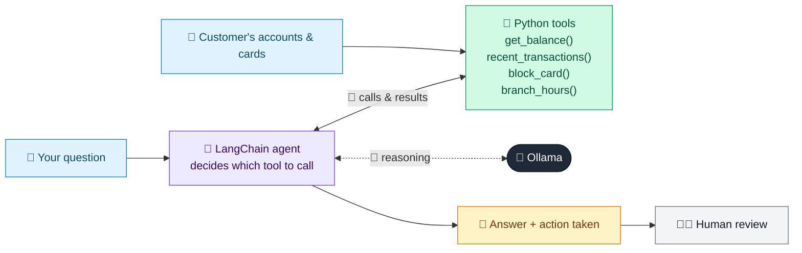

# 33 · Banking Customer Support Agent

  

**Industry:** 🏦 Banking · **Category:** 🙋 Retail Banking & Customer Experience

## 🏦 The business problem (new to banking? start here)

**In the business today:** Contact centres handle millions of simple requests: balances, recent transactions, blocking a lost card, branch hours.

**Who does this work:** Contact centre / customer service.

**Why it's hard:** Simple requests clog queues; customers want 24/7 instant help, done securely.

### Key terms
- **Retail banking**: Banking for individuals: accounts, cards, loans, mortgages and savings.

More terms: [Banking Primer & glossary](../PRIMER.md#glossary)

---

## 🤖 What the AI does
Answers balance, transaction and card questions and can block a lost card.

### How it works
Agent uses `get_balance`, `recent_transactions`, `block_card` and `branch_hours` tools over a mock core-banking API.



<sub>🟦 data · 🟩 Python: maths & rules (auditable) · 🟪 AI: reasoning & writing · ⬛ local LLM · 🟨 result</sub>

## 💬 Sample response

Real output from `qwen2.5:7b-instruct` running locally on a laptop. LLM wording changes from run to run; the numbers from
Python stay the same.

<details>
<summary><b>Show the full output</b></summary>

````text
--- You: What's my total balance? ---
Bot: Your total balance across all accounts is $5027.5. Here's a breakdown:
- Savings Account: $4215.4
- Current Account: $812.1


--- You: Show my last 3 transactions ---
Bot: Here are your last three transactions:

1. On 2026-10-09, you made a purchase of $64.2 from Amazon.
2. On 2026-10-08, you received a deposit of $2800.0 from Salary ACME Ltd.
3. On 2026-10-07, you had a direct debit of $120.0 for the Electric Co.


--- You: I lost my debit card ending 4821, please block it ---
Bot: Your card ending in 4821 has been blocked due to it being lost. A replacement card will be dispatched to you in 5 working days. Your new card reference is BLK-4821-2026. Please keep this reference for future inquiries.


--- You: What time does the Leeds branch open on Saturday? ---
Bot: The Leeds branch is open on Saturdays from 9:30 AM to 1:00 PM. For any further assistance, you can contact our 24/7 phone support at 0800 123 456.
````

</details>

## Run
```bash
# from the repo root, with Ollama running
python 01_banking/33_customer_support_agent/app.py
```

## Customize
- Replace the sample data at the top of `app.py` with your own data source (CSV, database, API).
- Tune thresholds and rules in the Python functions. These are the auditable part of the solution.
- Change the model with `OLLAMA_MODEL` (see the root [README](../../README.md#-model-recommendations)).

> Sample data is fictional; calculations are simplified for learning.

[⬅ Back to Banking use cases](../README.md#-use-cases) · [All industries](../../README.md)
