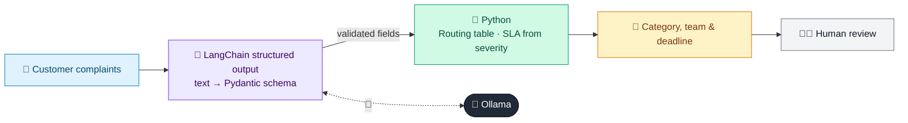

# 34 · Complaint Classifier & Router

  

**Industry:** 🏦 Banking · **Category:** 🙋 Retail Banking & Customer Experience

## 🏦 The business problem (new to banking? start here)

**In the business today:** Complaints arrive by email, phone and social media. Each must be categorised, prioritised and routed to the right team within regulatory deadlines.

**Who does this work:** Complaints handling teams, with conduct/compliance oversight.

**Why it's hard:** Misrouted or late complaints breach rules; complaints from vulnerable customers need urgent attention.

### Key terms
- **Customer complaint handling**: Regulators set deadlines (e.g. resolve within 30 days) and require reporting of complaint trends.
- **Vulnerable customer**: Someone more likely to suffer harm (e.g. due to age, illness, bereavement). Banks must take extra care with them.
- **Mis-selling**: Selling a product that is unsuitable or not properly explained. Leads to compensation and regulatory fines.

More terms: [Banking Primer & glossary](../PRIMER.md#glossary)

---

## 🤖 What the AI does
Classifies complaints by product, issue, severity and regulatory reportability and routes them.

### How it works
Structured output schema plus routing table; SLA computed from severity.



<sub>🟦 data · 🟩 Python: maths & rules (auditable) · 🟪 AI: reasoning & writing · ⬛ local LLM · 🟨 result</sub>

## 💬 Sample conversation

A real recorded run on `qwen2.5:7b-instruct` (local, on a laptop, 13 s). Expand a step to see what happened
behind the answer. LLM wording changes from run to run; the numbers from Python stay the same.

> **👤 You:** Classify today's customer complaints and route each one to the right team with a deadline.

**🦙 Ollama:**

#### I was charged a 35 overdraft fee twice for the same transaction and no...
```
{
  "product": "credit_card",
  "category": "fees_charges",
  "severity": "medium",
  "vulnerable_customer": false,
  "regulatory_reportable": false,
  "sentiment": "angry",
  "summary": "The customer is disputing a double charge of an overdraft fee and is requesting a refund."
}
-> Route: Retail Ops - Fees | SLA: 10 day(s)
```

#### My father has dementia and someone at your bank sold him a 10-year ins...
```
{
  "product": "investment_insurance",
  "category": "mis_selling",
  "severity": "high",
  "vulnerable_customer": true,
  "regulatory_reportable": true,
  "sentiment": "frustrated",
  "summary": "A family member reports that a bank sold an unsuitable 10-year insurance-linked investment to a person with dementia, who does not understand it."
}
-> Route: Conduct & Compliance | SLA: 3 day(s) | FLAG: regulatory log
```

#### The mobile app keeps logging me out when I try to pay bills. Very anno...
```
{
  "product": "mobile_app",
  "category": "digital_banking",
  "severity": "low",
  "vulnerable_customer": false,
  "regulatory_reportable": false,
  "sentiment": "neutral",
  "summary": "Customer is experiencing issues with the mobile app logging them out when trying to pay bills."
}
-> Route: Digital Support | SLA: 15 day(s)
```

#### Money was taken from my account for a purchase I never made in another...
```
{
  "product": "credit_card",
  "category": "fraud_dispute",
  "severity": "high",
  "vulnerable_customer": false,
  "regulatory_reportable": true,
  "sentiment": "angry",
  "summary": "The customer is reporting an unauthorized transaction from their account, which occurred in another country, and their card is still in their possession. This is classified as a fraud_dispute with high severity."
}
-> Route: Fraud Operations | SLA: 3 day(s) | FLAG: regulatory log
```

#### Your loan agent called me 6 times a day and threatened to tell my empl...
```
{
  "product": "loan",
  "category": "collections_conduct",
  "severity": "high",
  "vulnerable_customer": true,
  "regulatory_reportable": true,
  "sentiment": "angry",
  "summary": "The customer is experiencing harassment from debt collectors who are threatening to disclose the customer's missed EMI to their employer."
}
-> Route: Collections Oversight | SLA: 3 day(s) | FLAG: regulatory log
```


## Run
```bash
# from the repo root, with Ollama running
python 01_banking/34_complaint_classifier/app.py
```

## Customize
- Replace the sample data at the top of `app.py` with your own data source (CSV, database, API).
- Tune thresholds and rules in the Python functions. These are the auditable part of the solution.
- Change the model with `OLLAMA_MODEL` (see the root [README](../../README.md#-model-recommendations)).

> Sample data is fictional; calculations are simplified for learning.

[⬅ Back to Banking use cases](../README.md#-use-cases) · [All industries](../../README.md)
