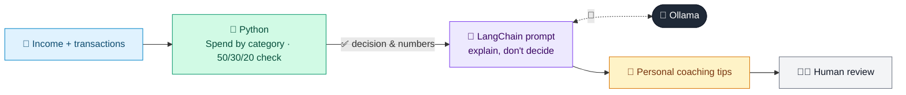

# 35 · Personal Finance Coach

  

**Industry:** 🏦 Banking · **Category:** 🙋 Retail Banking & Customer Experience

## 🏦 The business problem (new to banking? start here)

**In the business today:** Banks increasingly help customers manage money, analysing spending and suggesting budgets and savings inside the banking app.

**Who does this work:** Digital banking / customer engagement teams.

**Why it's hard:** Customers want personal, practical advice, not generic tips.

### Key terms
- **50/30/20 rule**: A budgeting rule: 50% of income on needs, 30% on wants, 20% on savings.
- **Retail banking**: Banking for individuals: accounts, cards, loans, mortgages and savings.

More terms: [Banking Primer & glossary](../PRIMER.md#glossary)

---

## 🤖 What the AI does
Analyses spending and gives personalised saving tips and a budget.

### How it works
Transactions are categorised and summarised in Python; the LLM coaches against the 50/30/20 rule.



<sub>🟦 data · 🟩 Python: maths & rules (auditable) · 🟪 AI: reasoning & writing · ⬛ local LLM · 🟨 result</sub>

## 💬 Sample conversation

A real recorded run on `qwen2.5:7b-instruct` (local, on a laptop, 10 s). Expand a step to see what happened
behind the answer. LLM wording changes from run to run; the numbers from Python stay the same.

> **👤 You:** Here's my spending for last month on a 5,200 take-home pay. How am I doing, and where can I save?

<details><summary>🐍 Python · Spending analysis</summary>

```json
{
  "income": 5200,
  "spent": 4048,
  "pct_of_income": {
    "needs": 54,
    "wants": 20,
    "savings": 4
  },
  "target_50_30_20": {
    "needs": 50,
    "wants": 30,
    "savings": 20
  },
  "top_wants": [
    [
      "Amazon",
      275.0
    ],
    [
      "Restaurants",
      230.0
    ],
    [
      "Zara",
      140.0
    ],
    [
      "Uber Eats",
      116.0
    ],
    [
      "Deliveroo",
      89.0
    ]
  ],
  "subscriptions_total": 90.0,
  "takeaway_total": 205.0
}
```

</details>

**🦙 Ollama:**

### 2-line Summary vs 50/30/20 Rule
Your current spending is more focused on wants and less on savings compared to the 50/30/20 rule, which suggests allocating 50% to needs, 30% to wants, and 20% to savings. Adjusting your budget can help you save more and reduce unnecessary expenses.

### 4 Specific Saving Tips with Estimated Monthly Savings
1. **Cut Down on Takeout Meals**: Reduce takeaway orders by $100/month.
2. **Cancel Unnecessary Subscriptions**: Save $15/month by unsubscribing from unused services.
3. **Reduce Shopping Spree**: Cut back on non-essential shopping by $50/month.
4. **Automate Savings**: Set up an automatic transfer of $100/month into a savings account.

### Suggested Monthly Budget Table
| Category       | Current Spending | Target Spending | Monthly Savings |
|----------------|------------------|----------------|----------------|
| Needs          | $2,720           | $2,600         | $120           |
| Wants          | $820             | $1,560         | -$740          |
| Savings        | $208             | $1,040         | $832           |
| Subscriptions  | $90              | $0             | $90            |
| Takeaway       | $205             | $0             | $205           |
| **Total**      | **$4,048**       | **$4,208**     | **$160**       |

### Encouraging Closing Line
By making small adjustments, you can significantly boost your savings and achieve your financial goals. Keep going!


## Run
```bash
# from the repo root, with Ollama running
python 01_banking/35_personal_finance_coach/app.py
```

## Customize
- Replace the sample data at the top of `app.py` with your own data source (CSV, database, API).
- Tune thresholds and rules in the Python functions. These are the auditable part of the solution.
- Change the model with `OLLAMA_MODEL` (see the root [README](../../README.md#-model-recommendations)).

> Sample data is fictional; calculations are simplified for learning.

[⬅ Back to Banking use cases](../README.md#-use-cases) · [All industries](../../README.md)
