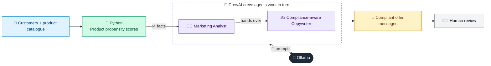

# 36 · Next Best Offer / Cross-sell

  

**Industry:** 🏦 Banking · **Category:** 🙋 Retail Banking & Customer Experience

## 🏦 The business problem (new to banking? start here)

**In the business today:** Banks try to offer each customer the product they most likely need next (e.g. a credit card for a new salaried customer) at the right time and channel.

**Who does this work:** Marketing / CRM analytics teams.

**Why it's hard:** Irrelevant offers annoy customers and can be seen as pushy or unfair.

### Key terms
- **Cross-sell / Next Best Offer**: Offering an existing customer the product they most likely need next.
- **Retail banking**: Banking for individuals: accounts, cards, loans, mortgages and savings.

More terms: [Banking Primer & glossary](../PRIMER.md#glossary)

---

## 🤖 What the AI does
Recommends the next best product for each customer with a personalised message.

### How it works
Python scores product propensity; a Marketing Analyst agent picks offers and a Copywriter agent drafts compliant messages.



<sub>🟦 data · 🟩 Python: maths & rules (auditable) · 🟪 AI: reasoning & writing · ⬛ local LLM · 🟨 result</sub>

## 💬 Sample conversation

A real recorded run on `qwen2.5:7b-instruct` (local, on a laptop, 15 s). Expand a step to see what happened
behind the answer. LLM wording changes from run to run; the numbers from Python stay the same.

> **👤 You:** What should we offer customers R-1, R-2 and R-3 next? Draft the messages.

<details><summary>🐍 Python · Propensity (top 3)</summary>

```json
{
  "R-1": {
    "credit_card": 0.6,
    "mutual_fund_sip": 0.4,
    "term_insurance": 0.4
  },
  "R-2": {
    "home_loan": 0.8,
    "mutual_fund_sip": 0.6,
    "travel_card": 0.5
  },
  "R-3": {
    "mutual_fund_sip": 0.6,
    "credit_card": 0.1,
    "travel_card": 0.1
  }
}
```

</details>

<details><summary>🧑‍💼 Marketing Analyst (agent)</summary>

Per customer: offer, why, channel, timing.

1. **Customer R-1:**
   - **Offer:** Credit Card
   - **Why:** The propensity score for a credit card is 0.6, which is the highest among the suggested offers. Given that R-1 has a savings product and their salary has increased by 20%, they are likely to benefit from a credit card for managing their finances and potentially increasing their spending.
   - **Channel:** App Push
   - **Timing:** Immediate, as the salary increase event is recent and they are likely to be receptive to new offers.

2. **Customer R-2:**
   - **Offer:** Home Loan
   - **Why:** The propensity score for a home loan is 0.8, which is the highest among the suggested offers. R-2 has searched for home loans twice, indicating a high interest in this product. They also have a credit card and a savings account, suggesting they are already engaged with the bank.
   - **Channel:** RM Call
   - **Timing:** Within the next 2 weeks, to capitalize on their recent interest and ensure a personal touch.

3. **Customer R-3:**
   - **Offer:** Mutual Fund SIP
   - **Why:** The propensity score for a mutual fund SIP is 0.6, which is the highest among the suggested offers. R-3 has a fixed deposit maturing soon, making them a good candidate for transitioning into a more dynamic investment option like a SIP.
   - **Channel:** Email
   - **Timing:** Within the next 7 days, to coincide with the maturity of their fixed deposit, making the transition seamless and timely.

</details>

**🦙 Ollama:**

**Customer R-1:**
Boost your finances with our Credit Card! Your recent salary increase makes this perfect for you. Download now in-app. Opt-out anytime.

**Customer R-2:**
Home Loan offer for you! We noticed your recent searches. Let’s chat about your options. Call us soon.

**Customer R-3:**
Your fixed deposit matures soon. Consider a Mutual Fund SIP for growth. Check your email for details. Opt-out anytime.


## Run
```bash
# from the repo root, with Ollama running
python 01_banking/36_next_best_offer/app.py
```

## Customize
- Replace the sample data at the top of `app.py` with your own data source (CSV, database, API).
- Tune thresholds and rules in the Python functions. These are the auditable part of the solution.
- Change the model with `OLLAMA_MODEL` (see the root [README](../../README.md#-model-recommendations)).

> Sample data is fictional; calculations are simplified for learning.

[⬅ Back to Banking use cases](../README.md#-use-cases) · [All industries](../../README.md)
