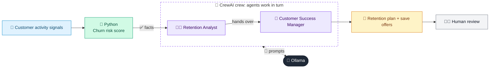

# 37 · Customer Churn Retention Agent

  

**Industry:** 🏦 Banking · **Category:** 🙋 Retail Banking & Customer Experience

## 🏦 The business problem (new to banking? start here)

**In the business today:** Banks watch for customers about to leave (salary stops arriving, balances drop, complaints rise) and try to keep the valuable ones.

**Who does this work:** Customer analytics and retention / customer success teams.

**Why it's hard:** Winning back a customer after they leave is much harder than keeping them.

### Key terms
- **Churn / attrition**: Customers leaving the bank or moving their main banking elsewhere.
- **Retail banking**: Banking for individuals: accounts, cards, loans, mortgages and savings.

More terms: [Banking Primer & glossary](../PRIMER.md#glossary)

---

## 🤖 What the AI does
Identifies customers likely to leave and designs retention actions.

### How it works
Churn signals scored in Python; Retention Analyst and Customer Success agents propose save offers.



<sub>🟦 data · 🟩 Python: maths & rules (auditable) · 🟪 AI: reasoning & writing · ⬛ local LLM · 🟨 result</sub>

## 💬 Sample response

Real output from `qwen2.5:7b-instruct` running locally on a laptop. LLM wording changes from run to run; the numbers from
Python stay the same.

<details>
<summary><b>Show the full output</b></summary>

````text
--- Churn risk ---
[
  {
    "id": "C-11",
    "churn_score": 92,
    "risk": "HIGH"
  },
  {
    "id": "C-12",
    "churn_score": 0,
    "risk": "LOW"
  },
  {
    "id": "C-13",
    "churn_score": 44,
    "risk": "MEDIUM"
  }
]


--- Retention plan ---
### Retention Plan for Customer C-11

**Action**: Personalized Rate Match Offer
**Offer**: Waive the next 3 months of FX fees
**Owner**: Account Manager (AM) Jane Doe
**Channel**: Email and Phone Call
**Script Opener**: "Jane Doe from our customer success team reached out to discuss ways to enhance your experience with us and ensure you continue to enjoy our services."
**Success Metric**: Customer satisfaction score (CSAT) post-communication and renewal of FX fee waiver

---

### Retention Plan for Customer C-11

**Action**: Personalized Rate Match Offer
**Offer**: Waive the next 3 months of FX fees
**Owner**: Account Manager (AM) Jane Doe
**Channel**: Email and Phone Call
**Script Opener**: "Jane Doe from our customer success team reached out to discuss ways to enhance your experience with us and ensure you continue to enjoy our services."
**Success Metric**: Customer satisfaction score (CSAT) post-communication and renewal of FX fee waiver

---

### Retention Plan for Customer C-13

**Action**: Personalized Rate Match Offer
**Offer**: Match competitor's mortgage rate for 6 months
**Owner**: Relationship Manager (RM) John Smith
**Channel**: Email and Phone Call
**Script Opener**: "John Smith from our customer success team reached out to discuss your recent interest in mortgage rates and ensure you continue to benefit from our services."
**Success Metric**: Customer satisfaction score (CSAT) post-communication and renewal of mortgage rate match

---

### Retention Plan for Customer C-13

**Action**: Personalized Rate Match Offer
**Offer**: Match competitor's mortgage rate for 6 months
**Owner**: Relationship Manager (RM) John Smith
**Channel**: Email and Phone Call
**Script Opener**: "John Smith from our customer success team reached out to discuss your recent interest in mortgage rates and ensure you continue to benefit from our services."
**Success Metric**: Customer satisfaction score (CSAT) post-communication and renewal of mortgage rate match
````

</details>

## Run
```bash
# from the repo root, with Ollama running
python 01_banking/37_churn_retention_agent/app.py
```

## Customize
- Replace the sample data at the top of `app.py` with your own data source (CSV, database, API).
- Tune thresholds and rules in the Python functions. These are the auditable part of the solution.
- Change the model with `OLLAMA_MODEL` (see the root [README](../../README.md#-model-recommendations)).

> Sample data is fictional; calculations are simplified for learning.

[⬅ Back to Banking use cases](../README.md#-use-cases) · [All industries](../../README.md)
