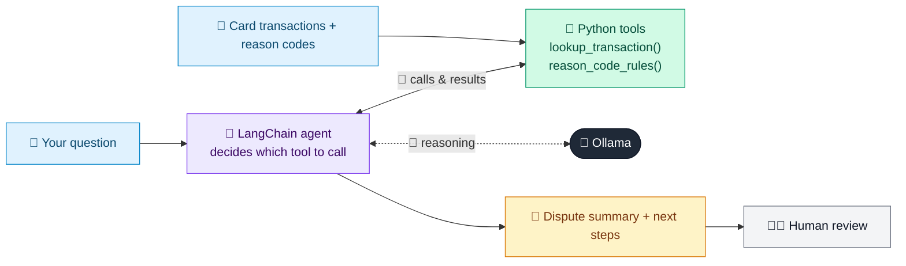

# 38 · Dispute & Chargeback Assistant

  

**Industry:** 🏦 Banking · **Category:** 🙋 Retail Banking & Customer Experience

## 🏦 The business problem (new to banking? start here)

**In the business today:** When a customer disputes a card payment (item never arrived, cancelled subscription still charged), the bank raises a chargeback through Visa/Mastercard.

**Who does this work:** Card disputes / chargeback operations.

**Why it's hard:** Each network has strict reason codes, deadlines and evidence rules; mistakes mean the bank loses the dispute.

### Key terms
- **Chargeback**: Reversing a card payment through the card network (Visa/Mastercard) when a customer has a valid dispute.
- **Reason code**: The card network's code for why a chargeback is raised (fraud, goods not received...), each with its own evidence rules.
- **MCC**: Merchant Category Code: a 4-digit code describing what kind of business a card merchant is, e.g. 5411 grocery, 7995 gambling.

More terms: [Banking Primer & glossary](../PRIMER.md#glossary)

---

## 🤖 What the AI does
Guides a card dispute, determines the reason code and drafts the chargeback case.

### How it works
Agent uses `lookup_transaction` and `reason_code_rules` tools and drafts the dispute summary.



<sub>🟦 data · 🟩 Python: maths & rules (auditable) · 🟪 AI: reasoning & writing · ⬛ local LLM · 🟨 result</sub>

## 💬 Sample response

Real output from `qwen2.5:7b-instruct` running locally on a laptop. LLM wording changes from run to run; the numbers from
Python stay the same.

<details>
<summary><b>Show the full output</b></summary>

````text
--- Customer ---
I ordered a laptop from TechMart Online (TX-902) on 22 Sept, it was due 29 Sept and never arrived. The merchant ignores my emails.


--- Assistant ---
Based on the provided information and the transaction details, here is the classification for the dispute:

- **Dispute Type:** Goods Not Received
- **Reason Code:** 4855
- **Evidence Required:** Expected delivery date, merchant contact attempts
- **Temporary Credit:** No (typically not applicable for goods not received disputes)
- **Summary for Back Office:** The customer ordered a laptop from TechMart Online on 22nd September, expecting delivery by 29th September. The laptop has not been received, and the merchant has not responded to the customer's emails. The customer is requesting a resolution. The merchant should be contacted first to verify the delivery status and any attempts made to contact the customer. The customer must provide the expected delivery date and evidence of their attempts to contact the merchant.

If the merchant does not respond or resolve the issue, a chargeback may be initiated. Please contact the merchant first to attempt a resolution.
````

</details>

## Run
```bash
# from the repo root, with Ollama running
python 01_banking/38_dispute_chargeback_assistant/app.py
```

## Customize
- Replace the sample data at the top of `app.py` with your own data source (CSV, database, API).
- Tune thresholds and rules in the Python functions. These are the auditable part of the solution.
- Change the model with `OLLAMA_MODEL` (see the root [README](../../README.md#-model-recommendations)).

> Sample data is fictional; calculations are simplified for learning.

[⬅ Back to Banking use cases](../README.md#-use-cases) · [All industries](../../README.md)
