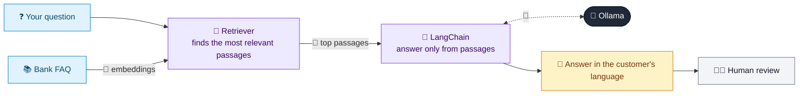

# 39 · Multilingual Banking FAQ (RAG)

  

**Industry:** 🏦 Banking · **Category:** 🙋 Retail Banking & Customer Experience

## 🏦 The business problem (new to banking? start here)

**In the business today:** Customers ask the same product questions (fees, limits, PIN reset) in many languages.

**Who does this work:** Customer service and digital channels.

**Why it's hard:** Maintaining FAQs and staff in every language is expensive.

### Key terms
- **Retail banking**: Banking for individuals: accounts, cards, loans, mortgages and savings.

More terms: [Banking Primer & glossary](../PRIMER.md#glossary)

---

## 🤖 What the AI does
Answers product FAQs in the customer's language (e.g. Hindi, Spanish, French).

### How it works
Translates the question to English, retrieves matching FAQ content, and answers in the language the question was asked in.



<sub>🟦 data · 🟩 Python: maths & rules (auditable) · 🟪 AI: reasoning & writing · ⬛ local LLM · 🟨 result</sub>

## 💬 Sample response

Real output from `qwen2.5:7b-instruct` running locally on a laptop. LLM wording changes from run to run; the numbers from
Python stay the same.

<details>
<summary><b>Show the full output</b></summary>

````text
--- Q: ATM se ek din mein kitna paisa nikaal sakte hain? ---
Daily ATM withdrawal limit is 1,000 for Classic debit cards and 2,500 for Platinum debit cards.


--- Q: ¿Cuánto cuesta una transferencia internacional? ---
Una transferencia internacional cuesta 15 por transferencia.


--- Q: Comment réinitialiser mon code PIN de l'application ? ---
Pour réinitialiser votre code PIN de l'application : ouvrez l'application, tappez 'Forgot PIN', vérifiez avec votre carte bancaire et un code OTP.


--- Q: मेरा कार्ड खो गया है, क्या करूं? ---
हालाँकि संदेश में जवाब नहीं मिला, आपका कार्ड खोने के लिए उपाय अपने अप्प में कार्ड > ब्लॉक वर्ग में 24/7 ब्लॉक करें या 0800 123 456 से फोन करें.
````

</details>

## Run
```bash
# from the repo root, with Ollama running
python 01_banking/39_multilingual_faq_rag/app.py
```

## Customize
- Replace the sample data at the top of `app.py` with your own data source (CSV, database, API).
- Tune thresholds and rules in the Python functions. These are the auditable part of the solution.
- Change the model with `OLLAMA_MODEL` (see the root [README](../../README.md#-model-recommendations)).

> Sample data is fictional; calculations are simplified for learning.

[⬅ Back to Banking use cases](../README.md#-use-cases) · [All industries](../../README.md)
