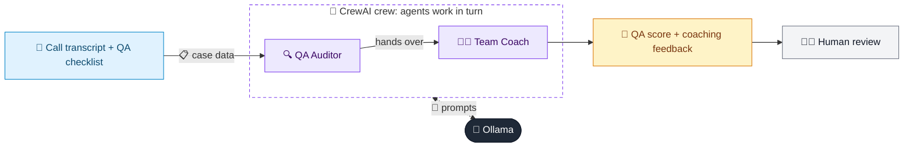

# 40 · Call Center QA Analyzer

  

**Industry:** 🏦 Banking · **Category:** 🙋 Retail Banking & Customer Experience

## 🏦 The business problem (new to banking? start here)

**In the business today:** Quality teams listen to a sample of calls to check agents verified customers securely, handled fraud correctly and treated customers well.

**Who does this work:** Contact centre quality assurance and team leaders.

**Why it's hard:** Only a tiny fraction of calls can be reviewed manually; security failures can enable fraud.

### Key terms
- **Call quality assurance (QA)**: Reviewing a sample of calls to check staff follow security, compliance and service standards.
- **Card fraud / CNP**: Unauthorised card use. Card-Not-Present (online/phone) fraud is the most common type.
- **Vulnerable customer**: Someone more likely to suffer harm (e.g. due to age, illness, bereavement). Banks must take extra care with them.

More terms: [Banking Primer & glossary](../PRIMER.md#glossary)

---

## 🤖 What the AI does
Scores call transcripts for compliance, empathy and resolution and coaches the agent.

### How it works
QA Auditor agent scores against a checklist; Coach agent writes improvement feedback.



<sub>🟦 data · 🟩 Python: maths & rules (auditable) · 🟪 AI: reasoning & writing · ⬛ local LLM · 🟨 result</sub>

## 💬 Sample conversation

A real recorded run on `qwen2.5:7b-instruct` (local, on a laptop, 25 s). Expand a step to see what happened
behind the answer. LLM wording changes from run to run; the numbers from Python stay the same.

> **👤 You:** QA this card-dispute call between agent Sam and a customer. What should Sam do better?

<details><summary>🔍 QA Auditor (agent)</summary>

| Checklist Item | Evidence Quote | Score | 
| --- | --- | --- |
| 1. Greeting & identification of agent | "Thanks for calling City Bank, this is Sam. How can I help?" | 5/5 |
| 2. Secure verification - must NEVER ask for full card number, CVV, PIN or OTP | "Agent: Okay. Can you give me your full card number and the CVV so I can check?" | 0/25 (Critical Fail) | 
| 3. Listening & empathy | "Customer: Um, sure, it's 4111... wait, do you need the CVV? Agent: Fine. I'll verify you another way. Date of birth and postcode please. Customer: 12 March 1984, LS1 4AB. Agent: Thanks. Yes I see it. It's probably a subscription you forgot. Not much I can do really. Customer: I never signed up for anything! I'm really worried. Agent: Okay, blocked. New card in 5 days. Bye." | 15/15 |
| 4. Correct handling of suspected fraud: offer block, raise dispute/fraud claim, explain next steps & timelines | "Agent: Okay, blocked. New card in 5 days." | 10/25 |
| 5. Accurate information, no assumptions | "Agent: Yes I see it. It's probably a subscription you forgot. Not much I can do really." | 5/10 (Partial Fail) |
| 6. Ownership & resolution | "Agent: Okay, blocked. New card in 5 days." | 10/10 |
| 7. Closing: summary, reference number, anything else | "Agent: Okay, blocked. New card in 5 days. Bye." | 10/10 |

**Total Score: 65/100**

**Critical Fails:**
- Secure verification - must NEVER ask for full card number, CVV, PIN or OTP (25 points)

**Overall: FAIL**

The call failed due to a critical security breach where the agent asked for the full card number and CVV, which is strictly prohibited. The agent should have used alternative verification methods and not requested sensitive information.

</details>

**🦙 Ollama:**

### Coaching Feedback for the Agent

**Strengths:**
- **Greeting & Identification:** The agent greeted the customer professionally and identified themselves correctly.
- **Ownership & Resolution:** The agent handled the situation by blocking the card and informing the customer about the new card issuance timeline.
- **Closing:** The agent provided a clear summary and reference number at the end of the call.

**Top 3 Improvements with Better Phrasing Examples:**

1. **Secure Verification:**
   - **Current:** "Agent: Okay. Can you give me your full card number and the CVV so I can check?"
   - **Improved:** "Agent: I understand you're concerned about your account. To ensure your security, could you please provide your last four digits of the card and your date of birth? This will help me verify your identity without needing your full card number or CVV."

2. **Listening & Empathy:**
   - **Current:** "Agent: Yes I see it. It's probably a subscription you forgot. Not much I can do really."
   - **Improved:** "Agent: I understand you're worried. Let me check your account to see if there's any activity that might explain this. Could you please provide your date of birth and postcode? This will help me verify your identity and understand the situation better."

3. **Correct Handling of Suspected Fraud:**
   - **Current:** "Agent: Okay, blocked. New card in 5 days."
   - **Improved:** "Agent: I've blocked your card for your safety. A new card will be issued in 5 days. I'll also be raising a fraud alert on your account to prevent any further unauthorized activity. Is there anything else you need assistance with?"

**Compliance Escalation Needed:**
- The agent must be reminded of the strict security protocols and the importance of never asking for full card numbers, CVV, PINs, or OTPs. This is a critical compliance issue that needs to be addressed immediately. The agent should be trained on alternative verification methods and the importance of maintaining customer data security.

By implementing these improvements, the agent will not only enhance their customer service but also ensure the highest level of security and compliance.


## Run
```bash
# from the repo root, with Ollama running
python 01_banking/40_call_center_qa/app.py
```

## Customize
- Replace the sample data at the top of `app.py` with your own data source (CSV, database, API).
- Tune thresholds and rules in the Python functions. These are the auditable part of the solution.
- Change the model with `OLLAMA_MODEL` (see the root [README](../../README.md#-model-recommendations)).

> Sample data is fictional; calculations are simplified for learning.

[⬅ Back to Banking use cases](../README.md#-use-cases) · [All industries](../../README.md)
