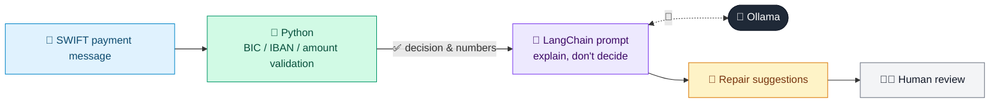

# 41 · SWIFT Payment Repair Assistant

  

**Industry:** 🏦 Banking · **Category:** 💱 Treasury, Payments & Operations

## 🏦 The business problem (new to banking? start here)

**In the business today:** International payments travel as SWIFT messages. If a field is wrong (bad BIC, invalid IBAN), the payment fails automatic processing and someone must repair it by hand.

**Who does this work:** Payments operations teams.

**Why it's hard:** Manual repairs are slow and costly, and some repairs need customer confirmation.

### Key terms
- **SWIFT / MT103**: SWIFT is the network banks use for international payments; MT103 is the message format for a customer transfer.
- **STP (Straight-Through Processing)**: A payment that is processed end-to-end with no manual intervention. Failures need costly manual repair.
- **BIC / IBAN / IFSC**: Bank and account identifiers: BIC (bank code, 8 or 11 characters), IBAN (international account number with a checksum), IFSC (Indian branch code).
- **Charges code (OUR/SHA/BEN)**: Who pays the transfer fees: OUR = sender, SHA = shared, BEN = beneficiary.

More terms: [Banking Primer & glossary](../PRIMER.md#glossary)

---

## 🤖 What the AI does
Validates MT103 payment messages and suggests repairs for failed STP.

### How it works
Python parses fields and validates BIC/IBAN/amount format; the LLM explains failures and proposes repairs.



<sub>🟦 data · 🟩 Python: maths & rules (auditable) · 🟪 AI: reasoning & writing · ⬛ local LLM · 🟨 result</sub>

## 💬 Sample response

Real output from `qwen2.5:7b-instruct` running locally on a laptop. LLM wording changes from run to run; the numbers from
Python stay the same.

<details>
<summary><b>Show the full output</b></summary>

````text
--- Validation ---
{
  "fields": {
    "20": "REF20261012-001",
    "23B": "CRED",
    "32A": "261012EUR15000,5",
    "50K": "/GB29NWBK60161331926819\nACME TRADING LTD\n1 HIGH STREET LONDON",
    "59": "/DE89370400440532013001\nMULLER MASCHINENBAU GMBH",
    "57A": "DEUTDEFFX",
    "70": "INVOICE 4471 MACHINE PARTS",
    "71A": "SHAR"
  },
  "issues": [
    ":57A: BIC 'DEUTDEFFX' must be 8 or 11 characters (got 9)",
    ":59: IBAN DE89370400440532013001 fails checksum",
    ":71A: charges code 'SHAR' invalid (OUR/SHA/BEN)"
  ]
}


--- Repair suggestions ---
### Issues and Corrections:

1. **:57A: BIC 'DEUTDEFFX' must be 8 or 11 characters (got 9)**
   - The BIC provided is incorrect as it is 9 characters long. The correct BIC should be 8 or 11 characters.
   - **Needs customer confirmation**: The exact BIC needs to be confirmed by the customer.

2. **:59: IBAN DE89370400440532013001 fails checksum**
   - The provided IBAN is invalid due to a failed checksum. The correct IBAN needs to be provided.
   - **Needs customer confirmation**: The exact correct IBAN needs to be confirmed by the customer.

3. **:71A: charges code 'SHAR' invalid (OUR/SHA/BEN)**
   - The charges code 'SHAR' is invalid. The correct charges code should be 'OUR', 'SHA', or 'BEN'.
   - **Corrected field value**: 'SHA'

### Repaired Field List:
```
{1:F01BANKGB2LAXXX0000000000}{2:I103DEUTDEFFXXXXN}{4:
:20:REF20261012-001
:23B:CRED
:32A:261012EUR15000,5
:50K:/GB29NWBK60161331926819
ACME TRADING LTD
1 HIGH STREET LONDON
:59:/DE89370400440532013001
MULLER MASCHINENBAU GMBH
:57A:DEUTDEFFXX
:70:INVOICE 4471 MACHINE PARTS
:71A:SHA
}
```

Note: The BIC and IBAN fields need to be confirmed by the customer.
````

</details>

## Run
```bash
# from the repo root, with Ollama running
python 01_banking/41_swift_payment_validator/app.py
```

## Customize
- Replace the sample data at the top of `app.py` with your own data source (CSV, database, API).
- Tune thresholds and rules in the Python functions. These are the auditable part of the solution.
- Change the model with `OLLAMA_MODEL` (see the root [README](../../README.md#-model-recommendations)).

> Sample data is fictional; calculations are simplified for learning.

[⬅ Back to Banking use cases](../README.md#-use-cases) · [All industries](../../README.md)
