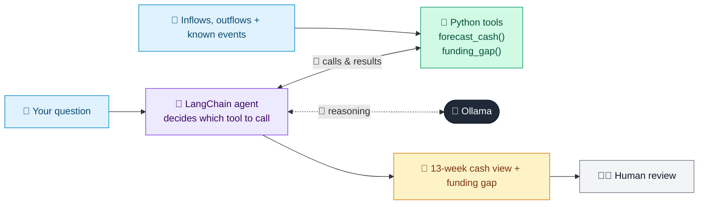

# 42 · Corporate Cash Flow Forecaster

  

**Industry:** 🏦 Banking · **Category:** 💱 Treasury, Payments & Operations

## 🏦 The business problem (new to banking? start here)

**In the business today:** Corporate bankers help business clients forecast cash for the coming weeks to spot shortfalls and arrange funding in time.

**Who does this work:** Corporate relationship managers and transaction banking / treasury advisers.

**Why it's hard:** Running out of cash, even for a week, can sink a profitable business.

### Key terms
- **Cash flow forecasting**: Projecting future cash in and out (often 13 weeks) so a company can plan funding.
- **Working capital**: Money tied up in day-to-day operations (stock, receivables minus payables). Banks fund it with overdrafts and credit lines.

More terms: [Banking Primer & glossary](../PRIMER.md#glossary)

---

## 🤖 What the AI does
Forecasts a corporate client's 13-week cash position and highlights funding gaps.

### How it works
Agent uses `forecast_cash` and `funding_gap` tools on historical inflows/outflows.



<sub>🟦 data · 🟩 Python: maths & rules (auditable) · 🟪 AI: reasoning & writing · ⬛ local LLM · 🟨 result</sub>

## 💬 Sample conversation

A real recorded run on `qwen2.5:7b-instruct` (local, on a laptop, 13 s). Expand a step to see what happened
behind the answer. LLM wording changes from run to run; the numbers from Python stay the same.

> **👤 You:** Give me the 13-week cash outlook and any funding needs.

<details><summary>🔧 Tool calls</summary>

```text
forecast_cash(weeks=13) -> [{"week": 1, "net_flow": -130, "closing_cash": 1070, "event": ""}, {"week": 2, "net_flow": -130, "closing_cash": 940, "event": ""}, {"week": 3, "net_flow": -130, "closing_cash": 810, "event": ""}, {"week": 4, "net_flow": -130, "closing_cash": 680, "event": ""}, {"week": 5, "net_flow": -580, "closing_cash": 100, "event": "Payroll bonus"}, {"week": 6, "net_flow": -130, "closing_cash": -30, "event": 
funding_gap() -> {"lowest_week": 13, "lowest_cash_k": -1020, "overdraft_limit_k": 500.0, "headroom_k": -520, "breach": true}
```

</details>

**🦙 Ollama:**

Based on the 13-week cash forecast, here is the summary of the trends and funding needs:

### Inflows vs Outflows Trend
- **Weeks 1-5**: The company experiences consistent outflows of $130,000 per week, with closing cash levels decreasing from $1,070,000 to $100,000.
- **Week 6**: The company faces a significant outflow of $580,000 due to payroll bonuses, resulting in negative cash of $30,000.
- **Weeks 7-9**: Cash levels continue to decline, reaching a low of $-800,000 in Week 9 due to a large tax payment.
- **Week 10-11**: Cash levels remain negative, but there is a slight improvement in Week 11 with a large customer receipt.
- **Weeks 12-13**: Cash levels continue to decline, with the lowest point in Week 13 at $-1,020,000.

### Week Cash Turns Negative
- The company's cash balance turns negative in Week 6, with a closing cash balance of $-30,000.

### Funding Gap vs Overdraft
- The lowest projected cash point is in Week 13 at $-1,020,000.
- The overdraft limit is $500,000, which is insufficient to cover the funding gap of $520,000.
- There is a funding gap breach in Week 13.

### Recommendations
1. **Working Capital Line**: Consider increasing the working capital line to $1,520,000 to cover the funding gap.
2. **Invoice Discounting**: Utilize invoice discounting to free up cash from receivables, potentially reducing the need for additional funding.
3. **Payables Timing**: Negotiate with suppliers to extend payment terms, allowing for better cash flow management.
4. **Sweeping Surplus**: Implement a cash sweep mechanism to transfer surplus funds from non-core accounts to the primary account to maintain positive cash levels.

These actions can help mitigate the risk of cash shortages and ensure the company remains financially stable throughout the forecast period.


## Run
```bash
# from the repo root, with Ollama running
python 01_banking/42_cash_flow_forecaster/app.py
```

## Customize
- Replace the sample data at the top of `app.py` with your own data source (CSV, database, API).
- Tune thresholds and rules in the Python functions. These are the auditable part of the solution.
- Change the model with `OLLAMA_MODEL` (see the root [README](../../README.md#-model-recommendations)).

> Sample data is fictional; calculations are simplified for learning.

[⬅ Back to Banking use cases](../README.md#-use-cases) · [All industries](../../README.md)
