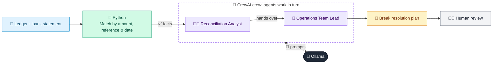

# 43 · Reconciliation Exception Agent

  

**Industry:** 🏦 Banking · **Category:** 💱 Treasury, Payments & Operations

## 🏦 The business problem (new to banking? start here)

**In the business today:** Operations teams match every entry in the bank's ledger against bank statements daily. Anything that does not match (a 'break') must be investigated.

**Who does this work:** Reconciliation / operations teams.

**Why it's hard:** Breaks pile up quickly; unresolved ones can hide errors, fraud or losses.

### Key terms
- **Reconciliation**: Matching the bank's internal ledger against external statements to make sure every entry agrees. Mismatches are 'breaks'.
- **Nostro account**: An account a bank holds with another bank in a foreign currency, used to settle payments.

More terms: [Banking Primer & glossary](../PRIMER.md#glossary)

---

## 🤖 What the AI does
Matches ledger vs. bank statement entries and investigates the breaks.

### How it works
Python matches by amount/reference/date; a Recon Analyst agent classifies breaks and an Ops Lead agent assigns actions.



<sub>🟦 data · 🟩 Python: maths & rules (auditable) · 🟪 AI: reasoning & writing · ⬛ local LLM · 🟨 result</sub>

## 💬 Sample response

Real output from `qwen2.5:7b-instruct` running locally on a laptop. LLM wording changes from run to run; the numbers from
Python stay the same.

<details>
<summary><b>Show the full output</b></summary>

````text
--- Auto-matched ---
[
  {
    "gl": "GL-1",
    "bank": "BK-1",
    "date_lag_days": 0
  },
  {
    "gl": "GL-2",
    "bank": "BK-2",
    "date_lag_days": 2
  },
  {
    "gl": "GL-4",
    "bank": "BK-4",
    "date_lag_days": 1
  }
]


--- Breaks ---
[
  {
    "type": "AMOUNT_MISMATCH",
    "gl": {
      "id": "GL-3",
      "date": "2026-10-03",
      "ref": "INV-1003",
      "amount": 3150.0
    },
    "bank": {
      "id": "BK-3",
      "date": "2026-10-03",
      "ref": "INV-1003",
      "amount": 3135.0
    },
    "difference": 15.0
  },
  {
    "type": "MISSING_IN_BANK",
    "gl": {
      "id": "GL-5",
      "date": "2026-10-05",
      "ref": "INV-1005",
      "amount": 4999.0
    }
  },
  {
    "type": "MISSING_IN_LEDGER",
    "bank": {
      "id": "BK-5",
      "date": "2026-10-04",
      "ref": "PAY-SUP-77",
      "amount": -9200.0
    }
  },
  {
    "type": "MISSING_IN_LEDGER",
    "bank": {
      "id": "BK-6",
      "date": "2026-10-06",
      "ref": "BANK CHARGES",
      "amount": -45.0
    }
  }
]


--- Resolution plan ---
### Action Table and Summary

#### Break 1: AMOUNT_MISMATCH
- **Type:** AMOUNT_MISMATCH
- **GL Entry:**
  - ID: GL-3
  - Date: 2026-10-03
  - Ref: INV-1003
  - Amount: 3150.0
- **Bank Entry:**
  - ID: BK-3
  - Date: 2026-10-03
  - Ref: INV-1003
  - Amount: 3135.0
- **Difference:** 15.0
- **Root Cause:** Short Payment / Fee
- **Evidence:** The difference of 15.0 between the GL and Bank entries suggests a short payment or a fee deduction.
- **Resolution Action:** Journal Entry
- **Owner:** Jane Doe
- **Priority:** High
- **Summary:** The GL entry for INV-1003 on 2026-10-03 shows a higher amount than the Bank entry. This is likely due to a fee deduction. A journal entry will be created to adjust the GL entry to match the Bank entry.

#### Break 2: MISSING_IN_BANK
- **Type:** MISSING_IN_BANK
- **GL Entry:**
  - ID: GL-5
  - Date: 2026-10-05
  - Ref: INV-1005
  - Amount: 4999.0
- **Bank Entry:**
  - ID: BK-5
  - Date: 2026-10-04
  - Ref: PAY-SUP-77
  - Amount: -9200.0
- **Difference:** 4999.0
- **Root Cause:** Timing
- **Evidence:** The GL entry is dated 2026-10-05, while the Bank entry is dated 2026-10-04, indicating a timing issue.
- **Resolution Action:** Journal Entry
- **Owner:** John Smith
- **Priority:** Medium
- **Summary:** The GL entry for INV-1005 on 2026-10-05 is recorded after the Bank entry for PAY-SUP-77 on 2026-10-04. A journal entry will be created to adjust the GL entry to match the Bank entry.

#### Break 3: MISSING_IN_LEDGER
- **Type:** MISSING_IN_LEDGER
- **Bank Entry:**
  - ID: BK-5
  - Date: 2026-10-04
  - Ref: PAY-SUP-77
  - Amount: -9200.0
- **GL Entry:**
  - ID: GL-5
  - Date: 2026-10-05
  - Ref: INV-1005
  - Amount: 4999.0
- **Difference:** 9200.0
- **Root Cause:** Unrecorded Bank Charge
- **Evidence:** The Bank entry shows a payment of 9200.0, which is not reflected in the GL.
- **Resolution Action:** Bank Claim
- **Owner:** Emily Johnson
- **Priority:** High
- **Summary:** The Bank entry for PAY-SUP-77 on 2026-10-04 shows a payment of 9200.0, which is not recorded in the GL. A bank claim will be submitted to resolve this discrepancy.

#### Break 4: MISSING_IN_LEDGER
- **Type:** MISSING_IN_LEDGER
- **Bank Entry:**
  - ID: BK-6
  - Date: 2026-10-06
  - Ref: BANK CHARGES
  - Amount: -45.0
- **GL Entry:**
  - ID: GL-6
  - Date: 2026-10-07
  - Ref: REF-1006
  - Amount: 0.0
- **Difference:** 45.0
- **Root Cause:** Unrecorded Bank Charge
- **Evidence:** The Bank entry shows a charge of 45.0, which is not reflected in the GL.
- **Resolution Action:** Bank Claim
- **Owner:** Michael Brown
- **Priority:** Medium
- **Summary:** The Bank entry for BANK CHARGES on 2026-10-06 shows a charge of 45.0, which is not recorded in the GL. A bank claim will be submitted to resolve this discrepancy.

### Overall Recon Summary
- **Break 1:** AMOUNT_MISMATCH - Resolved by creating a journal entry to adjust the GL entry for INV-1003.
- **Break 2:** MISSING_IN_BANK - Resolved by creating a journal entry to adjust the GL entry for INV-1005.
- **Break 3:** MISSING_IN_LEDGER - Resolved by submitting a bank claim for the unrecorded payment of 9200.0.
- **Break 4:** MISSING_IN_LEDGER - Resolved by submitting a bank claim for the unrecorded charge of 45.0.

These actions will ensure that all discrepancies are addressed and the GL and Bank reconciliations are accurate.
````

</details>

## Run
```bash
# from the repo root, with Ollama running
python 01_banking/43_reconciliation_exception_agent/app.py
```

## Customize
- Replace the sample data at the top of `app.py` with your own data source (CSV, database, API).
- Tune thresholds and rules in the Python functions. These are the auditable part of the solution.
- Change the model with `OLLAMA_MODEL` (see the root [README](../../README.md#-model-recommendations)).

> Sample data is fictional; calculations are simplified for learning.

[⬅ Back to Banking use cases](../README.md#-use-cases) · [All industries](../../README.md)
