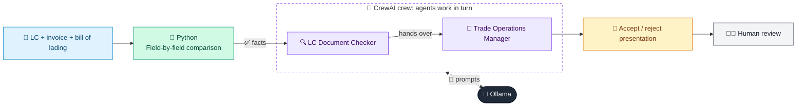

# 44 · Letter of Credit Document Checker

  

**Industry:** 🏦 Banking · **Category:** 💱 Treasury, Payments & Operations

## 🏦 The business problem (new to banking? start here)

**In the business today:** Under a Letter of Credit, the bank pays the exporter only if their documents exactly match the LC terms. Checkers examine every document line by line.

**Who does this work:** Trade finance document checkers and trade operations managers.

**Why it's hard:** Checking is meticulous manual work; missing a discrepancy means paying when the bank should not.

### Key terms
- **Letter of Credit (LC)**: A bank's promise to pay an exporter if they present documents that exactly match the LC's terms.
- **UCP 600**: The international rules (from the ICC) that govern how Letters of Credit work and how documents are checked.
- **Discrepancy**: A mismatch between presented documents and LC terms. Any discrepancy lets the bank refuse to pay.
- **Bill of Lading (B/L)**: The shipping document issued by the carrier: a receipt for goods and proof of shipment. A 'clean' B/L has no damage notes.
- **Incoterms (e.g. CIF)**: Standard trade terms defining who pays for shipping and insurance. CIF = seller pays Cost, Insurance and Freight.

More terms: [Banking Primer & glossary](../PRIMER.md#glossary)

---

## 🤖 What the AI does
Checks LC presentation documents for discrepancies against UCP 600 terms.

### How it works
Python compares invoice, bill of lading and LC fields; Document Checker and Trade Ops agents classify discrepancies.



<sub>🟦 data · 🟩 Python: maths & rules (auditable) · 🟪 AI: reasoning & writing · ⬛ local LLM · 🟨 result</sub>

## 💬 Sample conversation

A real recorded run on `qwen2.5:7b-instruct` (local, on a laptop, 28 s). Expand a step to see what happened
behind the answer. LLM wording changes from run to run; the numbers from Python stay the same.

> **👤 You:** Check this LC presentation from Shenzhen Lumen Electronics. Can we accept the documents?

<details><summary>🐍 Python · Discrepancies found</summary>

Invoice amount 126,500 exceeds LC amount + tolerance 126,000
B/L is claused: '3 cartons wet and torn' (LC requires clean on-board B/L)
Insurance dated 2026-09-24 after shipment date 2026-09-22
Insurance cover 126,500 < 110% of invoice (139,150)
Presented 24 days after shipment (> 21)

</details>

<details><summary>🔍 LC Document Checker (agent)</summary>

Discrepancy list with UCP references:

1. **Invoice Amount Exceeds LC Amount + Tolerance (UCP 600, Article 31)**

   - **UCP 600, Article 31** states that the amount of the documents presented must not exceed the amount of the credit, except for the tolerance as specified in the credit. The presented invoice amount of $126,500 exceeds the LC amount of $120,000 plus the tolerance of 5%, which would be $126,000. This is a **major discrepancy**.

2. **B/L is Claused: '3 cartons wet and torn' (UCP 600, Article 32)**

   - **UCP 600, Article 32** requires that the B/L be a clean B/L. A claused B/L indicates that the goods were not in good condition at the time of loading, which is a **major discrepancy**.

3. **Insurance Dated After Shipment Date (UCP 600, Article 33)**

   - **UCP 600, Article 33** requires that the insurance document be dated not later than the date of shipment. The insurance document dated 2026-09-24 is after the shipment date of 2026-09-22, which is a **major discrepancy**.

4. **Insurance Coverage Below Required Amount (UCP 600, Article 33)**

   - **UCP 600, Article 33** requires that the insurance coverage be for 110% of the invoice value. The insurance coverage of $126,500 is less than 110% of the invoice value of $126,500, which is $139,150. This is a **major discrepancy**.

5. **Presentation 24 Days After Shipment (UCP 600, Article 14)**

   - **UCP 600, Article 14** states that the documents must be presented within the period of validity of the credit. The presentation was made 24 days after the shipment date, which is beyond the 21-day presentation period. This is a **major discrepancy**.

In summary, the discrepancies are classified as follows:
- **Major Discrepancies**: Invoice amount, B/L clausing, insurance date, insurance coverage, and presentation period.

</details>

**🦙 Ollama:**

**Decision: Refuse the Presentation**

**Draft MT734 Narrative:**

```
MT734
Refusal Notice

To: [Applicant's Bank]
Reference: [LC Number]
Date: [Current Date]

Subject: Refusal of Presentation

Dear [Applicant's Bank],

We regret to inform you that the presentation made by [Applicant's Name] on [Presentation Date] is refused due to the following discrepancies:

1. **Invoice Amount Exceeds LC Amount + Tolerance (UCP 600, Article 31)**
   - The presented invoice amount of $126,500 exceeds the LC amount of $120,000 plus the tolerance of 5%, which would be $126,000. This is a major discrepancy.

2. **B/L is Claused: '3 cartons wet and torn' (UCP 600, Article 32)**
   - The B/L is claused, indicating that the goods were not in good condition at the time of loading. This is a major discrepancy.

3. **Insurance Dated After Shipment Date (UCP 600, Article 33)**
   - The insurance document dated 2026-09-24 is after the shipment date of 2026-09-22. This is a major discrepancy.

4. **Insurance Coverage Below Required Amount (UCP 600, Article 33)**
   - The insurance coverage of $126,500 is less than 110% of the invoice value of $126,500, which is $139,150. This is a major discrepancy.

5. **Presentation 24 Days After Shipment (UCP 600, Article 14)**
   - The presentation was made 24 days after the shipment date, which is beyond the 21-day presentation period. This is a major discrepancy.

Please note that the discrepancies listed above are major and cannot be waived. We recommend that the applicant correct these discrepancies and resubmit the presentation within the validity period of the credit.

Should you have any questions or require further clarification, please do not hesitate to contact us.

Thank you for your understanding.

Best regards,

[Your Name]
Trade Operations Manager
[Your Company Name]
[Your Contact Information]
```

Please ensure to replace the placeholders with the appropriate details before sending the message.


## Run
```bash
# from the repo root, with Ollama running
python 01_banking/44_trade_finance_lc_checker/app.py
```

## Customize
- Replace the sample data at the top of `app.py` with your own data source (CSV, database, API).
- Tune thresholds and rules in the Python functions. These are the auditable part of the solution.
- Change the model with `OLLAMA_MODEL` (see the root [README](../../README.md#-model-recommendations)).

> Sample data is fictional; calculations are simplified for learning.

[⬅ Back to Banking use cases](../README.md#-use-cases) · [All industries](../../README.md)
