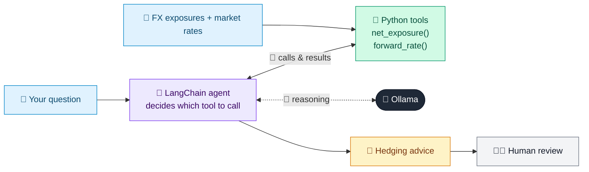

# 45 · FX Hedging Advisor

  

**Industry:** 🏦 Banking · **Category:** 💱 Treasury, Payments & Operations

## 🏦 The business problem (new to banking? start here)

**In the business today:** Companies that buy or sell abroad face currency risk. Bank FX sales teams help them measure it and lock in rates with forwards or options.

**Who does this work:** FX sales / treasury advisers for corporate clients.

**Why it's hard:** Clients need clear explanations of risk in their own currency, and advice must be about protection, not speculation.

### Key terms
- **FX exposure / hedging**: Risk that currency moves change the home-currency value of foreign receipts or payments; hedging locks in a rate.
- **FX forward**: A contract to exchange currency at a fixed rate on a future date. Removes uncertainty for a known cash flow.

More terms: [Banking Primer & glossary](../PRIMER.md#glossary)

---

## 🤖 What the AI does
Measures a corporate's FX exposure and suggests a hedging approach.

### How it works
Agent uses `net_exposure` and `forward_rate` tools and compares forward vs. unhedged outcomes.



<sub>🟦 data · 🟩 Python: maths & rules (auditable) · 🟪 AI: reasoning & writing · ⬛ local LLM · 🟨 result</sub>

## 💬 Sample conversation

A real recorded run on `qwen2.5:7b-instruct` (local, on a laptop, 17 s). Expand a step to see what happened
behind the answer. LLM wording changes from run to run; the numbers from Python stay the same.

> **👤 You:** Analyse our FX exposures and recommend a hedging plan.

<details><summary>🔧 Tool calls</summary>

```text
net_exposure() -> {"USD_3m": 1200000, "EUR_6m": -1200000}
forward_rate(currency='USD', months=3) -> USD 3m forward: 84.67 (spot 84.2); 1-sigma spot range at maturity 82.31 - 86.09
forward_rate(currency='EUR', months=6) -> EUR 6m forward: 93.31 (spot 91.5); 1-sigma spot range at maturity 87.29 - 95.71
```

</details>

**🦙 Ollama:**

Based on the provided exposures and forward rates, let's analyze the risk and recommend a hedging strategy.

### USD Exposure
- **Net Exposure**: +1,200,000 USD for 3 months.
- **Forward Rate**: 84.67 INR/USD (spot rate: 84.2 INR/USD).
- **1-sigma Spot Range at Maturity**: 82.31 - 86.09 INR/USD.

#### Risk Analysis
If the USD/INR spot rate moves unfavorably outside the 1-sigma range, the value of your exposure could decrease significantly. For example, if the spot rate at maturity is 82.31 INR/USD, your exposure would be worth approximately 1,200,000 * 82.31 = 98,772,000 INR, which is a loss of 1200000 * (84.2 - 82.31) = 2,280,000 INR compared to the forward rate.

#### Hedge Recommendation
- **Hedge Ratio**: 100% of the exposure.
- **Instrument**: Forward contract.
- **Reasoning**: A forward contract locks in the exchange rate, providing certainty and eliminating the risk of adverse movements in the spot rate.

### EUR Exposure
- **Net Exposure**: -1,200,000 EUR for 6 months.
- **Forward Rate**: 93.31 INR/EUR (spot rate: 91.5 INR/EUR).
- **1-sigma Spot Range at Maturity**: 87.29 - 95.71 INR/EUR.

#### Risk Analysis
If the EUR/INR spot rate moves unfavorably outside the 1-sigma range, the value of your exposure could increase significantly. For example, if the spot rate at maturity is 95.71 INR/EUR, your exposure would be worth approximately 1,200,000 * 95.71 = 114,852,000 INR, which is a gain of 1200000 * (95.71 - 93.31) = 2,880,000 INR compared to the forward rate.

#### Hedge Recommendation
- **Hedge Ratio**: 100% of the exposure.
- **Instrument**: Forward contract.
- **Reasoning**: A forward contract locks in the exchange rate, providing certainty and eliminating the risk of adverse movements in the spot rate.

### Summary
- **USD Exposure**: Hedge 1,200,000 USD for 3 months using a forward contract at 84.67 INR/USD.
- **EUR Exposure**: Hedge -1,200,000 EUR for 6 months using a forward contract at 93.31 INR/EUR.

These hedges will protect your company from exchange rate fluctuations and ensure that you can manage your financial risks effectively.


## Run
```bash
# from the repo root, with Ollama running
python 01_banking/45_fx_hedging_advisor/app.py
```

## Customize
- Replace the sample data at the top of `app.py` with your own data source (CSV, database, API).
- Tune thresholds and rules in the Python functions. These are the auditable part of the solution.
- Change the model with `OLLAMA_MODEL` (see the root [README](../../README.md#-model-recommendations)).

> Sample data is fictional; calculations are simplified for learning.

[⬅ Back to Banking use cases](../README.md#-use-cases) · [All industries](../../README.md)
