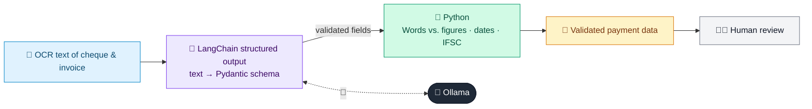

# 46 · Invoice & Cheque Data Extractor

  

**Industry:** 🏦 Banking · **Category:** 💱 Treasury, Payments & Operations

## 🏦 The business problem (new to banking? start here)

**In the business today:** Banks and their business clients process piles of invoices and cheques, reading the details and checking them before paying or clearing.

**Who does this work:** Payments / clearing operations, trade and accounts-payable teams.

**Why it's hard:** Manual keying is slow, and mismatched amounts are a common source of errors and fraud.

### Key terms
- **Cheque truncation / OCR**: Processing cheques from scanned images; OCR reads the printed and handwritten fields.
- **BIC / IBAN / IFSC**: Bank and account identifiers: BIC (bank code, 8 or 11 characters), IBAN (international account number with a checksum), IFSC (Indian branch code).
- **GSTIN**: India's 15-character Goods and Services Tax identification number for a business.

More terms: [Banking Primer & glossary](../PRIMER.md#glossary)

---

## 🤖 What the AI does
Extracts fields from invoices and cheques (OCR text) and validates them.

### How it works
Pydantic schema extraction with Python validation (amount-in-words vs. figures, dates, IFSC).



<sub>🟦 data · 🟩 Python: maths & rules (auditable) · 🟪 AI: reasoning & writing · ⬛ local LLM · 🟨 result</sub>

## 💬 Sample response

Real output from `qwen2.5:7b-instruct` running locally on a laptop. LLM wording changes from run to run; the numbers from
Python stay the same.

<details>
<summary><b>Show the full output</b></summary>

````text
--- Cheque ---
{
  "bank": "STATE BANK OF INDIA",
  "ifsc": "SBIN0001234",
  "cheque_number": "004512",
  "date": "12102026",
  "payee": "RAVI KUMAR ENTERPRISES",
  "amount_in_words": "Forty Five Thousand Six Hundred Only",
  "amount_in_figures": 45600.0,
  "account_number": "30012345678"
}


--- Invoice ---
{
  "invoice_number": "SRT/26-27/0193",
  "date": "05/10/2026",
  "seller_gstin": "27AAACS1234F1Z5",
  "buyer_gstin": "27AABCR5678K1Z2",
  "taxable_value": 39440.0,
  "total_tax": 7099.2,
  "invoice_total": 46539.2
}


--- Validation ---
{'cheque_words_match_figures': True, 'ifsc_format_valid': True, 'gstin_format_valid': True, 'invoice_total_adds_up': True, 'cheque_vs_invoice_difference': 939.2}
````

</details>

## Run
```bash
# from the repo root, with Ollama running
python 01_banking/46_invoice_cheque_extractor/app.py
```

## Customize
- Replace the sample data at the top of `app.py` with your own data source (CSV, database, API).
- Tune thresholds and rules in the Python functions. These are the auditable part of the solution.
- Change the model with `OLLAMA_MODEL` (see the root [README](../../README.md#-model-recommendations)).

> Sample data is fictional; calculations are simplified for learning.

[⬅ Back to Banking use cases](../README.md#-use-cases) · [All industries](../../README.md)
