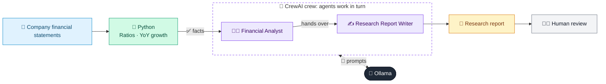

# 47 · Financial Statement Analyzer

  

**Industry:** 🏦 Banking · **Category:** 🏢 Enterprise Analytics & Audit

## 🏦 The business problem (new to banking? start here)

**In the business today:** Before lending to or investing in a company, analysts study its financial statements to judge profitability, debt and cash generation.

**Who does this work:** Credit analysts and equity / credit research analysts.

**Why it's hard:** Headline growth can hide weak cash flow or rising debt; spotting this takes careful ratio analysis.

### Key terms
- **Financial statements**: Income statement (profit), balance sheet (what is owned and owed) and cash flow statement.
- **EBITDA / EBIT**: Earnings before interest, tax, depreciation and amortisation (EBITDA), or before interest and tax (EBIT): a measure of operating profit.
- **Margins**: Profit as a % of revenue (gross, operating, net). Falling margins signal pricing pressure or rising costs.
- **Leverage (debt-to-equity)**: How much a company relies on borrowing. Higher leverage means higher risk if earnings fall.
- **Liquidity ratios (current ratio)**: Current assets / current liabilities: can the company pay its bills due within a year?
- **Free cash flow**: Operating cash flow minus capital expenditure: the cash really available to repay debt or pay dividends.

More terms: [Banking Primer & glossary](../PRIMER.md#glossary)

---

## 🤖 What the AI does
Analyses a company's income statement and balance sheet and writes an equity-style summary.

### How it works
Ratios and YoY growth computed in Python; Financial Analyst and Report Writer agents interpret them.



<sub>🟦 data · 🟩 Python: maths & rules (auditable) · 🟪 AI: reasoning & writing · ⬛ local LLM · 🟨 result</sub>

## 💬 Sample response

Real output from `qwen2.5:7b-instruct` running locally on a laptop. LLM wording changes from run to run; the numbers from
Python stay the same.

<details>
<summary><b>Show the full output</b></summary>

````text
--- Ratios ---
{
  "2024": {
    "gross_margin_pct": 38.0,
    "ebit_margin_pct": 11.0,
    "net_margin_pct": 6.8,
    "roe_pct": 13.5,
    "interest_cover": 6.2,
    "current_ratio": 1.42,
    "debt_to_equity": 0.65,
    "dso_days": 52,
    "dio_days": 100,
    "free_cash_flow": 260,
    "operating_cash_flow_to_net_income_pct": 158
  },
  "2025": {
    "gross_margin_pct": 35.7,
    "ebit_margin_pct": 9.5,
    "net_margin_pct": 5.5,
    "roe_pct": 11.0,
    "interest_cover": 4.5,
    "current_ratio": 1.34,
    "debt_to_equity": 0.77,
    "dso_days": 61,
    "dio_days": 111,
    "free_cash_flow": 40,
    "operating_cash_flow_to_net_income_pct": 121
  },
  "yoy_growth_pct": {
    "revenue": 6.8,
    "net_income": -14.5,
    "total_debt": 23.8,
    "inventory": 23.2,
    "receivables": 24.6
  }
}


--- Report ---
### Summary
- **Revenue Growth**: Northwind Consumer Goods plc experienced a 6.8% increase in revenue from 2024 to 2025, but net income declined by 14.5%, indicating a decline in overall profitability.
- **Profitability**: Gross margin and EBIT margin decreased, while net margin and ROE declined, suggesting increased costs and operational inefficiencies.
- **Cash Flow**: Free cash flow significantly decreased, and operating cash flow to net income ratio declined, indicating reduced cash generation from operations.

### Performance
- **Revenue Growth**: 6.8% increase from 2024 to 2025.
- **Gross Margin**: 38.0% in 2024 to 35.7% in 2025.
- **EBIT Margin**: 11.0% in 2024 to 9.5% in 2025.
- **Net Margin**: 6.8% in 2024 to 5.5% in 2025.
- **ROE**: 13.5% in 2024 to 11.0% in 2025.
- **Operating Cash Flow to Net Income**: 158% in 2024 to 121% in 2025.
- **Free Cash Flow**: 260 in 2024 to 40 in 2025.

### Balance Sheet & Liquidity
- **Current Ratio**: 1.42 in 2024 to 1.34 in 2025.
- **Debt to Equity**: 0.65 in 2024 to 0.77 in 2025.
- **Days Sales Outstanding (DSO)**: 52 days in 2024 to 61 days in 2025.
- **Days Inventory Outstanding (DIO)**: 100 days in 2024 to 111 days in 2025.

### Cash Flow
- **Free Cash Flow**: Decreased from 260 to 40.
- **Operating Cash Flow to Net Income**: Decreased from 158% to 121%.

### Key Risks / Red Flags
- **Profitability Decline**: Significant decrease in net income and profitability ratios.
- **Operating Efficiency**: Decrease in operating cash flow to net income ratio and increase in DSO and DIO.
- **Liquidity Concerns**: Decrease in current ratio and increase in debt to equity ratio.
- **Cash Flow Quality**: Significant decrease in free cash flow.

### Questions for Management
- What are the primary drivers of the decline in gross margin and EBIT margin?
- How are the increased DSO and DIO impacting the company's cash flow and working capital management?
- What measures are being taken to improve inventory turnover and reduce inventory holding costs?
- Are there any changes in the company's debt structure or financing strategies that could explain the increase in debt to equity ratio?
- What steps are being taken to address the decline in free cash flow and improve cash flow generation?

### Overall View
**Neutral**

The company has shown some positive revenue growth, but the decline in profitability, operating efficiency, and cash flow quality are significant concerns. The management needs to address these issues to maintain financial stability and improve overall performance. While the current situation is not dire, proactive measures are necessary to mitigate risks and ensure sustainable growth.
````

</details>

## Run
```bash
# from the repo root, with Ollama running
python 01_banking/47_financial_statement_analyzer/app.py
```

## Customize
- Replace the sample data at the top of `app.py` with your own data source (CSV, database, API).
- Tune thresholds and rules in the Python functions. These are the auditable part of the solution.
- Change the model with `OLLAMA_MODEL` (see the root [README](../../README.md#-model-recommendations)).

> Sample data is fictional; calculations are simplified for learning.

[⬅ Back to Banking use cases](../README.md#-use-cases) · [All industries](../../README.md)
