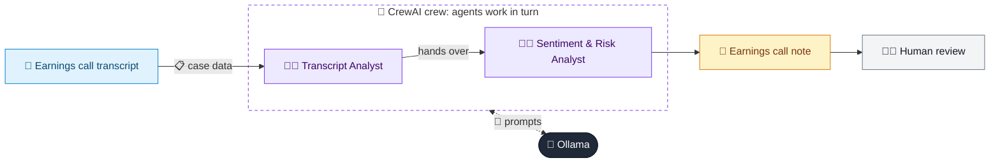

# 48 · Earnings Call Analyzer

  

**Industry:** 🏦 Banking · **Category:** 🏢 Enterprise Analytics & Audit

## 🏦 The business problem (new to banking? start here)

**In the business today:** After quarterly results, management hold an earnings call. Analysts and investors listen for changes in outlook and signs of trouble.

**Who does this work:** Equity research, investor relations and credit analysts.

**Why it's hard:** Calls are long and the important signals are often subtle changes in wording.

### Key terms
- **Guidance**: Management's forecast of future results. Investors watch closely for upgrades, downgrades or softer wording.
- **NIM (Net Interest Margin)**: A bank's interest income minus interest paid, as a % of assets. The core measure of lending profitability.
- **Delinquency / NPA / NPL**: A delinquent loan is behind on payments. After about 90 DPD it becomes a Non-Performing Asset / Loan.

More terms: [Banking Primer & glossary](../PRIMER.md#glossary)

---

## 🤖 What the AI does
Extracts guidance, sentiment and risks from an earnings call transcript.

### How it works
Transcript Analyst agent extracts key points; Sentiment Analyst agent rates management tone and risks.



<sub>🟦 data · 🟩 Python: maths & rules (auditable) · 🟪 AI: reasoning & writing · ⬛ local LLM · 🟨 result</sub>

## 💬 Sample conversation

A real recorded run on `qwen2.5:7b-instruct` (local, on a laptop, 40 s). Expand a step to see what happened
behind the answer. LLM wording changes from run to run; the numbers from Python stay the same.

> **👤 You:** Summarise Meridian Bank's Q3 FY26 earnings call. How confident did management sound, and what are the risks?

<details><summary>🧑‍💼 Transcript Analyst (agent)</summary>

### KPI Table
| KPI                | Q3 FY26 Actual | FY Guidance (Maintained/Lowered) | Q4 FY26 Outlook |
|--------------------|---------------|---------------------------------|----------------|
| **Loan Growth**    | 14%           | Lowered (13-15%)                 |                |
| **Net Interest Margin** | 3.42%         | Stable (expected to stabilise)   |                |
| **Operating Expenses** | 11%           | Maintained (11%)                 |                |
| **Cost-to-Income Ratio** | 46.8%         | Maintained (46.8%)               |                |
| **Credit Costs**   | 68 bps        | Lowered (52 bps to 68 bps)       |                |
| **Gross NPA**      | 2.1%          | Maintained (2.1%)                |                |
| **Provision Coverage** | 72%           | Maintained (72%)                 |                |
| **CET1 Ratio**     | 13.4%         | Maintained (13.4%)               |                |

### Guidance Status
- **Loan Growth**: Lowered from 13-15% to 13-15% (lower end more likely)
- **Net Interest Margin**: Maintained (expected to stabilise)
- **Operating Expenses**: Maintained (11%)
- **Cost-to-Income Ratio**: Maintained (46.8%)
- **Credit Costs**: Lowered (52 bps to 68 bps)
- **Gross NPA**: Maintained (2.1%)
- **Provision Coverage**: Maintained (72%)
- **CET1 Ratio**: Maintained (13.4%)

### Key Themes
1. **Loan Growth**: The bank reported a 14% year-on-year loan growth, driven by retail mortgages and SME segments. However, the guidance for the full fiscal year has been lowered, with the lower end of the range (13%) now more likely.
2. **Net Interest Margin**: The net interest margin compressed by 12 basis points to 3.42%, mainly due to rising deposit costs. The CFO expects margins to stabilise in the next quarter as rate cuts flow through to the deposit book.
3. **Operating Expenses**: Operating expenses grew by 11%, primarily due to technology and branch expansion. The cost-to-income ratio is 46.8%.
4. **Credit Costs**: Credit costs rose to 68 basis points from 52 basis points, driven by unsecured personal loans and credit cards. The CFO has tightened underwriting in these segments, and there is no sign of spillover to mortgages or SME segments.
5. **Deposit Growth**: Deposit growth was 9%, lagging behind loan growth of 14%. The bank aims to fund growth through granular retail deposits and may moderate loan growth if deposits lag.
6. **Provision Coverage**: The provision coverage ratio remains at 72%, and the gross non-performing asset (NPA) ratio is 2.1%, up 15 basis points.
7. **CET1 Ratio**: The Common Equity Tier 1 (CET1) ratio is 13.4%, maintained at the current level.

</details>

**🦙 Ollama:**

### Investor Note

**Tone Score**: -2

**Top 3 Positives**:
1. **Credit Costs**: The bank has managed to lower credit costs to 68 basis points, which is a positive sign for cost control.
2. **Provision Coverage**: The provision coverage ratio remains strong at 72%, indicating robust risk management.
3. **CET1 Ratio**: The bank has maintained its CET1 ratio at 13.4%, ensuring strong capital adequacy.

**Top 3 Risks**:
1. **Lowered Loan Growth Guidance**: The guidance for loan growth has been lowered, with the lower end of the range (13%) now more likely, which could impact revenue growth.
2. **Net Interest Margin Compression**: The net interest margin has compressed, and while it is expected to stabilise, this could pressure profitability.
3. **Deposit Growth Lagging**: Deposit growth has lagged behind loan growth, which could lead to funding challenges and higher funding costs.

**Watch-list**:
1. **Loan Growth**: Monitor the bank's ability to maintain or improve loan growth in the next quarter.
2. **Net Interest Margin**: Keep an eye on the stabilisation of net interest margins and any further pressure on profitability.
3. **Deposit Growth**: Watch for any signs of improvement in deposit growth, as it is crucial for funding and cost management.

**One-line Takeaway**: The bank has managed to maintain key financial ratios but faces risks from lower loan growth and net interest margin compression, which need to be closely monitored in the next quarter.


## Run
```bash
# from the repo root, with Ollama running
python 01_banking/48_earnings_call_analyzer/app.py
```

## Customize
- Replace the sample data at the top of `app.py` with your own data source (CSV, database, API).
- Tune thresholds and rules in the Python functions. These are the auditable part of the solution.
- Change the model with `OLLAMA_MODEL` (see the root [README](../../README.md#-model-recommendations)).

> Sample data is fictional; calculations are simplified for learning.

[⬅ Back to Banking use cases](../README.md#-use-cases) · [All industries](../../README.md)
