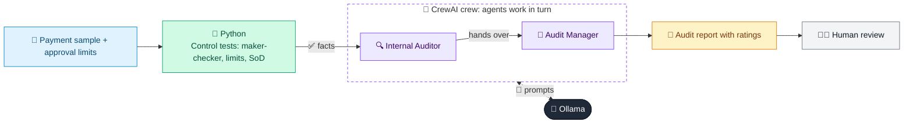

# 49 · Internal Audit Assistant

  

**Industry:** 🏦 Banking · **Category:** 🏢 Enterprise Analytics & Audit

## 🏦 The business problem (new to banking? start here)

**In the business today:** Internal auditors test samples of transactions to check controls worked, e.g. that a different person approved each payment within their authority.

**Who does this work:** Internal audit.

**Why it's hard:** Testing and report writing are labour-intensive; findings must follow a strict format for the audit committee.

### Key terms
- **Internal audit**: The independent team that tests whether the bank's controls work and reports to the board's audit committee.
- **Maker-checker**: A control where one person enters a transaction and a different person approves it (segregation of duties).

More terms: [Banking Primer & glossary](../PRIMER.md#glossary)

---

## 🤖 What the AI does
Tests a sample of transactions against controls and drafts audit findings.

### How it works
Python runs control tests (maker-checker, limits, SoD); Auditor and Audit Manager agents write findings with risk ratings.



<sub>🟦 data · 🟩 Python: maths & rules (auditable) · 🟪 AI: reasoning & writing · ⬛ local LLM · 🟨 result</sub>

## 💬 Sample response

Real output from `qwen2.5:7b-instruct` running locally on a laptop. LLM wording changes from run to run; the numbers from
Python stay the same.

<details>
<summary><b>Show the full output</b></summary>

````text
--- Control testing ---
{
  "sample_size": 6,
  "exceptions": [
    {
      "id": "P-02",
      "control": "Maker-checker / segregation of duties",
      "detail": "Same user made and approved"
    },
    {
      "id": "P-03",
      "control": "Delegation of authority",
      "detail": "310,000 > manager limit"
    },
    {
      "id": "P-04",
      "control": "Vendor master",
      "detail": "Payee not in approved vendor master"
    },
    {
      "id": "P-05",
      "control": "Vendor master",
      "detail": "Payee not in approved vendor master"
    },
    {
      "id": "P-04,P-05",
      "control": "Limit splitting",
      "detail": "Multiple payments just below officer limit"
    }
  ]
}


--- Audit report ---
### Audit Findings

#### Finding 1: P-02 - Maker-Checker / Segregation of Duties
- **Condition**: Same user made and approved the payment.
- **Criteria**: The control requires that the maker and checker roles be performed by different individuals to prevent fraud and ensure accuracy.
- **Cause**: Lack of proper internal controls, understaffing, or a lack of awareness about the importance of segregation of duties.
- **Effect**: Increased risk of fraud and errors, as the maker and checker roles are not separated.
- **Recommendation**: Implement segregation of duties by ensuring that the maker and checker roles are always performed by different individuals.
- **Rating**: High

#### Finding 2: P-03 - Delegation of Authority
- **Condition**: Payment amount of 310,000 exceeds the manager's approval limit.
- **Criteria**: The control requires that payment amounts within the manager's limit are approved by the manager, and amounts exceeding the limit require higher-level approval.
- **Cause**: Misconfiguration of approval limits, lack of proper oversight, or a deliberate attempt to circumvent the approval process.
- **Effect**: Potential for unauthorized or fraudulent payments, as the manager may be approving payments that are significantly above their limit.
- **Recommendation**: Review and adjust approval limits to ensure they are appropriate and that there are clear procedures for exceeding them. Increase oversight and training for managers.
- **Rating**: High

#### Finding 3: P-04 - Vendor Master
- **Condition**: Payee not in the approved vendor master.
- **Criteria**: The control requires that all payments are made to vendors listed in the approved vendor master to prevent unauthorized payments.
- **Cause**: Lack of proper vendor management, inadequate vendor vetting processes, or a failure to update the vendor master list.
- **Effect**: Potential for unauthorized payments, as payments can be made to unauthorized vendors.
- **Recommendation**: Regularly update and verify the vendor master list to ensure that all payments are made to approved vendors. Increase awareness and training on vendor management.
- **Rating**: High

#### Finding 4: P-05 - Vendor Master
- **Condition**: Payee not in the approved vendor master.
- **Criteria**: The control requires that all payments are made to vendors listed in the approved vendor master to prevent unauthorized payments.
- **Cause**: Same as P-04, due to a lack of proper vendor management, inadequate vendor vetting processes, or a failure to update the vendor master list.
- **Effect**: Potential for unauthorized payments, as payments can be made to unauthorized vendors.
- **Recommendation**: Regularly update and verify the vendor master list to ensure that all payments are made to approved vendors. Increase awareness and training on vendor management.
- **Rating**: High

#### Finding 5: P-04, P-05 - Limit Splitting
- **Condition**: Multiple payments just below the officer's limit.
- **Criteria**: The control requires that payments are not split to circumvent approval limits.
- **Cause**: Lack of proper limit splitting controls, a lack of awareness about the risks of limit splitting, or a deliberate attempt to circumvent the approval process.
- **Effect**: Potential for unauthorized or fraudulent payments, as payments are split to avoid higher-level approval.
- **Recommendation**: Develop and enforce policies to prevent splitting payments to circumvent approval limits. Increase awareness and training on the risks of limit splitting.
- **Rating**: High

### Overall Control Environment Opinion
- **Opinion**: Needs Improvement

### Agreed Actions
1. **Implement Segregation of Duties**: Ensure that the maker and checker roles are always performed by different individuals.
2. **Review and Adjust Approval Limits**: Ensure that approval limits are appropriate and that there are clear procedures for exceeding them.
3. **Enhance Vendor Management**: Regularly update and verify the vendor master list to prevent unauthorized payments.
4. **Implement Limit Splitting Controls**: Develop and enforce policies to prevent splitting payments to circumvent approval limits.
5. **Increase Awareness and Training**: Educate employees about the importance of internal controls and the risks associated with violations.

By addressing these issues, the organization can significantly reduce the risk of fraud and ensure the integrity of its payment processes.
````

</details>

## Run
```bash
# from the repo root, with Ollama running
python 01_banking/49_internal_audit_assistant/app.py
```

## Customize
- Replace the sample data at the top of `app.py` with your own data source (CSV, database, API).
- Tune thresholds and rules in the Python functions. These are the auditable part of the solution.
- Change the model with `OLLAMA_MODEL` (see the root [README](../../README.md#-model-recommendations)).

> Sample data is fictional; calculations are simplified for learning.

[⬅ Back to Banking use cases](../README.md#-use-cases) · [All industries](../../README.md)
