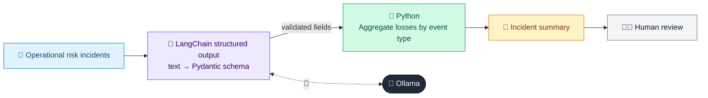

# 50 · Operational Risk Incident Analyzer

  

**Industry:** 🏦 Banking · **Category:** 🏢 Enterprise Analytics & Audit

## 🏦 The business problem (new to banking? start here)

**In the business today:** Every operational loss or near miss (an IT outage, a keying error, a forged signature) is logged, classified and analysed to prevent repeats.

**Who does this work:** Operational risk teams (Risk department).

**Why it's hard:** Inconsistent classification makes loss data unreliable for reporting and capital calculations.

### Key terms
- **Operational risk**: Losses from failed processes, people, systems or external events, e.g. IT outages, errors, fraud, floods.
- **Basel event types**: The 7 standard categories of operational loss (internal fraud, external fraud, system failures, process errors...).

More terms: [Banking Primer & glossary](../PRIMER.md#glossary)

---

## 🤖 What the AI does
Classifies operational-loss incidents into Basel event types and suggests root cause and controls.

### How it works
Each incident is mapped to a structured schema (Basel event type, root cause, severity, control).



<sub>🟦 data · 🟩 Python: maths & rules (auditable) · 🟪 AI: reasoning & writing · ⬛ local LLM · 🟨 result</sub>

## 💬 Sample response

Real output from `qwen2.5:7b-instruct` running locally on a laptop. LLM wording changes from run to run; the numbers from
Python stay the same.

<details>
<summary><b>Show the full output</b></summary>

````text
--- INC-101 (loss 42,000) ---
Teller processed a withdrawal on a forged signature; customer reported unauthorised debit next day.
{
  "basel_event_type": "Internal Fraud",
  "root_cause": "process",
  "severity": "high",
  "near_miss": false,
  "control_failure": "The control failure lies in the inadequate verification process for transactions. Specifically, there was a lack of robust signature verification procedures, which allowed the transaction to be processed based on a forged signature. This indicates that the internal controls designed to prevent unauthorized transactions were not effective.",
  "recommended_control": "Implement more stringent signature verification procedures, including the use of additional authentication methods such as signature comparison with a known sample or the use of digital signatures. Additionally, regular training for tellers on recognizing and preventing fraud attempts should be conducted."
}


--- INC-102 (loss 180,000) ---
Core banking batch job failed overnight; 12,000 salary credits delayed by 6 hours, compensation paid.
{
  "basel_event_type": "Business Disruption & System Failures",
  "root_cause": "systems",
  "severity": "high",
  "near_miss": false,
  "control_failure": "The control failure in this incident lies in the inadequate testing and validation processes for the core banking batch job. The failure to identify and address potential issues during the testing phase led to a critical system outage that delayed salary credits for 12,000 employees. This highlights a gap in the organization's change management and system maintenance procedures, which failed to ensure the robustness and reliability of the batch processing system.",
  "recommended_control": "Implement a more rigorous testing and validation framework for batch jobs, including stress testing and regular audits. Establish a robust change management process to ensure all changes to the system are thoroughly tested before deployment. Enhance monitoring and alert systems to detect and respond to issues in real-time."
}


--- INC-103 (loss 7,500) ---
Wrong FX rate keyed manually for a corporate remittance; difference absorbed by the bank.
{
  "basel_event_type": "Execution, Delivery & Process Management",
  "root_cause": "process",
  "severity": "medium",
  "near_miss": false,
  "control_failure": "Manual keying of foreign exchange (FX) rates was not integrated into the automated systems, leading to human error. The lack of a robust process to verify and cross-check the manually entered rates contributed to the incident. Additionally, there was no clear procedure or control in place to escalate or review such manual entries, which allowed the error to go unnoticed and result in a loss.",
  "recommended_control": "Implement automated FX rate lookup and verification systems to reduce manual errors. Establish a review and approval process for manual rate entries. Train staff on the importance of double-checking and verifying all manual entries."
}


--- INC-104 (loss 0) ---
Phishing email led an employee to enter credentials; account locked by SOC within 20 minutes, no loss.
{
  "basel_event_type": "External Fraud",
  "root_cause": "systems",
  "severity": "low",
  "near_miss": true,
  "control_failure": "The security awareness and phishing training for employees were insufficient, leading to the employee falling for the phishing email. Additionally, the incident response time could have been faster, as the account was locked within 20 minutes, but this quick action mitigated the potential impact.",
  "recommended_control": "Enhance phishing training programs for employees to better recognize and respond to phishing attempts. Implement more robust email filtering and monitoring systems to detect and block suspicious emails more effectively."
}


--- INC-105 (loss 250,000) ---
Regulator fined the bank for late filing of currency transaction reports for two quarters.
{
  "basel_event_type": "Clients, Products & Business Practices",
  "root_cause": "process",
  "severity": "medium",
  "near_miss": false,
  "control_failure": "The control failure in this incident lies in the inadequate process and oversight for timely submission of currency transaction reports. There was a lack of robust monitoring and alert systems to ensure compliance with regulatory deadlines. Additionally, there may have been insufficient training or communication regarding the importance and timing of these reports, leading to the oversight in filing them on time for two quarters.",
  "recommended_control": "Implementing a more rigorous and automated process for tracking and submitting currency transaction reports, along with regular training and reminders for relevant staff, can help prevent such incidents in the future."
}


--- INC-106 (loss 15,000) ---
Branch ATM damaged by flood water; cash written off and repairs required.
{
  "basel_event_type": "Damage to Physical Assets",
  "root_cause": "external",
  "severity": "high",
  "near_miss": false,
  "control_failure": "The incident highlights a control failure in the physical security and disaster recovery planning of the branch. The ATM was not adequately protected against flood risks, indicating a gap in the risk assessment and mitigation strategies. Additionally, the lack of a robust backup or alternative cash supply system contributed to the loss of cash and the need for repairs.",
  "recommended_control": "Implement enhanced physical security measures for critical assets, including flood barriers and waterproof enclosures. Develop and regularly test a comprehensive disaster recovery plan that includes alternative cash supply mechanisms and backup systems for critical operations."
}


--- Summary ---
Internal Fraud: 1 incident(s), loss 42,000
Business Disruption & System Failures: 1 incident(s), loss 180,000
Execution, Delivery & Process Management: 1 incident(s), loss 7,500
External Fraud: 1 incident(s), loss 0
Clients, Products & Business Practices: 1 incident(s), loss 250,000
Damage to Physical Assets: 1 incident(s), loss 15,000
````

</details>

## Run
```bash
# from the repo root, with Ollama running
python 01_banking/50_operational_risk_analyzer/app.py
```

## Customize
- Replace the sample data at the top of `app.py` with your own data source (CSV, database, API).
- Tune thresholds and rules in the Python functions. These are the auditable part of the solution.
- Change the model with `OLLAMA_MODEL` (see the root [README](../../README.md#-model-recommendations)).

> Sample data is fictional; calculations are simplified for learning.

[⬅ Back to Banking use cases](../README.md#-use-cases) · [All industries](../../README.md)
